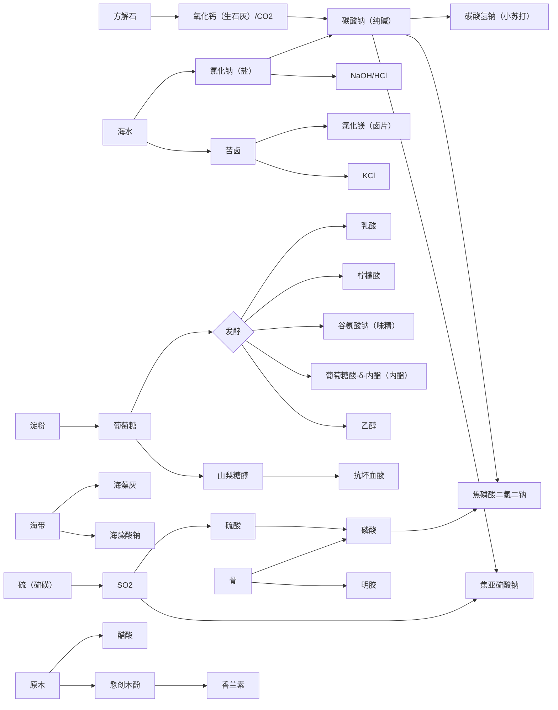

# 04 制备路线

每种第一批添加剂给出 1–5 条路线，按阶段从低到高排列。反应式均已配平（有机物写分子式，便于与 09 对照）；温度、压力只给量级。

**纯度**：由原料和工序决定（10 第 2.1 节）。配方不写纯度规则时，按配方类型的默认规则（../machines/01 第 1.1 节）；设备比配方的基准档次每高一档，剩余杂质再去掉 25%。

下文只在偏离默认规则时注明纯度。

## 实现约定（I18–I20）

> 2026-11-11 实现时拟定，数值与写法为游戏设定，待审。第一至三批的配方由数据生成写出（`content.batch1`–`batch3`、`content.Cultures`），T0 手工链仍是 I12 的手工配方。

- **计量**：1 份 = 1 个物品 = 1,000 mB（09 计量建议）；有反应式的步骤按配平系数写，结晶水与生成的水不写；气体也按 1,000 mB / 份。系数大到放不下储罐的，按比例缩小并在配方注释里说明（例：蔗糖硝酸氧化只写方程式六分之一的硝酸，二氧化氮回吸收塔）。天然原料的用量（几个柠檬出一份柠檬酸钙等）是游戏设定。
- **档次**：第一至三批的配方默认要求 T1（`min_tier: t1`），T0 设备不跑这些配方；04、13、14 标 T2 起的工序再写 `min_tier` 或用该档机器才有的条件（模式、方法、压力、无菌等）。
- **时长**（档次速率 ×1 时的 tick）：研磨、压榨、固液分离、配料 100；浸提、熬煮、结晶、干燥、熏蒸、蒸馏、液相反应、吸收、气相反应、电解、吸附 200；窑炉 400；液态发酵 12,000；固态发酵 24,000；菌种操作 1,200。能耗不写，按配方类型的默认值（machines/01 §2）。
- **纯度**：按配方类型的默认规则（machines/01 §1.1）；从不带纯度的原料第一次得到某物料、或分离出与输入不同的物料时写来源值（发酵液、浸提物、天然色素粗品等，数值见配方）；脱色、重结晶、树脂吸附等精制步骤反复做可提高纯度。
- **回收溶剂**：浸提、萃取、醇沉、树脂洗脱回收的乙醇、丙酮、甲醇、正己烷、乙酸乙酯、二氧化碳按来源方式取粗制下限（不随被提取物的纯度变化）；扩培与树脂步骤的起点纯度只取菌种或被提纯的物料。
- **门槛**：T4 无菌发酵罐的菌种要达到食品级（M30 纯化两次可达）；复配（泡打粉、胶基）要求全部组分达到食品级；13 号 33 双乙酸钠要求乙酸 ≥ 90%（冰乙酸）。其余配方不设门槛。
- **合并步骤**：没有对应物料的中间状态合并到相邻步骤（例：柠檬榨汁与钙盐沉淀合成一步；面筋酸解、中和合成两步）；04、13、14 中“除菌、离心、干燥、粉碎”等不改变物料的工序不单独写。
- **补登的物料**（2026-11-11，09、08）：硝酸 `nitric_acid`、木醋液 `wood_vinegar`、薄荷原油 `mint_oil`、果胶液 `pectin_liquor`（K0，含量 1%）、红曲米 `red_yeast_rice`（K5，覆盖界限 30% / 45% / 55%）、甜菜原汁 `beetroot_juice`、精炼大豆油 `refined_soybean_oil`、复配膨松剂（泡打粉）`baking_powder`（K12）、酸处理淀粉、羟丙基淀粉、醋酸酯淀粉、多聚磷酸钠（六偏磷酸钠）、吐温 80、2-萘磺酸、d-柠檬烯；酶 10 种（葡萄糖氧化酶、果胶酶、纤维素酶、木瓜蛋白酶、菠萝蛋白酶、脂肪酶、乳糖酶、谷氨酰胺转氨酶、凝乳酶、转化酶）；催化剂原料标签 `materials/cobalt`、`platinum`、`rhodium`、`palladium`、`vanadium`（他模组提供）。
- **菌种**：菌种工作台的平板分离按样本写一条配方，同一样本里能分出的菌都在这张平板上，每种菌的权重 1、杂菌权重等于菌种数（样本标签 `samples/<种类>`，08 §标签体系）；酮古龙酸菌、巨大芽孢杆菌走诱变平板。全部菌种都有纯化平板与扩培（葡萄糖）。同一配方挑出一个菌落，平板配方的产物数不受产物槽数限制。
- **配方选择**（2026-11-11 补）：同一内容能做多条配方时，条件（含催化剂）多的优先；一样多时原料多的优先，再按 ID（machines/02 §6）。
- **吸附柱只收流体**：固体提取物（甜菊糖苷、栀子黄、鼠尾草酸等）的树脂吸附改在搅拌反应罐里以树脂为催化剂进行（乙醇洗脱，除杂 90%）；液体（乳酸、山梨糖醇液、葡萄糖酸、麦芽糖醇液）在吸附柱里吸附或离子交换，饱和后用水或盐酸再生。
- **T4 化学合成**：14 标 T4 的化学步骤（三氯蔗糖、纽甜、硫胺素、叶酸等）由 T3 高压反应釜或 T2 搅拌反应罐承担（T4 没有做液相反应的机器），T4 部分是其中的发酵与酶法步骤。
- **第四批补充**（I30，2026-11-11 实装拟定，待审）：
  - 用到暂无来源原料的路线照写；这些作物、矿石写成空标签，纯度报表把这些配方单列为“原料暂无来源”，不计入纯度表与“最早可做出的档次”
  - 副产物原料（葡萄皮渣、柑橘皮、可可豆壳、花生红衣、米糠、红米糠）与主产物同一条配方联产（2026-11-11 原写“只出副产、主产物归成品线”，2026-11-12 按 11 问题 43 改）：葡萄 4 → 葡萄汁 3 + 皮渣 1，可可豆 4 → 可可碎粒 3 + 豆壳 1，稻谷 4 → 大米 3 + 米糠 1，红米 4 → 大米 3 + 红米糠 1，柑橘 4 → 柑橘汁 2 + 柑橘皮 1，花生 4 → 花生油 2 + 红衣 1（比例为游戏设定，现实的壳、糠、红衣占比更小）
  - 酶分级（P95）在搅拌反应罐里以离子交换树脂为催化剂进行，洗脱液决定级分（同“吸附柱只收流体”）
  - 酶固定化（P96）：固定化酶各是一个催化剂物品（2026-11-11 用户定），酶 ×2 + 海藻酸钠 + 氯化钙（或卡拉胶 + 氯化钾）在搅拌反应罐成珠，作催化剂可用 64 次；菌体固定化（350）直接用菌种物品作菌体
  - 固体单酯的分子蒸馏：熔成熔融液（保持纯度）→ 精馏塔分子蒸馏 → 冷却结晶（保持纯度）（2026-11-11 用户定）
  - 基因重组（P94）：宿主菌种 + 琼脂 + 供体样本 + 表达载体，平板上工程菌与宿主 1 : 3；同一宿主的供体按生境区分；表达载体由大肠杆菌 + 琼脂在基因重组模式下得到
  - 天然色素水溶线：T1 用水浸提（花青素加柠檬酸），T2 用稀乙醇在萃取罐浸提并回收乙醇（来源值 20%），树脂纯化、喷雾干燥；油溶线 T2 用溶剂浸提（来源值 20%）
  - 种子胶：干法在研磨机一步得粗胶，湿法在萃取罐热水浸提，精制为乙醇沉淀（T2）

---

## 1 冰乙酸（冰醋酸）C2H4O2

| 路线 | 阶段 | 流程 | 关键反应 |
| --- | --- | --- | --- |
| A 醋发酵 | T0–T1 | 果酒 / 米酒倒入开口发酵缸，接种醋母（醋酸菌），静置 2–4 周，过滤得食醋（乙酸 3%–6%） | C2H6O + O2 → C2H4O2 + H2O |
| B 食醋提浓 | T1–T2 | 食醋 + 碳酸钠 → 乙酸钠溶液 → 蒸发结晶 → 乙酸钠 + 稀硫酸 → 蒸馏 | 2 C2H4O2 + Na2CO3 → 2 C2H3NaO2 + CO2 + H2O；2 C2H3NaO2 + H2SO4 → Na2SO4 + 2 C2H4O2 |
| C 木材干馏 | T1–T2 | 原木在密闭土窑干馏 → 木醋液（乙酸、甲醇、丙酮、木焦油）→ 氢氧化钙（熟石灰）中和 → 乙酸钙（灰醋石）→ 加硫酸蒸馏 | Ca(C2H3O2)2 + H2SO4 → CaSO4 + 2 C2H4O2 |
| D 甲醇羰基化 | T3 | 甲醇 + CO，铑/碘催化，高压反应釜 3 MPa 级 → 精馏 | CH4O + CO → C2H4O2 |

- 副产：C 路线同时产出木炭、甲醇（供 D）、木焦油（供 30 号香兰素的愈创木酚）。
- 标准中“冰乙酸（低压羰基化法）”是单独条目（CNS 01.112）；游戏内作为同一物品，用 Tooltip 标注来源路线。

## 2 乳酸 C3H6O3

| 路线 | 阶段 | 流程 | 关键反应 |
| --- | --- | --- | --- |
| A 乳酸发酵 | T0 | 蔬菜 / 牛奶 / 糖水加盐入陶坛，厌氧发酵 → 酸浆（稀乳酸） | C6H12O6 → 2 C3H6O3 |
| B 钙盐法 | T2 | 淀粉液化、糖化 → 葡萄糖液接种乳酸菌，加 CaCO3 维持 pH → 乳酸钙发酵液 → 冷却结晶乳酸钙 → 硫酸酸解 → 滤除硫酸钙 → 活性炭脱色 → 蒸发浓缩 | 2 C3H6O3 + CaCO3 → C6H10CaO6 + CO2 + H2O；C6H10CaO6 + H2SO4 → 2 C3H6O3 + CaSO4 |
| C 发酵–膜分离 | T4 | 无菌发酵，用氨水调 pH 得乳酸铵 → 电渗析 / 离子交换 → 分子蒸馏 → 实验室级 L-乳酸（不产硫酸钙） | — |
| D 乳腈法（可选） | T3 | 乙醛 + 氢氰酸 → 乳腈 → 硫酸水解 → 酯化精馏提纯；得到外消旋 DL-乳酸 | C2H4O + HCN → C3H5NO；C3H5NO + 2 H2O + H2SO4 → C3H6O3 + NH4HSO4 |

## 3 柠檬酸 C6H8O7

| 路线 | 阶段 | 流程 | 关键反应 |
| --- | --- | --- | --- |
| A 柠檬汁钙盐法（舍勒，1784） | T1 | 柠檬榨汁 → 煮沸加 CaCO3 → 柠檬酸钙沉淀 → 洗涤 → 稀硫酸分解 → 滤除硫酸钙 → 浓缩、冷却结晶 | 2 C6H8O7 + 3 CaCO3 → Ca3(C6H5O7)2 + 3 CO2 + 3 H2O；Ca3(C6H5O7)2 + 3 H2SO4 → 2 C6H8O7 + 3 CaSO4 |
| B 浅盘发酵 | T2 | 糖液接种黑曲霉，浅盘表面培养 8–12 天 → 钙盐法提取 | 2 C6H12O6 + 3 O2 → 2 C6H8O7 + 4 H2O |
| C 深层发酵 | T4 | 淀粉或糖蜜液化、糖化 → 无菌通气发酵（pH < 2）→ 钙盐法或离子交换 → 活性炭脱色 → 结晶（一水物或无水物） | 同 B |

- 柠檬需要他模组标签（见 08）；没有柠檬时 A 路线不可用，B/C 只需葡萄糖。
- “钙盐法”（发酵液 → 钙盐沉淀 → 硫酸酸解 → 硫酸钙）是乳酸、柠檬酸、葡萄糖酸共用的提取工艺，副产硫酸钙可进入 12 号。

## 4 谷氨酸钠（味精）C5H8NNaO4·H2O

| 路线 | 阶段 | 流程 | 关键反应 |
| --- | --- | --- | --- |
| A 面筋酸解（池田菊苗，1908） | T2 | 面粉加水揉洗得面筋 → 浓盐酸回流水解 → 浓缩冷却析出谷氨酸盐酸盐 → 碱中和到等电点 pH≈3.2 → 谷氨酸结晶 → 碳酸钠中和 → 活性炭脱色 → 蒸发结晶 | C5H10ClNO4 + NaOH → C5H9NO4 + NaCl + H2O；2 C5H9NO4 + Na2CO3 → 2 C5H8NNaO4 + CO2 + H2O |
| B 发酵法 | T4 | 淀粉液化（α-淀粉酶）→ 糖化（葡萄糖淀粉酶）→ 谷氨酸棒杆菌通气发酵（补氨、限量生物素）→ 除菌 → 等电点结晶 → 中和 → 脱色 → 结晶 | C6H12O6 + NH3 + 3/2 O2 → C5H9NO4 + CO2 + 3 H2O |

- T0/T1 阶段不产谷氨酸钠，但用海带熬“昆布高汤”作为鲜味原料（1908 年池田菊苗正是从昆布高汤中确认鲜味来自谷氨酸盐；谷氨酸本身由里特豪森于 1866 年从面筋水解液中分离），为 A 路线做剧情铺垫。
- A 路线的残液含其他氨基酸，可作为后续“水解植物蛋白 / 酱油”线的原料。

## 5 碳酸钠（纯碱）Na2CO3

| 路线 | 阶段 | 流程 | 关键反应 |
| --- | --- | --- | --- |
| A 海藻灰 | T0 | 晒干海带 → 营火或土窑烧灰 → 热水浸出 → 澄清 → 熬干 = 粗碱（含 Na2CO3、K2CO3、NaCl、KCl、碘化物） | 海藻中的有机钠盐燃烧后转为 Na2CO3 |
| B 天然碱矿 | T0–T1 | 在干旱群系采天然碱矿（碳酸氢三钠）→ 溶解澄清 → 煅烧 | 2 Na3H(CO3)2·2H2O → 3 Na2CO3 + CO2 + 5 H2O |
| C 路布兰法 | T2 | 氯化钠 + 硫酸 → 硫酸钠（元明粉）+ 氯化氢；硫酸钠 + 石灰石 + 煤在回转窑熔烧 → 黑灰 → 水浸 → 蒸发结晶 | 2 NaCl + H2SO4 → Na2SO4 + 2 HCl；Na2SO4 + CaCO3 + 2 C → Na2CO3 + CaS + 2 CO2 |
| D 氨碱法（索尔维） | T3 | 饱和盐水吸氨 → M19 吸收塔通 CO2 析出 NaHCO3 → 过滤 → 煅烧；石灰窑提供 CO2 和氧化钙（生石灰），石灰乳回收氨 | NaCl + NH3 + CO2 + H2O → NaHCO3 + NH4Cl；2 NaHCO3 → Na2CO3 + CO2 + H2O；CaCO3 → CaO + CO2；2 NH4Cl + CaO → CaCl2 + 2 NH3 + H2O |
| E 联合制碱（侯德榜） | T3 | 同 D 前两步，母液加盐冷析 NH4Cl 作副产，不用石灰乳回收氨；需配套合成氨 | 同 D 前两式 |

- C 路线副产 HCl（供 4、11、17 号），D 路线副产 CaCl2（本身是附录 A 的稳定剂和凝固剂，CNS 18.002）。

## 6 碳酸氢钠（小苏打）NaHCO3

| 路线 | 阶段 | 流程 | 关键反应 |
| --- | --- | --- | --- |
| A 发酵气碳化 | T1 | 把酿酒 / 发酵缸逸出的 CO2 导入盛饱和碳酸钠溶液的 M04 浸提桶（通气模式）→ 析出碳酸氢钠 → 过滤晾干 | Na2CO3 + CO2 + H2O → 2 NaHCO3 |
| B 吸收塔碳化 | T2 | 碳酸钠溶液在 M19 吸收塔中逆流吸收 CO2 → 离心 → 低温干燥（< 60 °C，防止分解） | 同上 |
| C 氨碱法精制 | T3 | 取 5-D 的粗 NaHCO3 → 重溶 → 再碳化 | — |

- 泡打粉 = 碳酸氢钠 + 焦磷酸二氢二钠（10 号）+ 淀粉，在调配机中配制。

## 7 碳酸钾 K2CO3

| 路线 | 阶段 | 流程 | 关键反应 |
| --- | --- | --- | --- |
| A 草木灰淋灰 | T0 | 草木灰装入淋灰桶 → 水淋 → 灰水（碱水）→ 铁锅熬干 = 粗钾碱 → 土窑煅烧去有机物 = 珍珠灰 | 灰中 K2CO3 溶出 |
| B 蓬灰 | T0 | 盐生草本在营火上烧灰结块（H10） = 蓬灰（兰州拉面的传统用碱，钾钠碳酸盐混合物）；游戏中以原版“枯萎的灌木”代表盐生草本，烧成草木灰，不另设蓬灰物料（2026-11-10） | — |
| C 氢氧化钾碳化 | T3 | KCl 溶液电解 → KOH → 吸收 CO2 → 蒸发结晶 | 2 KCl + 2 H2O → 2 KOH + H2 + Cl2；2 KOH + CO2 → K2CO3 + H2O |

- KCl 来自 11 号苦卤中的光卤石（KCl·MgCl2·6H2O），或他模组标签。

## 8 碳酸氢铵（臭粉）NH4HCO3

| 路线 | 阶段 | 流程 | 关键反应 |
| --- | --- | --- | --- |
| A 鹿角盐（干馏） | T1 | 骨、角在密闭土窑中干馏 → 冷凝收集白色升华物 = 碳酸铵类混合物（“鹿角盐”，最早的化学膨松剂）；残渣为骨炭 | 含氮有机物热解生成 NH3、CO2、H2O，冷凝后结合成铵盐 |
| B 合成氨碳化 | T3 | 合成氨 → 氨水 → M19 吸收塔吸收 CO2 → 结晶 → 离心 → 低温干燥 | N2 + 3 H2 ⇌ 2 NH3；NH3 + CO2 + H2O → NH4HCO3 |

- A 路线副产骨炭，可作脱色剂（历史上用于精制蔗糖）。

## 9 硫酸铝钾（明矾）KAl(SO4)2·12H2O

| 路线 | 阶段 | 流程 | 关键反应 |
| --- | --- | --- | --- |
| A 明矾石法（中国传统） | T1 | 明矾石 → 土窑煅烧 → 堆放风化、淋水 → 热水浸出 → 澄清 → 冷却结晶 | 2 KAl3(SO4)2(OH)6 → K2SO4 + Al2(SO4)3 + 2 Al2O3 + 6 H2O；K2SO4 + Al2(SO4)3 + 24 H2O → 2 KAl(SO4)2·12H2O |
| B 黏土酸溶 | T2 | 煅烧黏土 + 硫酸 → 硫酸铝溶液 → 加硫酸钾 → 冷却结晶 → 重结晶 | Al2O3 + 3 H2SO4 → Al2(SO4)3 + 3 H2O |
| C 氢氧化铝法 | T3 | 氢氧化铝 + 硫酸 → 加硫酸钾 → 结晶 | 2 Al(OH)3 + 3 H2SO4 → Al2(SO4)3 + 6 H2O |

- 硫酸钾可由 7 号碳酸钾制得：K2CO3 + H2SO4 → K2SO4 + CO2 + H2O。
- 标准对铝残留量有限制（如油炸面制品 ≤ 100 mg/kg，以 Al 计），可在食品上体现为“过量使用”的负面效果。

## 10 焦磷酸二氢二钠 Na2H2P2O7

先做磷酸，再中和、缩合。

| 路线 | 阶段 | 流程 | 关键反应 |
| --- | --- | --- | --- |
| A 骨灰磷酸 | T2 | 骨头煅烧 → 骨灰（羟基磷灰石）→ 硫酸分解 → 滤除硫酸钙 → 稀磷酸 → 浓缩 | Ca5(PO4)3OH + 5 H2SO4 → 3 H3PO4 + 5 CaSO4 + H2O |
| B 湿法磷酸 + 净化 | T3 | 磷灰石 + 硫酸 → 粗磷酸 + 磷石膏 → 溶剂萃取净化 → 食品级 | Ca5(PO4)3F + 5 H2SO4 → 3 H3PO4 + 5 CaSO4 + HF |
| C 热法磷酸 | T3 | 磷灰石 + 硅石 + 焦炭进 M26 电弧炉 → 黄磷蒸气 → 燃烧 → 水合 | 2 Ca3(PO4)2 + 6 SiO2 + 10 C → 6 CaSiO3 + P4 + 10 CO；P4 + 5 O2 → P4O10；P4O10 + 6 H2O → 4 H3PO4 |
| D 中和–缩合（目标产物） | T2–T3 | 磷酸 + 碳酸钠中和至 pH≈4.2 → 磷酸二氢钠 → 干燥 → M20 回转窑 220–250 °C 缩合 → 粉碎 | 2 H3PO4 + Na2CO3 → 2 NaH2PO4 + CO2 + H2O；2 NaH2PO4 → Na2H2P2O7 + H2O |

- 同一条磷酸线可派生附录 A 的 19 种磷酸盐（见 02），第二批起逐步开放。

## 11 氯化镁（卤片）MgCl2·6H2O

| 路线 | 阶段 | 流程 | 关键反应 |
| --- | --- | --- | --- |
| A 苦卤 | T0 | 晒盐池析出氯化钠后剩下的母液 = 苦卤（MgCl2、MgSO4、KCl、NaCl），直接作“卤水”点豆腐 | — |
| B 熬卤片 | T1 | 苦卤蒸发浓缩，依次析出氯化钠、硫酸镁（泻盐）、光卤石，末段冷却得氯化镁（卤片） | — |
| C 海水沉镁 | T3 | 海水 + 石灰乳 → Mg(OH)2 沉淀 → 盐酸溶解 → 蒸发结晶 | MgCl2 + Ca(OH)2 → Mg(OH)2 + CaCl2；Mg(OH)2 + 2 HCl → MgCl2 + 2 H2O |

- A 路线的苦卤是来源方式的典型手工产物（含氯化镁 7.2%，07）；B 路线同时产出硫酸镁（泻盐）和光卤石（KCl 来源）。

## 12 硫酸钙（石膏）CaSO4·2H2O

| 路线 | 阶段 | 流程 | 关键反应 |
| --- | --- | --- | --- |
| A 石膏矿石煅烧 | T0–T1 | 采石膏矿石 → 研磨 → 约 150 °C 煅烧 → 半水硫酸钙（熟石膏），点豆腐常用 | 2 CaSO4·2H2O → 2 CaSO4·0.5H2O + 3 H2O |
| B 沉淀法 | T2 | 方解石（原版方块）+ 稀硫酸 → 过滤洗涤 → 干燥 | CaCO3 + H2SO4 + H2O → CaSO4·2H2O + CO2 |
| C 钙盐法副产 | T2 | 柠檬酸、乳酸、磷酸工序的硫酸钙滤饼 → 洗涤 → 干燥；必须达到食品级才能用于食品 | — |

- 第 12 号添加剂的物品是硫酸钙（石膏），即二水物 `gypsum`；A 路线的半水硫酸钙（熟石膏）`plaster` 是另一物品。两者都能点豆腐，成品配方用标签 `additives/calcium_sulfate` 同时接受。

## 13 葡萄糖酸-δ-内酯（内酯）C6H10O6

| 路线 | 阶段 | 流程 | 关键反应 |
| --- | --- | --- | --- |
| A 发酵氧化 | T4 | 葡萄糖液接种黑曲霉（或用葡萄糖氧化酶）通气 → 葡萄糖酸（以盐形式控 pH）→ 离子交换转游离酸 → 真空浓缩 → 30–70 °C 结晶，内酯化析出葡萄糖酸-δ-内酯 | 2 C6H12O6 + O2 → 2 C6H12O7；C6H12O7 → C6H10O6 + H2O |
| B 电解 / 催化氧化 | T3 | 葡萄糖在溴化物电解液中电解氧化（或钯、金催化空气氧化）→ 同上 | 同上 |

## 14 琼脂

| 路线 | 阶段 | 流程 | 关键反应 |
| --- | --- | --- | --- |
| A 熬冻（凉粉） | T0 | 红藻（石花菜）洗净 → 陶锅熬煮 → 布滤 → 冷却凝冻 = 石花菜冻（可直接食用，不能长期保存） | — |
| B 寒天冻融 | T0 | 熬煮液凝冻后切条 → 冬季或寒冷群系露天冻融数日（反复冻结–融化把水和可溶杂质挤出）→ 晒干 = 条状琼脂 | — |
| C 碱处理–压榨 | T2 | 红藻 NaOH 碱处理（提高凝胶强度）→ 洗涤 → 热水提取 → 压滤 → 凝冻 → 压榨脱水 → 干燥 → 粉碎 | 半乳糖-6-硫酸酯在碱中闭环为 3,6-脱水半乳糖 |

## 15 海藻酸钠 (C6H7NaO6)n

| 路线 | 阶段 | 流程 | 关键反应（按单体单元） |
| --- | --- | --- | --- |
| A 钙析–酸化法 | T2 | 海带浸泡切碎 → 稀酸预处理 → 碳酸钠消化（海藻酸转为钠盐溶出）→ 稀释压滤 → 加 CaCl2 析出海藻酸钙 → 盐酸脱钙得海藻酸 → 碳酸钠中和 → 干燥粉碎 | 2 C6H8O6 + Na2CO3 → 2 C6H7NaO6 + CO2 + H2O |

- 联产：浸泡水中回收D-甘露糖醇（附录 A 甜味剂）和碘（中国海带化工的传统三联产）。
- 这里是原版海带的主要工业出口，也给 CaCl2 找到了用途。

## 16 果胶

| 路线 | 阶段 | 流程 | 关键反应 |
| --- | --- | --- | --- |
| A 家制果胶液 | T1 | 苹果皮核加水熬煮 → 布滤 → 果胶液（只能直接用于果酱，不能干燥储存） | — |
| B 酸提醇沉 | T2 | 苹果渣 / 柑橘皮 → 热稀酸提取（pH 1.5–3，70–90 °C）→ 压滤 → 浓缩 → 乙醇沉淀 → 乙醇洗涤 → 干燥粉碎 = 高酯果胶；乙醇经 M08 蒸馏甑回收 | — |
| C 脱酯 | T2 | 高酯果胶经酸或氨脱酯 → 低酯 / 酰胺化果胶（可用 Ca2+ 凝胶，低糖果酱用） | — |

- 苹果渣来自 M02 螺旋压榨机榨苹果汁的副产。

## 17 明胶

| 路线 | 阶段 | 流程 | 关键反应 |
| --- | --- | --- | --- |
| A 熬胶 | T1 | 皮、骨长时间熬煮 → 布滤 → 冷却成冻 → 切片晾干 = 皮胶 / 骨胶（工业胶，纯度低） | — |
| B 碱法（骨明胶，B 型） | T2 | 骨头破碎脱脂 → 稀盐酸浸泡脱钙得骨素 → 石灰乳长时间浸渍 → 水洗中和 → 分段热水提取 → 压滤 → 活性炭吸附（M14 + M12）→ 蒸发浓缩 → 灭菌 → 冷却成冻 → 干燥；T3 起可加离子交换（M25）| 脱钙总式：Ca5(PO4)3OH + 4 HCl → 3 CaHPO4 + 2 CaCl2 + H2O |
| C 酸法（皮明胶，A 型） | T2 | 皮革 / 兔子皮 → 稀酸浸泡 → 提取 → 同 B 后段 | — |

- B 路线的脱钙液回收磷酸氢钙（附录 A 磷酸盐之一），骨渣可煅烧进入 10 号骨灰磷酸。

## 18 焦糖色（普通法，I 类）

| 路线 | 阶段 | 流程 | 关键反应 |
| --- | --- | --- | --- |
| A 炒糖色 | T0 | 蔗糖在铁锅中加热到 170–200 °C 焦化 → 加热水稀释 = 糖色 | 糖类热解、脱水、聚合，无确定分子式 |
| B 普通法 | T2 | 葡萄糖浆或蔗糖加少量酸 / 碱催化 → M14 搅拌反应罐 120–150 °C → 冷却过滤 → 浓缩到规定色率 | — |
| C 氨法 / 亚硫酸铵法（III、IV 类） | T3（第二批） | 同 B，加入氨水或亚硫酸铵 | 须控制 4-甲基咪唑等副产物 |

## 19 甜菜红

| 路线 | 阶段 | 流程 | 关键反应 |
| --- | --- | --- | --- |
| A 榨汁浓缩 | T1 | 甜菜根洗净切碎 → 压榨 → 布滤 → 低温（< 50 °C）浓缩 → 浓缩汁 | — |
| B 发酵除糖–喷雾干燥 | T2–T3 | 甜菜汁加酵母短时发酵耗糖 → 离心 → 真空低温浓缩 = 甜菜红浓缩液（T2 止于此）→ 加麦芽糊精 → M28 喷雾干燥成粉（T3） | — |

- 主成分甜菜苷（C24H26N2O13）不耐热、不耐光：温度超过阈值时产物纯度下降，这是一个好的“必须用真空浓缩”的设计理由。

## 20 β-胡萝卜素 C40H56

| 路线 | 阶段 | 流程 | 关键反应 |
| --- | --- | --- | --- |
| A 溶剂提取 | T2 | 胡萝卜切片干燥 → 粉碎 → 正己烷 / 丙酮浸提 → 蒸发回收溶剂 → 胡萝卜油树脂 → 皂化去油脂 → 结晶 | — |
| B 三孢布拉霉发酵 | T4 | 正、负两株三孢布拉霉混合深层发酵 → 过滤菌丝体 → 破壁 → 乙酸乙酯提取 → 结晶 | — |
| C 化学合成 | 第三批 | 维生素 A 中间体路线的 Wittig 缩合 | 暂不实现 |

- 附录 A 同时收录合成、三孢布拉霉、藻源三种 β-胡萝卜素（INS 160a(i)(iii)(iv)），盐藻养殖可作后续路线。

## 21 红曲米 / 红曲红

| 路线 | 阶段 | 流程 | 关键反应 |
| --- | --- | --- | --- |
| A 红曲米 | T1 | 大米浸泡 → 蒸熟 → 摊凉至约 35 °C → 拌入红曲种 → 曲房堆积升温 → 摊开、翻曲、喷水 7–10 天 → 晒干 | — |
| B 红曲红色素 | T2–T3 | 红曲米粉碎 → 乙醇浸提 → 过滤 → 浓缩 = 红曲红浸膏（T2 止于此）→ M28 喷雾干燥成粉（T3） | — |
| C 液态深层发酵 | T4 | 红曲霉无菌发酵 → 菌丝体乙醇提取 | 控制桔青霉素 C13H14O5 |

- 桔青霉素是现实中的关键杂质，正好对应“纯度”：T1 曲房产出纯度随机（温湿度控制越好越高），T4 无菌发酵按配方规则得到固定纯度。

## 22 叶绿素铜钠盐

| 路线 | 阶段 | 流程 | 关键反应 |
| --- | --- | --- | --- |
| A 提取–皂化–铜代 | T2 | 干树叶 / 草粉（现实多用蚕沙、苜蓿）→ 乙醇或丙酮浸提 → 浓缩得叶绿素浸膏 → NaOH 皂化（切除植醇和甲酯）→ 酸化析出 → 加 CuSO4，Cu2+ 置换卟啉中心的 Mg2+ → NaOH 成盐 → 洗涤干燥 | 叶绿素 a C55H72MgN4O5 → 叶绿素铜钠盐（以铜叶绿酸 e6 三钠计 C34H31CuN4Na3O6） |

- 硫酸铜：2 Cu + 2 H2SO4 + O2 → 2 CuSO4 + 2 H2O（原版铜锭可用）。

## 23 苯甲酸钠 C7H5NaO2

| 路线 | 阶段 | 流程 | 关键反应 |
| --- | --- | --- | --- |
| A 甲苯液相氧化 | T3 | 甲苯 + 空气，钴盐催化，约 160 °C、1 MPa 级 → 粗苯甲酸 → 精馏或升华提纯 → 碳酸钠中和 → 脱色 → 干燥 | 2 C7H8 + 3 O2 → 2 C7H6O2 + 2 H2O；2 C7H6O2 + Na2CO3 → 2 C7H5NaO2 + CO2 + H2O |
| B 安息香升华（历史，可选） | T1 | 安息香树脂干馏、升华 → 苯甲酸结晶 | 需要新增安息香树，默认不做 |

- 甲苯两条来源：煤焦化得煤焦油 → 粗苯精馏（T2–T3）；原油精馏 → 石脑油重整 → 芳烃精馏（T3）。

## 24 亚硝酸钠 NaNO2 / 硝酸钾（硝石）KNO3

| 路线 | 阶段 | 流程 | 关键反应 |
| --- | --- | --- | --- |
| A 硝土熬硝 | T0–T1 | 收集硝土 → 淋灰桶水淋 → 硝水加草木灰水（钙镁硝酸盐转为钾盐）→ 澄清 → 熬煮浓缩 → 冷却结晶 = 硝酸钾（硝石） | Ca(NO3)2 + K2CO3 → 2 KNO3 + CaCO3 |
| B 硝腌 | T0 | 硝酸钾 + 氯化钠腌肉，肉中微生物把硝酸盐还原为亚硝酸盐，生成的 NO 与肌红蛋白结合发色 | NO3- → NO2- → NO |
| C 复分解制硝酸钾 | T2 | 硝酸钠 + KCl → 冷却析出 KNO3 | NaNO3 + KCl → KNO3 + NaCl |
| D 氮氧化物碱吸收 | T3 | 氨催化氧化得 NO/NO2 → 吸收塔用碳酸钠溶液吸收 → 亚硝酸钠溶液 → 蒸发结晶 | 4 NH3 + 5 O2 → 4 NO + 6 H2O；Na2CO3 + NO + NO2 → 2 NaNO2 + CO2 |

- 亚硝酸盐的使用量和残留量受严格限制，适合设计“过量即中毒”的机制。

## 25 焦亚硫酸钠 Na2S2O5 / 二氧化硫 SO2

| 路线 | 阶段 | 流程 | 关键反应 |
| --- | --- | --- | --- |
| A 燃硫熏蒸 | T0 | H09 熏蒸箱中燃烧硫（硫磺），SO2 熏蒸果干、蜜饯（标准规定硫磺只限熏蒸） | S + O2 → SO2 |
| B 吸收结晶 | T2 | M10 烘房燃硫（T3 起用 M27 气相反应炉）产 SO2 → M19 吸收塔用碳酸钠溶液吸收至 pH≈4 → 亚硫酸氢钠饱和液 → 冷却结晶时脱水 → 离心干燥 | Na2CO3 + 2 SO2 + H2O → 2 NaHSO3 + CO2；2 NaHSO3 → Na2S2O5 + H2O |

## 26 山梨糖醇 C6H14O6

| 路线 | 阶段 | 流程 | 关键反应 |
| --- | --- | --- | --- |
| A 电解还原 | T3 | 葡萄糖 + 硫酸钠电解液，铅阴极电解还原（20 世纪 30 年代工艺）→ 脱盐 → 浓缩 | C6H12O6 + 2 H+ + 2 e- → C6H14O6 |
| B 催化加氢 | T3 | 50% 葡萄糖液 + H2，镍催化剂（雷尼镍或镍/硅藻土），120–150 °C、4–8 MPa → 过滤回收镍 → 离子交换除镍离子 → 活性炭 → 浓缩 = 山梨糖醇液（70%）→ 可再结晶 | C6H12O6 + H2 → C6H14O6 |

- 镍是附录 C.2 明确列出的糖醇加工催化剂；镍锭来自 Thermal（`forge:ingots/nickel`）。

## 27 单，双甘油脂肪酸酯（单甘酯）C21H42O4 等

| 路线 | 阶段 | 流程 | 关键反应 |
| --- | --- | --- | --- |
| A 甘油解 | T2 | 油脂 + 丙三醇（摩尔比约 1:2）+ 少量碱催化剂 → M14 搅拌反应罐 200–250 °C、通氮保护 → 磷酸中和催化剂 → 冷却 = 单甘油酯含量 40%–60% 的混合物 | 以硬脂酸甘油三酯计：C57H110O6 + 2 C3H8O3 → 3 C21H42O4 |
| B 直接酯化 | T2 | 丙三醇 + 硬脂酸，酸催化 → 同上 | C3H8O3 + C18H36O2 → C21H42O4 + H2O |
| C 分子蒸馏 | T4 | 反应混合物 → 短程分子蒸馏 → 单甘油酯含量 ≥ 90% | — |

- 丙三醇来自皂化：C57H110O6 + 3 NaOH → 3 C18H35NaO2 + C3H8O3（顺带产出肥皂）。

## 28 抗坏血酸（维生素 C）C6H8O6

| 路线 | 阶段 | 流程 | 关键反应 |
| --- | --- | --- | --- |
| A 莱氏法（Reichstein，1933） | T4 | 葡萄糖加氢 → 山梨糖醇 → 氧化葡萄糖酸杆菌发酵 → L-山梨糖 → 丙酮/硫酸保护 → 二丙酮-L-山梨糖 → 次氯酸钠氧化 → 酸水解 → 2-酮-L-古龙酸 → 甲醇酯化 → 碱内酯化 → 酸化 → 结晶 | 2 C6H14O6 + O2 → 2 C6H12O6 + 2 H2O；C6H12O6 + 2 C3H6O → C12H20O6 + 2 H2O |
| B 二步发酵法（中国，20 世纪 70 年代） | T4 | 山梨糖醇 → 第一步发酵（氧化葡萄糖酸杆菌）→ L-山梨糖 → 第二步混菌发酵（酮古龙酸菌 + 巨大芽孢杆菌伴生菌）→ 2-酮-L-古龙酸 → 甲醇酯化 → 碳酸钠转化为抗坏血酸钠 → 离子交换酸化 → 结晶 | C6H12O6 + O2 → C6H10O7 + H2O；C6H10O7 + CH4O → C7H12O7 + H2O；C7H12O7 → C6H8O6 + CH4O |

- 这是第一批最长的链，直接复用 26 号山梨糖醇；B 路线省去丙酮保护和化学氧化，体现“生物法替代化学法”。

## 29 l-薄荷醇（薄荷脑）C10H20O

| 路线 | 阶段 | 流程 | 关键反应 |
| --- | --- | --- | --- |
| A 水蒸气蒸馏 + 冷冻结晶 | T1–T2 | 薄荷全草阴干 → 蒸馏甑水蒸气蒸馏 → 油水分离得薄荷原油（薄荷醇约 70%–80%）→ 冷冻到 −5 至 −10 °C 析晶（T1 用冰或雪降温）→ 离心或压滤 → l-薄荷醇 + 薄荷素油 | 物理分离 |
| B 合成法 | T3 | 间甲酚 + 丙烯 → 百里酚 → 加氢 → 薄荷醇异构体混合物 → 精馏 → 拆分 | C7H8O + C3H6 → C10H14O；C10H14O + 3 H2 → C10H20O |

## 30 香兰素 C8H8O3

| 路线 | 阶段 | 流程 | 关键反应 |
| --- | --- | --- | --- |
| A 香荚兰豆 | T1 | 香荚兰豆荚 → 热水杀青 → 发汗（日晒夜捂，持续数周）→ 干燥 → 乙醇浸提 = 香荚兰酊（豆荚中香兰素约 2%） | 香兰素葡萄糖苷经酶解释放香兰素 |
| B 木质素氧化 | T3 | 木材亚硫酸盐制浆 → 木质素磺酸盐废液 → 碱性空气氧化（铜催化）→ 酸化、溶剂萃取 → 精馏 → 结晶 | 木质素 → C8H8O3 |
| C 愈创木酚–乙醛酸法 | T3 | 愈创木酚 + 乙醛酸碱性缩合 → 3-甲氧基-4-羟基扁桃酸 → 空气氧化脱羧 → 香兰素 | C7H8O2 + C2H2O3 → C9H10O5；2 C9H10O5 + O2 → 2 C8H8O3 + 2 CO2 + 2 H2O |

- 愈创木酚可由 1-C 木材干馏的木焦油精馏得到，形成“木头 → 醋 + 香草味”的有趣闭环。

---

## 共用中间体与基础化学品

下列物料被多条路线共用，按最早阶段给出主要做法。

| 中间体 | 阶段 | 做法 | 关键反应 | 用于 |
| --- | --- | --- | --- | --- |
| 氧化钙（生石灰）/ 氢氧化钙（熟石灰）/ CO2 | T0–T1 | 方解石或石灰石入窑煅烧，氧化钙加水消化 | CaCO3 → CaO + CO2；CaO + H2O → Ca(OH)2 | 2, 3, 5, 6, 11, 17 |
| 淀粉 | T1 | 马铃薯 / 小麦磨浆 → 沉淀 → 干燥 | — | 2, 3, 4, 13 |
| 葡萄糖 | T1–T2 | 麦芽糖化（T1）、酸水解或酶法液化 + 糖化（T2–T4） | (C6H10O5)n + n H2O → n C6H12O6 | 2, 3, 4, 13, 26, 28 |
| 乙醇 | T0–T2 | 糖液酵母发酵 → 蒸馏 → 精馏 | C6H12O6 → 2 C2H6O + 2 CO2 | 1, 16, 21, 22 |
| 氢氧化钠 | T1–T3 | 苛化法（碳酸钠 + 石灰乳）；氯碱电解 | Na2CO3 + Ca(OH)2 → 2 NaOH + CaCO3；2 NaCl + 2 H2O → 2 NaOH + H2 + Cl2 | 4, 14, 22, 27 |
| 盐酸 | T2–T3 | 路布兰副产 HCl 吸收；H2 + Cl2 合成 | H2 + Cl2 → 2 HCl | 4, 11, 15, 17 |
| 硫酸 | T1–T3 | 沃德法（T1）：硫与少量硝酸钾在 M10 烘房燃烧，烟气通入 M04 浸提桶的水中，得稀硫酸（粗制）；铅室法（T2）：M19 吸收塔铅室模式，氮氧化物循环；接触法（T3）：M27 气相反应炉 + 五氧化二钒 | S + O2 → SO2；2 KNO3 + S → K2SO4 + 2 NO；2 NO + O2 → 2 NO2；SO2 + NO2 + H2O → H2SO4 + NO；2 SO2 + O2 → 2 SO3；SO3 + H2O → H2SO4 | 1, 2, 3, 5, 9, 10, 12 |
| 硝酸 | T1–T3 | 硝酸钾 + 浓硫酸蒸馏（T1，M08 蒸馏甑）；氨催化氧化（T3，奥斯特瓦尔德法，M27 + 铂网 → M19 吸收） | KNO3 + H2SO4 → KHSO4 + HNO3；4 NH3 + 5 O2 → 4 NO + 6 H2O；2 NO + O2 → 2 NO2；3 NO2 + H2O → 2 HNO3 + NO | 24，乙醛酸，第三批硝化 |
| 硝酸钠 | T1–T2 | 钠硝石矿溶解结晶（T1）；硝酸 + 碳酸钠中和（T2） | 2 HNO3 + Na2CO3 → 2 NaNO3 + H2O + CO2 | 24 |
| 氮气 / 氧气 | T2–T3 | 空气分离：T2 在 M19 吸收塔中（P35 + P27）用炽热木炭除去空气中的氧，再用石灰乳吸收 CO2，得氮气；T3 用 M22 精馏塔深冷模式（P17）分出氮气、氧气 | C + O2 → CO2；CO2 + Ca(OH)2 → CaCO3 + H2O | 4, 8, 24, 27（惰性保护） |
| 次氯酸钠 | T3 | 氯碱电解所得氯气通入稀氢氧化钠溶液（M14，冷却） | Cl2 + 2 NaOH → NaClO + NaCl + H2O | 28 |
| 乙醛 | T3 | 乙醇铜催化脱氢（M23）；第二批起也可由乙烯氧化 | C2H6O → C2H4O + H2；2 C2H4 + O2 → 2 C2H4O | 2（D 路线），第二批巴豆醛 |
| 乙醛酸 | T3 | 蔗糖经硝酸氧化得草酸（舍勒，1776）→ M24 电解还原 | C12H22O11 + 36 HNO3 → 6 C2H2O4 + 36 NO2 + 23 H2O；C2H2O4 + H2 → C2H2O3 + H2O | 30 |
| 甲烷 / 氢氰酸 | T3 | 甲烷取自 M05 发酵缸厌氧消化（沼气）或 M07 干馏煤气；安德卢梭法：甲烷 + 氨 + 氧气，M27 气相反应炉铂网催化 | C6H12O6 → 3 CH4 + 3 CO2；2 CH4 + 2 NH3 + 3 O2 → 2 HCN + 6 H2O | 2（D 路线，可选），77（B 路线） |
| 氨 | T3 | 合成氨（高压反应釜，铁催化） | N2 + 3 H2 ⇌ 2 NH3 | 4, 5, 8, 24 |
| 氢气 / 一氧化碳 | T2–T3 | 水煤气；氯碱副产 H2；电解水 | C + H2O → CO + H2；2 H2O → 2 H2 + O2 | 1, 26, 29 |
| 活性炭 | T1–T3 | 木炭 / 骨炭经水蒸气或 ZnCl2 活化 | — | 脱色（2, 3, 4, 26 等） |
| 甲醇 | T1–T3 | 木材干馏；合成气 | CO + 2 H2 → CH4O | 1, 28 |
| 油脂 / 丙三醇 | T1–T2 | 动物脂熬油；植物种子压榨；皂化副产丙三醇 | 见 27 号 | 27 |
| 氯化钠（盐）/ 苦卤 | T0–T1 | 晒盐池蒸发海水；岩盐 | — | 5, 11, 7 |

