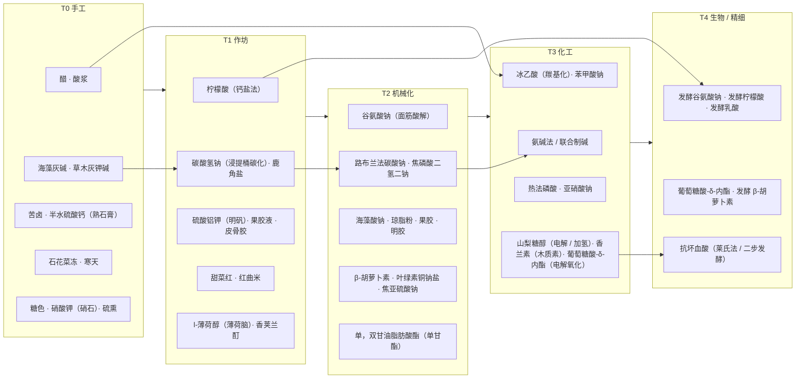

# 11 科技树、后续批次与待定问题

## 科技树

第一批 30 项按“最早可用阶段”排开（第二、三批见“批次总览”），箭头表示解锁关系（前一阶段的产物或机器是后一阶段的前置）。

### 阶段门槛（建议）

| 进入阶段 | 关键前置 | 关键新能力 |
| --- | --- | --- |
| T1 | 陶器、铁锅、木桶、土窑结构 | 燃料加热、批量浸提与煅烧 |
| T2 | 铜 / 铁机械件、首台 FE 发电 | 连续搅拌反应、压滤、真空蒸发、气体吸收 |
| T3 | 钢、耐酸内衬、高压容器 | 精馏、加氢、电解、电弧炉 |
| T4 | 不锈钢、无菌密封件、菌种工作台 | 深层通气发酵、膜分离、冷冻干燥 |

## 批次总览

| 批次 | 编号 | 项数 | 文档 | 重点 | 新增工艺 / 机器 |
| --- | --- | --- | --- | --- | --- |
| 第一批 | 1–30 | 30 | [03](03-first-batch.md)、[04](04-production-routes.md) | 覆盖主要功能类别，T0–T4 每阶段都有产物 | P01–P56；M01–M31（合并后 29 台）；H01–H13 |
| 第二批 | 31–78 | 48 | [13](13-batch-2.md) | 补齐常用防腐剂、甜味剂、增稠剂、磷酸盐、天然色素、乳化剂；石化线起步 | P57–P65；M27 裂解模式、M18 超临界模块；H14 |
| 第三批 | 79–139 | 61 | [14](14-batch-3.md) | 合成色素、高倍甜味剂、合成抗氧化剂；酶制剂、营养强化剂、香料、胶基四份专项名单 | P66–P79；M14 聚合模式与紫外灯模块、M21 密炼转子；H15 |
| 第四批 | 140–423 | 284 | [15](15-batch-4.md) | 表 A.1 其余添加剂 234 项（另有 4 种漏列，并入第五批）、表 C.3 其余酶制剂 50 项；天然色素提取线、种子胶、变性淀粉、纤维素醚、有机硅、基因重组 | P80–P96；M14 真空模块、M20 氯化模式、M21 高剪切乳化头、M24 熔盐模式、M25 分级模式、M27 气相催化与流化床模式、M30 基因重组模式 |
| 第五批 | 424–584；香料用国标编码 N001–N404、S0001–S1506 | 161 + 香料 1,845 | [17](17-batch-5.md)、[18](18-batch-5-flavors.md)、[19](19-batch-5-synthetic-flavors.md)（清单 [16](16-batch-5-backlog.md)） | 表 A.1 漏列 4 项、加工助剂、营养强化剂、胶基物质；食品用香料按路线模板设计（NT1–NT18、ST01–ST61） | P97–P104；M20 还原模式、M23 高压聚合模式，M23 乙氧基化模式扩到丙氧基化 |

阶段分布（按最早可用阶段）：第二批 T0 4 项、T1 6 项、T2 16 项、T3 15 项、T4 7 项（2026-11-05 按工艺重标 52、53、61、71）；第三批以 T3、T4 为主，T0–T1 只有植物靛、鱼肝油、植物蛋白酶、麦芽、天然精油、天然橡胶、蜂蜡等传统做法；第四批添加剂 T0 12 项、T1 46 项、T2 70 项、T3 82 项、T4 24 项，酶制剂 T1 3 项、T2 6 项、T4 41 项。；第五批（按前体关系图推算的最早档次）非香料 T0 4 项、T1 3 项、T2 77 项、T3 56 项、T4 20 项，天然香料 T1 241 项、T2 73 项、T3 40 项、T4 19 项，合成香料 T1 4 项、T2 157 项、T3 1216 项、T4 50 项（另有 45 条香料与 455 引用已有物料）

### 第五批（已设计）

2026-11-11 完成设计：非香料 424–584 见 [17](17-batch-5.md)，食品用香料见 [18](18-batch-5-flavors.md)（模板、天然香料）与 [19](19-batch-5-synthetic-flavors.md)（合成香料），实装计划见 [I31](../implementations/I31-content-batch-5.md)。新增物料并入 09（香料单列第 E 节，分类“香料”）、08 第 C 节；设计中提出的问题 29–45 已决定（29–40 为 2026-11-11，41–45 为 2026-11-12，见下表）。至此 GB 2760-2024 表 A.1、表 B.2、B.3、表 C.1–C.3，GB 14880-2012 与公告增补（已确认部分），GB 1886.359-2022（按 2014 版推定）名单都有了路线。

## 待定问题

| # | 问题 | 选项 / 建议 |
| --- | --- | --- |
| 1 | 法规最大使用量做硬限制还是提示 | 建议：提示 + 超量产生负面效果（如亚硝酸盐中毒），不阻止合成。**已定（2026-11-12，问题 45）**：不做用量限制，成品配方按现实写 |
| 2 | 计量体系 | 建议沿用 GTCEu 习惯：1 份 = 1 个粉 = 1000 mB，配方按化学计量比写（见 09） |
| 3 | T2 动力 | 只用 FE，还是同时接受机械动力应力 / 蒸汽 |
| 4 | 贵金属与过渡金属催化剂来源 | **已定（2026-11-04）**：铑、铂、钒、钴、钯、钨由其他模组提供，配方按标签匹配；本模组注册全部催化剂物品（见 08 §C 催化剂与助剂） |
| 5 | 有毒物料与泄漏 | 氢氰酸、氯气、SO2、NOx 是否做泄漏伤害（未定）。**已定（2026-11-05）**：剧毒原料路线保留为可选路线，同一产物另设不经剧毒原料的路线（同一成品允许多条路线）：281 增设氯乙酸法；344、158 与咖啡因合成（366 B）暂无替代，其中咖啡因另有提取路线。可选路线全部开启，不设配置项禁用（2026-11-05） |
| 6 | 低纯度能否做食品 | 允许用劣质、粗制、精制添加剂做“土法食品”（效果减弱或有副作用），还是一律要求食品级。**已定（2026-11-12，问题 45）**：允许；每种成品自定最低纯度，不达要求的打“土法”“劣质”标签，带代谢系统的杂质减益（[../foods/01](../foods/01-overview.md) 第 5 节） |
| 7 | 联动机器纯度 | 按 10 第 7 节的设备档次计算固定值，还是全部开放给配置 |
| 8 | 海水获取 | 只在海洋 / 海滩群系取，还是任何水源加盐 |
| 9 | GTCEu | 作为可选依赖共用材料（见 09），还是只做化学式文本对照 |
| 10 | 季节 | 是否读取季节模组（如 Serene Seasons），让晒盐、冻融、制曲受季节影响 |
| 11 | 混用限量 | GB 2760 附录 A 第 A.4 条：相同色泽着色剂、防腐剂、抗氧化剂混用时比例之和不超过 1。建议成品配方校验时按此累加，与问题 1 一并处理。**已定（2026-11-12，问题 45）**：不做混用校验（同问题 1） |
| 12 | 标签强制声明 | 天门冬酰苯丙氨酸甲酯（阿斯巴甜）须标注含苯丙氨酸。建议成品 Tooltip 增加固定提示行，规则写入文本规范 |
| 13 | 煤焦油芳烃来源 | 苯、萘、甲酚来自 M07 干馏与 M27 裂解。安装 GTCEu、通用机械等时，是否直接接受其苯、萘流体（标签导入，按外部物品计） |
| 14 | 版本节点的依赖差异 | 热力系列只在 1.20.1 节点，农夫乐事在 26.1.2 节点暂缺。依赖它们的原料（硫、镍、锡、银、铅、乳胶、松脂、树皮、稻米）在其他节点需要本模组的后备来源（矿石、作物或替代配方），按节点用数据生成输出。**已定（2026-11-04）**：只做硫矿石、磷灰石矿石（未装热力时生成）和稻谷、树皮（未装农夫乐事时生成或掉落）；镍、锡、银、铅不做后备，依赖其他模组；乳胶、松脂由本模组橡胶树与 H15 割取提供；后备物品在各节点都注册，按是否装有对应模组在运行时启用，配置文件可强制启用（见 08 §C、I07） |
| 15 | 纯度档位的叫法 | **已定（2026-11-04）**：“食品级”作为特例保留原名；药物、日化品等其他领域沿用同一套五档名称，界限按物料类别给出，不另设别名 |
| 16 | 手工反复精制 | **已定（2026-11-05）**：每条手工精制配方按现实工艺写 `t0_max`（只在 T0 设备上生效），多数为粗制或精制下限（07、10 第 2.1 节） |
| 17 | 默认去除比例 | **已定（2026-11-05）**：采用 ../machines/01 第 1.1 节的 50%、75%、90%、99%；数据生成报表与 03、13、14 的“食品级档次”不一致时再交设计调整 |
| 18 | 色价类天然色素 | **已定（2026-11-05）**：辣椒红、栀子黄、甜菜红按国标色价与纯色素吸光度折算出食品级下限；红曲红的国标色价为“符合声称”，仍用游戏设定（10 第 1.5 节） |
| 19 | 加权平均的计量 | **已定（2026-11-05）**：起点纯度按数量加权时 1 个物品折合 1,000 mB |
| 20 | 溶液形态产物的界限 | **已定（2026-11-05）**：按国标含量写 10 第 1.5 节覆盖（湿基）：乳酸钾、乳酸钠、植酸、山梨糖醇液 50%，麦芽糖醇液 34%，异构化乳糖 33%（标准未规定水分，按干物质约 67% 折算，游戏设定），稳定态二氧化氯 1.1%（以 ClO2 计），冰结构蛋白 0.5%，酒石酸铁 2.8%（以铁计），亚硫酸氢钠溶液 32%（国标只管固体，取欧盟规格，类别由 K0 改为 K1）；粗制、精制为游戏设定 |
| 21 | 暂无来源的原料 | **暂定（2026-11-05）**：维持现状，暂无来源的原料保留“暂无来源（待定）”，以后再定 |
| 22 | 基因重组 | **已定（2026-11-05）**：加“表达载体”耗材（`cultures/expression_vector`，每次基因重组消耗 1 个，游戏抽象）；新增大肠杆菌（`cultures/e_coli`），作 181 B 与表 C.3 第 39 项（105，工程菌（凝乳酶））的宿主；皱胃暂无来源 |
| 23 | 同一物质的拆分与形态 | **已定（2026-11-05）**：全部拆分。`malic_acid` 改名 DL-苹果酸，L 型为 `l_malic_acid`（56 B、140）；`calcium_silicate` 只指食品硅酸钙，炉渣为 `phosphorus_slag`；`magnesite` 改名菱镁矿粉，食品碳酸镁为 `magnesium_carbonate`；11 种色素各设铝色淀物品；姜黄、天然胡萝卜素、番茄红各设物品，61 姜黄素因此从 T2 起 |
| 24 | 麦芽来源 | **已定（2026-11-05）**：以 14 与 GB 2760 为准，新增大麦麦芽（`enzymes/barley_malt`），96、402 用大麦麦芽；大麦与其他无来源原料一样列为待定来源；小麦麦芽 `enzymes/malt` 保留作 T1 糖化 |
| 25 | 阶段口径 | **已定（2026-11-05）**：阶段以工艺为准，取本步工序所用设备的档次，上游更高时在括号注明；不拘于 T0–T4，必要时可拆子阶段（README 阶段约定）。13 的 52、53、71 改为 T2，61 改为 T2；14 的 138 改为 T0 / T3 |
| 26 | 简化取舍 | **已定（2026-11-05）**：动物脂改为混合油脂（`animal_fat`，反应式仍以硬脂酸甘油三酯计），水解得动物脂脂肪酸，压榨分出油酸、精馏分出棕榈酸与硬脂酸；咖啡因合成路线保留；阿力甜与酶的分级简化维持现状 |
| 27 | 规范化模块 | **已定（2026-11-05）**：新增通用升级“规范化模块”，装在升级槽，产出纯度降到所在档位的下限，方便存储（../machines/01 第 1.2 节、10 第 2.1 节第 6 步）。劣质产物与 K0 物料不变：劣质的下限是 0%，规范化会让产物失去用途 |
| 28 | 不带纯度的物料 | **已定（2026-11-05）**：按现实逻辑，不按某一物质质量分数分档的物料不带纯度：酶制剂与酶源（全部酶、麦芽、大麦麦芽、木瓜乳汁、无花果乳汁、胰脏浸提液）、蒸馏水、多组分混合物（原油、焦油、苦卤、灰、天然油脂、脂肪酸混合物等，不是单一分子、整体一起用）；菌种保留纯度（10 第 1.1 节）。规范化模块的两条限制（百分数门槛、T1 无升级槽）与劣质不生效经确认 |
| 29 | 第五批原料来源 | **已定（2026-11-11，第五批）**：① 粗硒：联动他模组的硒标签，并新增硒矿石（世界生成，游戏设定），焙烧直接得二氧化硒（509 B）；② 富硒大豆：大豆在亚硒酸钠稀溶液中浸泡发芽富集（游戏简化）；③ 动物血：原版生肉在 M12 压榨副产（流体，游戏简化），同时接受他模组血液标签；④ 原版物品代用全部接受（西瓜片、橡木原木、蒲公英、玫瑰丛），朗姆酒等 12 补成品时再接 |
| 30 | 铬盐路线 | **已定（2026-11-11，第五批）**：两条都做：A 金属铬溶于酸（他模组铬）；B 新增铬铁矿石（世界生成）→ 铬酸钠 → 重铬酸钠 → 还原为三价铬盐，按问题 5 口径作可选剧毒路线 |
| 31 | 已有物料的属性调整 | **已定（2026-11-11，第五批）**：① 另设固体 `ferric_citrate_powder`（柠檬酸铁粉，483），原溶液不变；② `zinc_chloride` 改为化学品 K1，催化剂槽照样接受；③ 石蜡与微晶蜡统一 K7（改 2026-11-05 对石蜡的标注）；④ 苦卤组成补少量溴化物；⑤ 保留两种口径：按有效成分含量计价的提取物 K5，香料中整体使用的精油、油树脂等不带纯度（写入 10 第 1.1 节）；⑥ 462 直接用 `alpha_tocopherol`，显示名改为 d-α-生育酚，不新建物料；⑦ L-乳酸钙（495）与乳酸钙（114）分开 |
| 32 | 133 d-香芹酮 B 路线 | **已定（2026-11-11，第五批）**：d-柠檬烯经亚硝酰氯加成的路线实得 l-香芹酮，移到 S0224 作 B 路线；133 只保留葛缕子、莳萝籽蒸馏（14 已改，I20 的 133 B 配方在 I31 中删除） |
| 33 | 溴 | **已定（2026-11-11，第五批）**：改回溴化物：S0474 用 (3-乙氧羰基丙基)三苯基溴化鏻，S0461 用溴乙酸乙酯；溴来自 P103 |
| 34 | 同物异条与配方冲突 | **已定（2026-11-11，第五批）**：N346 与 N080 共用物料；N082 改玳玳果整果蒸馏、N225 玳玳果皮冷榨、N255 苦橙冷榨，新增原料玳玳果；N169 新增原料红橘；N131 改果皮水蒸气蒸馏，N226 保持冷榨；N136 只作浸膏，净油为 N301；墨红花改为暂无来源；N160 新增原料卡南伽花；N186 新增原料冷杉属针叶（暂无来源），N192 冷杉针叶用原版云杉树叶；S0719 由 S0767 精馏分出；S0931 由 S0230 精馏分出；567 与 568 共用物料；569 维持一个物料；新增 dl-薄荷醇（百里香酚加氢）供 S1396；S1230、S1231 写成一条配方两个产出。另定：同一工序本来就同时得到的多个产物（联产）写成一条多产出配方。**原写“靠配比区分不算冲突”已由问题 41 更正**：配比不是区分手段，部分加氢与完全加氢等按催化剂与条件区分 |
| 35 | 异构体混合物的纯度 | **已定（2026-11-11，第五批）**：同分异构体混合按单一物质（K3 / K4），不同分子式的混合物不带纯度（现设计） |
| 36 | 长链与未确认路线 | **已定（2026-11-11，第五批）**：① 五种专利结构风味物（S1471、S1472、S1484、S1485、S1505）暂缓，不实装；② 鲜味、清凉酰胺照现设计；③ 大环麝香类照现设计；④ 未确认的七种按现设计实装；⑤ S0565 保持发酵；⑥ S0233 α-鸢尾酮增加合成路线：6-甲基柠檬醛 + 丙酮 → 假鸢尾酮 → 酸催化环化 |
| 37 | 含量低的天然单离 | **已定（2026-11-11，第五批）**：① 五种异硫氰酸酯保留天然单离，另加化学合成路线（烯基胺、甲硫基烷基胺 + 二硫化碳）；② S0445 保留单离，另加惕各酸异丁酯异构化–精馏路线；③ S0955 新增原料宽叶薄荷桉（暂无来源） |
| 38 | 原油与溶剂 | **已定（2026-11-11，第五批）**：① 与 I19 的“原油切割”合为一条配方，在其产出表中加入丙烷、丁烷、轻石脑油；② 直馏、加氢石脑油两种物品都保留 |
| 39 | 酯化口径与菌种 | **已定（2026-11-11，第五批）**：① 叔醇、萜醇酯保留酯交换（A），另加酸酐路线（B），新增己酸酐、苯甲酸酐、异丁酸酐；② 发酵氨基酸各设诱变菌株（亮氨酸、脯氨酸、精氨酸、谷氨酰胺；赖氨酸用 534 的菌株）；③ B12、K2 复用已有菌种 |
| 40 | 多步路线的实装 | **已定（2026-11-11，第五批）**：方案 A：每个模板只写改变物料的核心配方，提纯为可选精制，粉碎、过滤、回收溶剂等并入；一行多个模板时，相邻核心配方类型相同的合为一条（M14 与 M23 同属 R11，合并后在 M23 上做，模式取加压的一步），类型不同的拆开并登记中间体（茉莉酸、异丙醇胺、高圣草酚、对乙基苯磺酸钠、大豆油脂肪酸、发酵起子培养液、柏木油、4,4-二甲基-1,3-二氧六环、1-庚烯）；9 条“浸膏 → 净油”各登记浸膏物料。实装表见 18 第 1.4 节，逐条结果见 19 第 6 节 |
| 41 | 配方唯一性与概率平板 | **已定（2026-11-11，第五批）**：冲突的判据：同一配方类型下模式、催化剂、条件都相同而输入物料集合（不看数量）相同；**数量与配比不是区分手段**（取代问题 34 中“靠配比区分”的说法）。匹配要求全覆盖，输入集合是真子集时不冲突。区分手段依次为：联产合并成一条多产出配方、模式或催化剂、条件、增减输入物料、拆成两步并登记中间体。按此改了 20 条路线（S0018、S0062、S0023、S0032、S1502、S1233、S0996、S0693、S0810、S0814、S0815、S1429、S1017、S0930、S0077、S0204、S0074、S0224、489、500）与 5 个中间体（`hydroxymenthofurolactone`、`p_toluidine`、`toluene_2_3_diamine`、`piperylene`、`isoprenol`、`dimethyldioxane`），新增中间体 `nitrotoluene`、`dinitrotoluene`、`nitrosyl_chloride`，新增菌株 `cultures/bacillus_subtilis_ribose`、`cultures/bacillus_subtilis_acetoin`；32 组联产与 33 组逐条处理列在 18 第 1.5 节（含 2026-11-12 第二轮核对补上的 14 组：前几批 7 组、香料 7 组，一律改成“后一步由前一步做”或换试剂）；条件不是可靠的区分手段，因为设备的能力是集合，输入相同只差温度或压力的两条配方总是先注册的那条被选中。概率平板：同一宿主、同样操作得到的菌株共用一块 R18 平板，产出按 `plate.weights` 抽取，玩家挑菌落；所有需要挑出来的菌株都带概率（带供体样本的工程菌失败时产出宿主菌）。486 铁卟啉与 493 血红素铁合并为一个物料；580 聚乙烯蜡改用乙醛作链转移剂 |
| 42 | 第五批实装待审十条 | **已定（2026-11-12，第五批）**：以还原现实为主逐条审定。① 天然原料按现实得油率分档（16 / 8 / 4 / 2 / 1），浸膏、油树脂取半，酊、提取物 2，香脂 1（18 §1.4）；合成配方的数量按关键反应系数取整数；② 回转窑碱熔只出钠盐，水溶酸化另写 M14 配方：对乙基苯酚（S0101）、2-萘酚（80）、间苯二酚（195）；蓖麻油碱裂解（ST38）在 M23 高温做，癸二酸二钠另行酸化；③ 丙酮丁醇发酵按现实质量比 3 : 6 : 1 出丙酮、正丁醇、乙醇（经 `abe_broth` 精馏）；④ 494 电解液不消耗（游戏简化），配方只写铁；⑤ 511 保留乙醇沉淀（GB 1903.28-2018 即醇沉）；⑥ 513 增加 N-乙酰-D 体消旋配方，545 同样写；⑦ 528 B 改用甲醇作还原剂，盐酸 8 份，不再放出氯气（US4528175）；⑧ 碳四、碳五馏分合为一条轻石脑油裂解（经 `naphtha_cracked_gas`），不再用丁烷裂解；⑨ 581 费托轻油产出轻石脑油；⑩ 糖蜜分甘蔗、甜菜两种物料，两者都可用的配方引用流体标签 `molasses`；⑪ 辣椒油树脂改为不带纯度；⑫ N267 焦木酸另设精制物料 `refined_wood_vinegar`；⑬ 颜色取值：文档写明 > 现实外观 > 类别默认（09）；⑭ 实装检查补上的冲突处理写进 13、14、15、17、18、19（18 §1.5）；实装方的其余拟定照准 |
| 43 | 实装待审（I05、I18–I21、I28、I30） | **已定（2026-11-12）**：以还原现实为主逐条审定。① 钴盐改为具体的盐乙酸钴（ID `cobalt_acetate`，移入 09，标签 `catalysts/cobalt` 不变）；② 英文名的构型前缀分两种：费歇尔构型 D/L 大写（L-Lysine、DL-Methionine、D-Ribose），旋光方向 d/l 小写（d-Limonene、l-Menthol、d-α-生育酚）（text-standard §2.1）；③ 成品在效果设计前给占位饱食度（12 开头：能当饭吃的 4 点、饮料 2 点，调味料类保持不能食用）；④ 松脂改回 08 §C 的原料、不带纯度（07 的“含松香约 70%”是得率），09 删去该行；⑤ 麦芽不记纯度（K11 酶源，10 §1.1）；⑥ 副产物配方改为同时产出主副产物（葡萄汁、柑橘汁为新成品，可可碎粒、花生油、大米已有）；⑦ 吐温 60、40 按方程式减半（司盘 1 件 + 10 份环氧乙烷 → 0.5 份吐温；固体司盘不能取半，整件消耗）；⑧ 321 甘草抗氧化物改回甘草渣，352 的浸提联产 `materials/licorice_residue`；⑨ 稻谷与大米分开，新增 `materials/paddy`，碾米产出大米与米糠（联产）。另定：树脂纯化由 T3 改在 T2 搅拌反应罐；`getItems()` 用含外部规则的有效纯度（10 §4.4）；木瓜乳汁补 `papaya_latex`，条状琼脂、甜菊叶浸液、栀子染液按“覆盖”处理不另设物料。⑩ 两种树脂的单体由苯 + 乙烯改为苯乙烯（2026-11-12 批准）：离子交换树脂由聚苯乙烯（441）磺化，大孔吸附树脂由苯乙烯加甲苯致孔剂悬浮聚合，二乙烯苯交联剂省略作游戏简化（08 §C 催化剂与助剂） |
| 44 | 实装返工（二）的数值（I31、I30、I21、I18） | **已定（2026-11-12）**：① 档表补上 7 种原料：柏木 4、桃叶 8、橡苔 8、海带 16、灵猫香 1，蜡菊花由实装拟的 8 改为 **16**（现实得油率约 0.1%，1 吨花出 1 千克）；朗姆酒是流体，不套档表，按 4 桶写；② “每产出 1 单位”指模板原来的产出量（精油 100 mB、浸膏 250 mB 或 1 件），产出量不随档改；③ 发酵配方按每份产物取整：葡萄糖 1，氨按产物的氮数（脯氨酸 1、精氨酸 4 + 二氧化碳 1），赖氨酸的氮源按 17 第 534 号用**硫酸铵 1 份**（19 S0344 原写氨，已改）；④ 联产合并的产出量**按输入分摊**（丙酮 3 份 → 异弗尔酮 500 mB + 异亚丙基丙酮 750 mB），切馏分类的联产照原量；⑤ 间苯二酚（195）的碱熔在 **M23 高温**，不是 M14（搅拌反应罐没有高温档），同 ST38；⑥ 占位饱食度：02、11、12 三个大类与生面、生坯、冲调粉不能食用，饮料、酒类与调味茶 2 点，其余 4 点；⑦ 副产比例（葡萄、可可豆、稻谷、红米 4 → 3 + 1，柑橘、花生 4 → 2 + 1）、431 C 与裂解的桶数、N267 的木焦油 100 mB、581 的轻石脑油 250 mB、消旋的乙酸酐 100 mB、528 B 另出二氧化碳而不写水（04 的“生成的水不写”）、乙酸钴结晶并入 M14，一律照准 |
| 45 | 成品配方的总体方向 | **已定（2026-11-12）**：① 先做食品中间体，再按 GB 2760 附录 E 的大类分批写成品配方；② 增设调配香精，香料先调成香精再进成品；③ 加工助剂进工艺配方，营养强化剂进强化食品；④ 成品数值（饱食度、饱和度、品质、代谢成分含量）由一套算法从配方算出；⑤ 新增食品加工工艺与设备（烤箱等），家常成品同时允许原版熔炉、农夫乐事厨具、T0 器具等简化方式，简化方式只影响效率（批量、能耗、时长），不影响品质；⑥ 添加剂效果分三层：工艺必需写进配方；色泽、滋味和气味、状态、保存性四项品质（防腐剂、抗氧化剂计入保存性）；生理作用走新的代谢系统，直接修改玩家属性，不用药水效果。不做保质期与变质，罐装、冷冻等包装以堆叠上限间接体现；⑦ 每种成品自定输入的最低纯度，标签由低到高为劣质、土法、不标、顶档，不用“手作”，纯度不足的减益并入代谢系统；⑧ 不做用量限制（问题 1、11 随之定）。总体设计见 [../foods/01](../foods/01-overview.md)。同日续定：系统名称“代谢”；顶档标签“特级”（纯度档位已有“精制”）；堆叠上限散装鲜品（含汤羹类）16、包装 64；品质三档（一般、良好、优），饱和度系数 1.0、1.2、1.4；代谢成分继续设计，见 [../foods/02](../foods/02-metabolism.md) |
| 46 | 代谢系统的数据与配置 | **已定（2026-11-13）**：① 死亡是否清空体内量与储备由配置文件决定（`[metabolism] clear_on_death`；默认清空，沿用原建议）；② 原版与他模组食物的营养数据按食品设定、实际成分、加工工艺逐个确定，经数据包 `data/<命名空间>/foodindustrial/nutrition/` 配置，不按物品标签给默认值；另写 AI 执行的配置流程（[../foods/agents/food-nutrition-data.md](../foods/agents/food-nutrition-data.md)），流程内规定不臆测、信息不足时询问用户；③ 慢性部分（杂质、营养素）由配置文件开关，默认开启。数据包格式、命令等细节见 [../foods/03](../foods/03-nutrition-data.md)。同日续定：快吸收糖按 WHO 的游离糖计（添加的单糖、双糖与蜂蜜、糖浆、果汁中的糖）；数据来源依次为《中国食物成分表 标准版》第 6 版、USDA FoodData Central、产品标签；维生素 C、B1 的加工损失按 USDA 营养素保留率表 Release 6，维生素 D 暂按不损失计并标出；农夫乐事的数据随模组附带；数据包格式、命令与配置项按 03 第 2、3 节实装，本模组的 `foodindustrial/nutrition/*.json` 全部由数据生成写出，农夫乐事等随模组附带的他方食物同样由数据生成写出；数据生成时检查六个成分键齐全、手工配置的条目带依据。实装计划为 [I34](../implementations/I34-nutrition-data.md)、[I35](../implementations/I35-metabolism.md)、[I36](../implementations/I36-vanilla-nutrition.md) |
| 47 | 代谢系统的实装细节与 Apothic Attributes 联动 | **已定（2026-11-13）**：① 数据生成的输入放在哪里由实装定；② 结算的时间差取主世界“一天中的时间”与“游戏刻”两者差值中的较大者，关闭昼夜循环时照常代谢；③ 离线期间不计；④ 本系统内同一属性的修正按百分数相加；⑤ 维生素 C 缺乏减少全部来源的治疗；⑥ 失去意识的各项效果（画面变黑，不能移动、跳跃、攻击、破坏与放置方块、使用物品、打开容器，受伤不醒）由配置文件逐项开关；⑦ 酒精中毒用新的伤害类型 `foodindustrial:alcohol_poisoning`，无视护甲；⑧ 有营养数据的物品（含原版、他模组）按住 Shift 时追加一行营养成分（[../text-standard.md](../text-standard.md) 第 3.3 节）；⑨ “体内”面板在生存背包右侧，按钮打开，不遮挡配方书，创造模式不显示。另定（用户要求）：装有 Apothic Attributes 时，其属性面板中本系统的修正显示所属成分的图标，不显示问号；同日续定：每种成分一个图标（7 个，“体内”面板共用）；装有时 1.20.1 的挖掘速度与三个节点的受到的治疗改挂它的 `mining_speed`、`healing_received` 属性。实装见 [I35](../implementations/I35-metabolism.md) |
