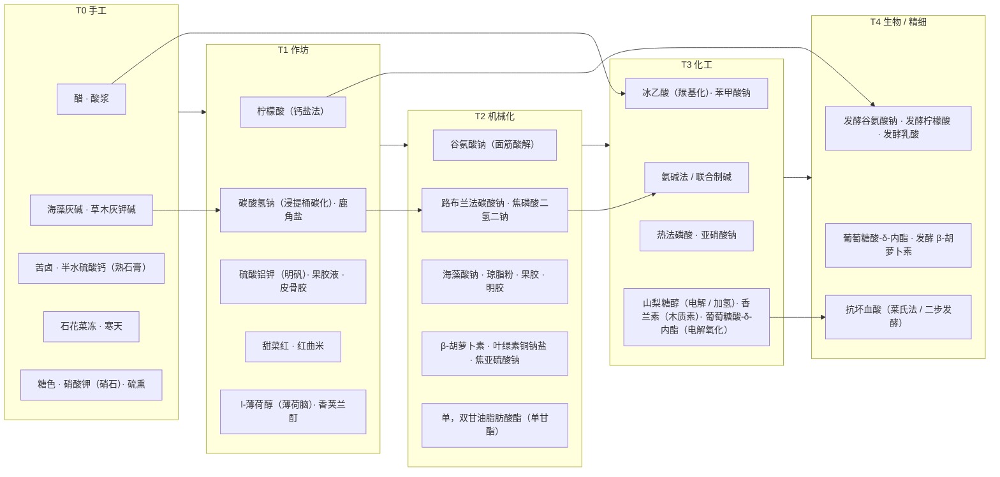

# 11 科技树、后续批次与待定问题

## 科技树

第一批 30 项按“最早可用阶段”排开（第二、三批见“批次总览”），箭头表示解锁关系（前一阶段的产物或机器是后一阶段的前置）。

### 阶段门槛（建议）

| 进入阶段 | 关键前置 | 关键新能力 |
| --- | --- | --- |
| T1 | 陶器、铁锅、木桶、土窑结构 | 燃料加热、批量浸提与煅烧 |
| T2 | 铜 / 铁机械件、首台 FE 发电 | 连续搅拌反应、压滤、真空蒸发、气体吸收 |
| T3 | 钢、耐酸内衬、高压容器 | 精馏、加氢、电解、电弧炉 |
| T4 | 不锈钢、无菌密封件、菌种工作台 | 深层通气发酵、膜分离、冷冻干燥 |

## 批次总览

| 批次 | 编号 | 项数 | 文档 | 重点 | 新增工艺 / 机器 |
| --- | --- | --- | --- | --- | --- |
| 第一批 | 1–30 | 30 | [03](03-first-batch.md)、[04](04-production-routes.md) | 覆盖主要功能类别，T0–T4 每阶段都有产物 | P01–P56；M01–M31（合并后 29 台）；H01–H13 |
| 第二批 | 31–78 | 48 | [13](13-batch-2.md) | 补齐常用防腐剂、甜味剂、增稠剂、磷酸盐、天然色素、乳化剂；石化线起步 | P57–P65；M27 裂解模式、M18 超临界模块；H14 |
| 第三批 | 79–139 | 61 | [14](14-batch-3.md) | 合成色素、高倍甜味剂、合成抗氧化剂；酶制剂、营养强化剂、香料、胶基四份专项名单 | P66–P79；M14 聚合模式与紫外灯模块、M21 密炼转子；H15 |
| 第四批 | 140–423 | 284 | [15](15-batch-4.md) | 表 A.1 其余添加剂 234 项（另有 4 种漏列，并入第五批）、表 C.3 其余酶制剂 50 项；天然色素提取线、种子胶、变性淀粉、纤维素醚、有机硅、基因重组 | P80–P96；M14 真空模块、M20 氯化模式、M21 高剪切乳化头、M24 熔盐模式、M25 分级模式、M27 气相催化与流化床模式、M30 基因重组模式 |
| 第五批 | 424–584；香料用国标编码 N001–N404、S0001–S1506 | 161 + 香料 1,845 | [17](17-batch-5.md)、[18](18-batch-5-flavors.md)、[19](19-batch-5-synthetic-flavors.md)（清单 [16](16-batch-5-backlog.md)） | 表 A.1 漏列 4 项、加工助剂、营养强化剂、胶基物质；食品用香料按路线模板设计（NT1–NT18、ST01–ST61） | P97–P104；M20 还原模式、M23 高压聚合模式，M23 乙氧基化模式扩到丙氧基化 |

阶段分布（按最早可用阶段）：第二批 T0 4 项、T1 6 项、T2 16 项、T3 15 项、T4 7 项（2026-11-05 按工艺重标 52、53、61、71）；第三批以 T3、T4 为主，T0–T1 只有植物靛、鱼肝油、植物蛋白酶、麦芽、天然精油、天然橡胶、蜂蜡等传统做法；第四批添加剂 T0 12 项、T1 46 项、T2 70 项、T3 82 项、T4 24 项，酶制剂 T1 3 项、T2 6 项、T4 41 项。；第五批（按前体关系图推算的最早档次）非香料 T0 4 项、T1 3 项、T2 77 项、T3 56 项、T4 20 项，天然香料 T1 241 项、T2 73 项、T3 40 项、T4 19 项，合成香料 T1 4 项、T2 157 项、T3 1216 项、T4 50 项（另有 45 条香料与 455 引用已有物料）

### 第五批（已设计）

2026-11-11 完成设计：非香料 424–584 见 [17](17-batch-5.md)，食品用香料见 [18](18-batch-5-flavors.md)（模板、天然香料）与 [19](19-batch-5-synthetic-flavors.md)（合成香料），实装计划见 [I31](../implementations/I31-content-batch-5.md)。新增物料并入 09（香料单列第 E 节，分类“香料”）、08 第 C 节；设计中提出的问题 29–45 已决定（29–40 为 2026-11-11，41–45 为 2026-11-12，见下表）。至此 GB 2760-2024 表 A.1、表 B.2、B.3、表 C.1–C.3，GB 14880-2012 与公告增补（已确认部分），GB 1886.359-2022（按 2014 版推定）名单都有了路线。

### 添加剂线剩余待定（2026-11-18 清完）

2026-11-18 决定下表第 2、3、7、8、9、10、12、13、21 项，添加剂线不再留待定项。随之新增三处设计：配方类型 W03 取水（[../machines/01 第 2 节](../machines/01-recipe-types.md)）、H16 手摇海水泵（[07](07-manual-crafting.md)）、M54 电动海水泵（[06](06-machines.md)）；成品 Tooltip 的“含苯丙氨酸”声明行写入 [../text-standard 第 3.3 节](../text-standard.md)；暂无来源原料的来源规则写入 [08](08-raw-materials.md)。

## 待定问题

| # | 问题 | 选项 / 建议 |
| --- | --- | --- |
| 1 | 法规最大使用量做硬限制还是提示 | 建议：提示 + 超量产生负面效果（如亚硝酸盐中毒），不阻止合成。**已定（2026-11-12，问题 45）**：不做用量限制，成品配方按现实写 |
| 2 | 计量体系 | 建议沿用 GTCEu 习惯：1 份 = 1 个粉 = 1000 mB，配方按化学计量比写（见 09）。**已定（2026-11-18）**：沿用 1 份 = 1 个粉 = 1,000 mB，配方按化学计量比写（[09 §计量建议](09-chemical-formulas.md)）；接入他模组机器时按其现有配方对照换算 |
| 3 | T2 动力 | 只用 FE，还是同时接受机械动力应力 / 蒸汽。**已定（2026-11-18）**：全部档次只用 FE。机械动力的应力与蒸汽由其他模组自行转成 FE 接入，本模组不另设接口与配方分支 |
| 4 | 贵金属与过渡金属催化剂来源 | **已定（2026-11-04）**：铑、铂、钒、钴、钯、钨由其他模组提供，配方按标签匹配；本模组注册全部催化剂物品（见 08 §C 催化剂与助剂） |
| 5 | 有毒物料与泄漏 | 氢氰酸、氯气、SO2、NOx 是否做泄漏伤害（未定）。**已定（2026-11-05）**：剧毒原料路线保留为可选路线，同一产物另设不经剧毒原料的路线（同一成品允许多条路线）：281 增设氯乙酸法；344、158 与咖啡因合成（366 B）暂无替代，其中咖啡因另有提取路线。可选路线全部开启，不设配置项禁用（2026-11-05） |
| 6 | 低纯度能否做食品 | 允许用劣质、粗制、精制添加剂做“土法食品”（效果减弱或有副作用），还是一律要求食品级。**已定（2026-11-12，问题 45）**：允许；每种成品自定最低纯度，不达要求的打“土法”“劣质”标签，带代谢系统的杂质减益（[../foods/01](../foods/01-overview.md) 第 5 节） |
| 7 | 联动机器纯度 | 按 10 第 7 节的设备档次计算固定值，还是全部开放给配置。**已定（2026-11-18）**：按 [10 第 7 节](10-purity-jei-ae2.md)的设备档次算固定值，纯度上限不开放给配置；每个联动模组保留“启用”与“设备档次”两项配置 |
| 8 | 海水获取 | 只在海洋 / 海滩群系取，还是任何水源加盐。**已定（2026-11-18）**：只在海洋、海滩群系用海水泵抽取，空桶不再直接取海水，任何水源加盐的做法不做；两台泵——H16 手摇海水泵（T0，[07](07-manual-crafting.md)）与 M54 电动海水泵（T1，[06](06-machines.md)），配方类型 W03 取水见 [../machines/01 第 2 节](../machines/01-recipe-types.md) |
| 9 | GTCEu | 作为可选依赖共用材料（见 09），还是只做化学式文本对照。**已定（2026-11-18）**：作可选依赖共用材料，[09 §与 GTCEu 的联动](09-chemical-formulas.md)的三条方式全做（化学式对照、标签互通、材料互认）；GT 物料按外部物品计（[10 第 1.6 节](10-purity-jei-ae2.md)），实装见 [I26](../implementations/I26-gtceu.md) |
| 10 | 季节 | 是否读取季节模组（如 Serene Seasons），让晒盐、冻融、制曲受季节影响。**已定（2026-11-18）**：不读季节模组。晒盐、冻融、制曲只看群系与天气（[07 §环境](07-manual-crafting.md)），装与不装季节模组表现一致 |
| 11 | 混用限量 | GB 2760 附录 A 第 A.4 条：相同色泽着色剂、防腐剂、抗氧化剂混用时比例之和不超过 1。建议成品配方校验时按此累加，与问题 1 一并处理。**已定（2026-11-12，问题 45）**：不做混用校验（同问题 1） |
| 12 | 标签强制声明 | 天门冬酰苯丙氨酸甲酯（阿斯巴甜）须标注含苯丙氨酸。建议成品 Tooltip 增加固定提示行，规则写入文本规范。**已定（2026-11-18）**：依 [GB 2760-2024](https://file.jgvogel.cn/134/upload/resources/file/595476.pdf) 附录 A 表 A.1 脚注 3、脚注 9，投入天门冬酰苯丙氨酸甲酯（阿斯巴甜）或天门冬酰苯丙氨酸甲酯乙酰磺胺酸的成品，Tooltip 在营养成分组件之前加固定声明行“阿斯巴甜（含苯丙氨酸）”“天门冬酰苯丙氨酸甲酯乙酰磺胺酸（含苯丙氨酸）”；规则写入 [../text-standard](../text-standard.md) 第 3.3 节 |
| 13 | 煤焦油芳烃来源 | 苯、萘、甲酚来自 M07 干馏与 M27 裂解。安装 GTCEu、通用机械等时，是否直接接受其苯、萘流体（标签导入，按外部物品计）。**已定（2026-11-18）**：接受。按标签导入其苯、萘（[09](09-chemical-formulas.md) 的 GT 对应列已列二者），按外部物品计（劣质，[10 第 1.6 节](10-purity-jei-ae2.md)）；甲酚无对应材料，仍自产。M07 干馏与 M27 裂解两条自产路线都保留 |
| 14 | 版本节点的依赖差异 | 热力系列只在 1.20.1 节点，农夫乐事在 26.1.2 节点暂缺。依赖它们的原料（硫、镍、锡、银、铅、乳胶、松脂、树皮、稻米）在其他节点需要本模组的后备来源（矿石、作物或替代配方），按节点用数据生成输出。**已定（2026-11-04）**：只做硫矿石、磷灰石矿石（未装热力时生成）和稻谷、树皮（未装农夫乐事时生成或掉落）；镍、锡、银、铅不做后备，依赖其他模组；乳胶、松脂由本模组橡胶树与 H15 割取提供；后备物品在各节点都注册，按是否装有对应模组在运行时启用，配置文件可强制启用（见 08 §C、I07） |
| 15 | 纯度档位的叫法 | **已定（2026-11-04）**：“食品级”作为特例保留原名；药物、日化品等其他领域沿用同一套五档名称，界限按物料类别给出，不另设别名 |
| 16 | 手工反复精制 | **已定（2026-11-05）**：每条手工精制配方按现实工艺写 `t0_max`（只在 T0 设备上生效），多数为粗制或精制下限（07、10 第 2.1 节） |
| 17 | 默认去除比例 | **已定（2026-11-05）**：采用 ../machines/01 第 1.1 节的 50%、75%、90%、99%；数据生成报表与 03、13、14 的“食品级档次”不一致时再交设计调整 |
| 18 | 色价类天然色素 | **已定（2026-11-05）**：辣椒红、栀子黄、甜菜红按国标色价与纯色素吸光度折算出食品级下限；红曲红的国标色价为“符合声称”，仍用游戏设定（10 第 1.5 节） |
| 19 | 加权平均的计量 | **已定（2026-11-05）**：起点纯度按数量加权时 1 个物品折合 1,000 mB |
| 20 | 溶液形态产物的界限 | **已定（2026-11-05）**：按国标含量写 10 第 1.5 节覆盖（湿基）：乳酸钾、乳酸钠、植酸、山梨糖醇液 50%，麦芽糖醇液 34%，异构化乳糖 33%（标准未规定水分，按干物质约 67% 折算，游戏设定），稳定态二氧化氯 1.1%（以 ClO2 计），冰结构蛋白 0.5%，酒石酸铁 2.8%（以铁计），亚硫酸氢钠溶液 32%（国标只管固体，取欧盟规格，类别由 K0 改为 K1）；粗制、精制为游戏设定 |
| 21 | 暂无来源的原料 | **暂定（2026-11-05）**：维持现状，暂无来源的原料保留“暂无来源（待定）”，以后再定。**已定（2026-11-18）**：按类别定统一规则，见 [08 §暂无来源原料的来源规则](08-raw-materials.md)——作物类新增本模组作物与种子（种子由村民交易或战利品给出）、野生植物类做按群系生成的采集方块、矿类新增矿石生成、动物与虫类走实体掉落、藻类走 M30 培养；装有对应模组时优先用其标签。逐种落到实装的数据生成 |
| 22 | 基因重组 | **已定（2026-11-05）**：加“表达载体”耗材（`cultures/expression_vector`，每次基因重组消耗 1 个，游戏抽象）；新增大肠杆菌（`cultures/e_coli`），作 181 B 与表 C.3 第 39 项（105，工程菌（凝乳酶））的宿主；皱胃暂无来源 |
| 23 | 同一物质的拆分与形态 | **已定（2026-11-05）**：全部拆分。`malic_acid` 改名 DL-苹果酸，L 型为 `l_malic_acid`（56 B、140）；`calcium_silicate` 只指食品硅酸钙，炉渣为 `phosphorus_slag`；`magnesite` 改名菱镁矿粉，食品碳酸镁为 `magnesium_carbonate`；11 种色素各设铝色淀物品；姜黄、天然胡萝卜素、番茄红各设物品，61 姜黄素因此从 T2 起 |
| 24 | 麦芽来源 | **已定（2026-11-05）**：以 14 与 GB 2760 为准，新增大麦麦芽（`enzymes/barley_malt`），96、402 用大麦麦芽；大麦与其他无来源原料一样列为待定来源；小麦麦芽 `enzymes/malt` 保留作 T1 糖化 |
| 25 | 阶段口径 | **已定（2026-11-05）**：阶段以工艺为准，取本步工序所用设备的档次，上游更高时在括号注明；不拘于 T0–T4，必要时可拆子阶段（README 阶段约定）。13 的 52、53、71 改为 T2，61 改为 T2；14 的 138 改为 T0 / T3 |
| 26 | 简化取舍 | **已定（2026-11-05）**：动物脂改为混合油脂（`animal_fat`，反应式仍以硬脂酸甘油三酯计），水解得动物脂脂肪酸，压榨分出油酸、精馏分出棕榈酸与硬脂酸；咖啡因合成路线保留；阿力甜与酶的分级简化维持现状 |
| 27 | 规范化模块 | **已定（2026-11-05）**：新增通用升级“规范化模块”，装在升级槽，产出纯度降到所在档位的下限，方便存储（../machines/01 第 1.2 节、10 第 2.1 节第 6 步）。劣质产物与 K0 物料不变：劣质的下限是 0%，规范化会让产物失去用途 |
| 28 | 不带纯度的物料 | **已定（2026-11-05）**：按现实逻辑，不按某一物质质量分数分档的物料不带纯度：酶制剂与酶源（全部酶、麦芽、大麦麦芽、木瓜乳汁、无花果乳汁、胰脏浸提液）、蒸馏水、多组分混合物（原油、焦油、苦卤、灰、天然油脂、脂肪酸混合物等，不是单一分子、整体一起用）；菌种保留纯度（10 第 1.1 节）。规范化模块的两条限制（百分数门槛、T1 无升级槽）与劣质不生效经确认 |
| 29 | 第五批原料来源 | **已定（2026-11-11，第五批）**：① 粗硒：联动他模组的硒标签，并新增硒矿石（世界生成，游戏设定），焙烧直接得二氧化硒（509 B）；② 富硒大豆：大豆在亚硒酸钠稀溶液中浸泡发芽富集（游戏简化）；③ 动物血：原版生肉在 M12 压榨副产（流体，游戏简化），同时接受他模组血液标签；④ 原版物品代用全部接受（西瓜片、橡木原木、蒲公英、玫瑰丛），朗姆酒等 12 补成品时再接 |
| 30 | 铬盐路线 | **已定（2026-11-11，第五批）**：两条都做：A 金属铬溶于酸（他模组铬）；B 新增铬铁矿石（世界生成）→ 铬酸钠 → 重铬酸钠 → 还原为三价铬盐，按问题 5 口径作可选剧毒路线 |
| 31 | 已有物料的属性调整 | **已定（2026-11-11，第五批）**：① 另设固体 `ferric_citrate_powder`（柠檬酸铁粉，483），原溶液不变；② `zinc_chloride` 改为化学品 K1，催化剂槽照样接受；③ 石蜡与微晶蜡统一 K7（改 2026-11-05 对石蜡的标注）；④ 苦卤组成补少量溴化物；⑤ 保留两种口径：按有效成分含量计价的提取物 K5，香料中整体使用的精油、油树脂等不带纯度（写入 10 第 1.1 节）；⑥ 462 直接用 `alpha_tocopherol`，显示名改为 d-α-生育酚，不新建物料；⑦ L-乳酸钙（495）与乳酸钙（114）分开 |
| 32 | 133 d-香芹酮 B 路线 | **已定（2026-11-11，第五批）**：d-柠檬烯经亚硝酰氯加成的路线实得 l-香芹酮，移到 S0224 作 B 路线；133 只保留葛缕子、莳萝籽蒸馏（14 已改，I20 的 133 B 配方在 I31 中删除） |
| 33 | 溴 | **已定（2026-11-11，第五批）**：改回溴化物：S0474 用 (3-乙氧羰基丙基)三苯基溴化鏻，S0461 用溴乙酸乙酯；溴来自 P103 |
| 34 | 同物异条与配方冲突 | **已定（2026-11-11，第五批）**：N346 与 N080 共用物料；N082 改玳玳果整果蒸馏、N225 玳玳果皮冷榨、N255 苦橙冷榨，新增原料玳玳果；N169 新增原料红橘；N131 改果皮水蒸气蒸馏，N226 保持冷榨；N136 只作浸膏，净油为 N301；墨红花改为暂无来源；N160 新增原料卡南伽花；N186 新增原料冷杉属针叶（暂无来源），N192 冷杉针叶用原版云杉树叶；S0719 由 S0767 精馏分出；S0931 由 S0230 精馏分出；567 与 568 共用物料；569 维持一个物料；新增 dl-薄荷醇（百里香酚加氢）供 S1396；S1230、S1231 写成一条配方两个产出。另定：同一工序本来就同时得到的多个产物（联产）写成一条多产出配方。**原写“靠配比区分不算冲突”已由问题 41 更正**：配比不是区分手段，部分加氢与完全加氢等按催化剂与条件区分 |
| 35 | 异构体混合物的纯度 | **已定（2026-11-11，第五批）**：同分异构体混合按单一物质（K3 / K4），不同分子式的混合物不带纯度（现设计） |
| 36 | 长链与未确认路线 | **已定（2026-11-11，第五批）**：① 五种专利结构风味物（S1471、S1472、S1484、S1485、S1505）暂缓，不实装；② 鲜味、清凉酰胺照现设计；③ 大环麝香类照现设计；④ 未确认的七种按现设计实装；⑤ S0565 保持发酵；⑥ S0233 α-鸢尾酮增加合成路线：6-甲基柠檬醛 + 丙酮 → 假鸢尾酮 → 酸催化环化 |
| 37 | 含量低的天然单离 | **已定（2026-11-11，第五批）**：① 五种异硫氰酸酯保留天然单离，另加化学合成路线（烯基胺、甲硫基烷基胺 + 二硫化碳）；② S0445 保留单离，另加惕各酸异丁酯异构化–精馏路线；③ S0955 新增原料宽叶薄荷桉（暂无来源） |
| 38 | 原油与溶剂 | **已定（2026-11-11，第五批）**：① 与 I19 的“原油切割”合为一条配方，在其产出表中加入丙烷、丁烷、轻石脑油；② 直馏、加氢石脑油两种物品都保留 |
| 39 | 酯化口径与菌种 | **已定（2026-11-11，第五批）**：① 叔醇、萜醇酯保留酯交换（A），另加酸酐路线（B），新增己酸酐、苯甲酸酐、异丁酸酐；② 发酵氨基酸各设诱变菌株（亮氨酸、脯氨酸、精氨酸、谷氨酰胺；赖氨酸用 534 的菌株）；③ B12、K2 复用已有菌种 |
| 40 | 多步路线的实装 | **已定（2026-11-11，第五批）**：方案 A：每个模板只写改变物料的核心配方，提纯为可选精制，粉碎、过滤、回收溶剂等并入；一行多个模板时，相邻核心配方类型相同的合为一条（M14 与 M23 同属 R11，合并后在 M23 上做，模式取加压的一步），类型不同的拆开并登记中间体（茉莉酸、异丙醇胺、高圣草酚、对乙基苯磺酸钠、大豆油脂肪酸、发酵起子培养液、柏木油、4,4-二甲基-1,3-二氧六环、1-庚烯）；9 条“浸膏 → 净油”各登记浸膏物料。实装表见 18 第 1.4 节，逐条结果见 19 第 6 节 |
| 41 | 配方唯一性与概率平板 | **已定（2026-11-11，第五批）**：冲突的判据：同一配方类型下模式、催化剂、条件都相同而输入物料集合（不看数量）相同；**数量与配比不是区分手段**（取代问题 34 中“靠配比区分”的说法）。匹配要求全覆盖，输入集合是真子集时不冲突。区分手段依次为：联产合并成一条多产出配方、模式或催化剂、条件、增减输入物料、拆成两步并登记中间体。按此改了 20 条路线（S0018、S0062、S0023、S0032、S1502、S1233、S0996、S0693、S0810、S0814、S0815、S1429、S1017、S0930、S0077、S0204、S0074、S0224、489、500）与 5 个中间体（`hydroxymenthofurolactone`、`p_toluidine`、`toluene_2_3_diamine`、`piperylene`、`isoprenol`、`dimethyldioxane`），新增中间体 `nitrotoluene`、`dinitrotoluene`、`nitrosyl_chloride`，新增菌株 `cultures/bacillus_subtilis_ribose`、`cultures/bacillus_subtilis_acetoin`；32 组联产与 33 组逐条处理列在 18 第 1.5 节（含 2026-11-12 第二轮核对补上的 14 组：前几批 7 组、香料 7 组，一律改成“后一步由前一步做”或换试剂）；条件不是可靠的区分手段，因为设备的能力是集合，输入相同只差温度或压力的两条配方总是先注册的那条被选中。概率平板：同一宿主、同样操作得到的菌株共用一块 R18 平板，产出按 `plate.weights` 抽取，玩家挑菌落；所有需要挑出来的菌株都带概率（带供体样本的工程菌失败时产出宿主菌）。486 铁卟啉与 493 血红素铁合并为一个物料；580 聚乙烯蜡改用乙醛作链转移剂 |
| 42 | 第五批实装待审十条 | **已定（2026-11-12，第五批）**：以还原现实为主逐条审定。① 天然原料按现实得油率分档（16 / 8 / 4 / 2 / 1），浸膏、油树脂取半，酊、提取物 2，香脂 1（18 §1.4）；合成配方的数量按关键反应系数取整数；② 回转窑碱熔只出钠盐，水溶酸化另写 M14 配方：对乙基苯酚（S0101）、2-萘酚（80）、间苯二酚（195）；蓖麻油碱裂解（ST38）在 M23 高温做，癸二酸二钠另行酸化；③ 丙酮丁醇发酵按现实质量比 3 : 6 : 1 出丙酮、正丁醇、乙醇（经 `abe_broth` 精馏）；④ 494 电解液不消耗（游戏简化），配方只写铁；⑤ 511 保留乙醇沉淀（GB 1903.28-2018 即醇沉）；⑥ 513 增加 N-乙酰-D 体消旋配方，545 同样写；⑦ 528 B 改用甲醇作还原剂，盐酸 8 份，不再放出氯气（US4528175）；⑧ 碳四、碳五馏分合为一条轻石脑油裂解（经 `naphtha_cracked_gas`），不再用丁烷裂解；⑨ 581 费托轻油产出轻石脑油；⑩ 糖蜜分甘蔗、甜菜两种物料，两者都可用的配方引用流体标签 `molasses`；⑪ 辣椒油树脂改为不带纯度；⑫ N267 焦木酸另设精制物料 `refined_wood_vinegar`；⑬ 颜色取值：文档写明 > 现实外观 > 类别默认（09）；⑭ 实装检查补上的冲突处理写进 13、14、15、17、18、19（18 §1.5）；实装方的其余拟定照准 |
| 43 | 实装待审（I05、I18–I21、I28、I30） | **已定（2026-11-12）**：以还原现实为主逐条审定。① 钴盐改为具体的盐乙酸钴（ID `cobalt_acetate`，移入 09，标签 `catalysts/cobalt` 不变）；② 英文名的构型前缀分两种：费歇尔构型 D/L 大写（L-Lysine、DL-Methionine、D-Ribose），旋光方向 d/l 小写（d-Limonene、l-Menthol、d-α-生育酚）（text-standard §2.1）；③ 成品在效果设计前给占位饱食度（12 开头：能当饭吃的 4 点、饮料 2 点，调味料类保持不能食用）；④ 松脂改回 08 §C 的原料、不带纯度（07 的“含松香约 70%”是得率），09 删去该行；⑤ 麦芽不记纯度（K11 酶源，10 §1.1）；⑥ 副产物配方改为同时产出主副产物（葡萄汁、柑橘汁为新成品，可可碎粒、花生油、大米已有）；⑦ 吐温 60、40 按方程式减半（司盘 1 件 + 10 份环氧乙烷 → 0.5 份吐温；固体司盘不能取半，整件消耗）；⑧ 321 甘草抗氧化物改回甘草渣，352 的浸提联产 `materials/licorice_residue`；⑨ 稻谷与大米分开，新增 `materials/paddy`，碾米产出大米与米糠（联产）。另定：树脂纯化由 T3 改在 T2 搅拌反应罐；`getItems()` 用含外部规则的有效纯度（10 §4.4）；木瓜乳汁补 `papaya_latex`，条状琼脂、甜菊叶浸液、栀子染液按“覆盖”处理不另设物料。⑩ 两种树脂的单体由苯 + 乙烯改为苯乙烯（2026-11-12 批准）：离子交换树脂由聚苯乙烯（441）磺化，大孔吸附树脂由苯乙烯加甲苯致孔剂悬浮聚合，二乙烯苯交联剂省略作游戏简化（08 §C 催化剂与助剂） |
| 44 | 实装返工（二）的数值（I31、I30、I21、I18） | **已定（2026-11-12）**：① 档表补上 7 种原料：柏木 4、桃叶 8、橡苔 8、海带 16、灵猫香 1，蜡菊花由实装拟的 8 改为 **16**（现实得油率约 0.1%，1 吨花出 1 千克）；朗姆酒是流体，不套档表，按 4 桶写；② “每产出 1 单位”指模板原来的产出量（精油 100 mB、浸膏 250 mB 或 1 件），产出量不随档改；③ 发酵配方按每份产物取整：葡萄糖 1，氨按产物的氮数（脯氨酸 1、精氨酸 4 + 二氧化碳 1），赖氨酸的氮源按 17 第 534 号用**硫酸铵 1 份**（19 S0344 原写氨，已改）；④ 联产合并的产出量**按输入分摊**（丙酮 3 份 → 异弗尔酮 500 mB + 异亚丙基丙酮 750 mB），切馏分类的联产照原量；⑤ 间苯二酚（195）的碱熔在 **M23 高温**，不是 M14（搅拌反应罐没有高温档），同 ST38；⑥ 占位饱食度：02、11、12 三个大类与生面、生坯、冲调粉不能食用，饮料、酒类与调味茶 2 点，其余 4 点；⑦ 副产比例（葡萄、可可豆、稻谷、红米 4 → 3 + 1，柑橘、花生 4 → 2 + 1）、431 C 与裂解的桶数、N267 的木焦油 100 mB、581 的轻石脑油 250 mB、消旋的乙酸酐 100 mB、528 B 另出二氧化碳而不写水（04 的“生成的水不写”）、乙酸钴结晶并入 M14，一律照准 |
| 45 | 成品配方的总体方向 | **已定（2026-11-12）**：① 先做食品中间体，再按 GB 2760 附录 E 的大类分批写成品配方；② 增设调配香精，香料先调成香精再进成品；③ 加工助剂进工艺配方，营养强化剂进强化食品；④ 成品数值（饱食度、饱和度、品质、代谢成分含量）由一套算法从配方算出；⑤ 新增食品加工工艺与设备（烤箱等），家常成品同时允许原版熔炉、农夫乐事厨具、T0 器具等简化方式，简化方式只影响效率（批量、能耗、时长），不影响品质；⑥ 添加剂效果分三层：工艺必需写进配方；色泽、滋味和气味、状态、保存性四项品质（防腐剂、抗氧化剂计入保存性）；生理作用走新的代谢系统，直接修改玩家属性，不用药水效果。不做保质期与变质，罐装、冷冻等包装以堆叠上限间接体现；⑦ 每种成品自定输入的最低纯度，标签由低到高为劣质、土法、不标、顶档，不用“手作”，纯度不足的减益并入代谢系统；⑧ 不做用量限制（问题 1、11 随之定）。总体设计见 [../foods/01](../foods/01-overview.md)。同日续定：系统名称“代谢”；顶档标签“特级”（纯度档位已有“精制”）；堆叠上限散装鲜品（含汤羹类）16、包装 64；品质三档（一般、良好、优），饱和度系数 1.0、1.2、1.4；代谢成分继续设计，见 [../foods/02](../foods/02-metabolism.md) |
| 46 | 代谢系统的数据与配置 | **已定（2026-11-13）**：① 死亡是否清空体内量与储备由配置文件决定（`[metabolism] clear_on_death`；默认清空，沿用原建议）；② 原版与他模组食物的营养数据按食品设定、实际成分、加工工艺逐个确定，经数据包 `data/<命名空间>/foodindustrial/nutrition/` 配置，不按物品标签给默认值；另写 AI 执行的配置流程（[../foods/agents/food-nutrition-data.md](../foods/agents/food-nutrition-data.md)），流程内规定不臆测、信息不足时询问用户；③ 慢性部分（杂质、营养素）由配置文件开关，默认开启。数据包格式、命令等细节见 [../foods/03](../foods/03-nutrition-data.md)。同日续定：快吸收糖按 WHO 的游离糖计（添加的单糖、双糖与蜂蜜、糖浆、果汁中的糖）；数据来源依次为《中国食物成分表 标准版》第 6 版、USDA FoodData Central、产品标签；维生素 C、B1 的加工损失按 USDA 营养素保留率表 Release 6，维生素 D 暂按不损失计并标出；农夫乐事的数据随模组附带；数据包格式、命令与配置项按 03 第 2、3 节实装，本模组的 `foodindustrial/nutrition/*.json` 全部由数据生成写出，农夫乐事等随模组附带的他方食物同样由数据生成写出；数据生成时检查六个成分键齐全、手工配置的条目带依据。实装计划为 [I34](../implementations/I34-nutrition-data.md)、[I35](../implementations/I35-metabolism.md)、[I36](../implementations/I36-vanilla-nutrition.md) |
| 47 | 代谢系统的实装细节与 Apothic Attributes 联动 | **已定（2026-11-13）**：① 数据生成的输入放在哪里由实装定；② 结算的时间差取主世界“一天中的时间”与“游戏刻”两者差值中的较大者，关闭昼夜循环时照常代谢；③ 离线期间不计；④ 本系统内同一属性的修正按百分数相加；⑤ 维生素 C 缺乏减少全部来源的治疗；⑥ 失去意识的各项效果（画面变黑，不能移动、跳跃、攻击、破坏与放置方块、使用物品、打开容器，受伤不醒）由配置文件逐项开关；⑦ 酒精中毒用新的伤害类型 `foodindustrial:alcohol_poisoning`，无视护甲；⑧ 有营养数据的物品（含原版、他模组）按住 Shift 时追加一行营养成分（[../text-standard.md](../text-standard.md) 第 3.3 节）；⑨ “体内”面板在生存背包右侧，按钮打开，不遮挡配方书，创造模式不显示。另定（用户要求）：装有 Apothic Attributes 时，其属性面板中本系统的修正显示所属成分的图标，不显示问号；同日续定：每种成分一个图标（7 个，“体内”面板共用）；装有时 1.20.1 的挖掘速度与三个节点的受到的治疗改挂它的 `mining_speed`、`healing_received` 属性。实装见 [I35](../implementations/I35-metabolism.md) |
| 48 | 成品的品质与数值 | **已定（2026-11-14）**（细则见 [../foods/04](../foods/04-quality.md)）：① 各成品配方按现实列评价项，等权合成品质档，不按大类定权重；② 不按 GB 2760 表 A.1 逐个品种限定添加剂可用的食品类别，各批按现实配方选；③ 每个评价项两个品质位，放一个到良好，两个构成有据的协同组合到优；④ 饱食度 = `20 × √(每份能量 / 2,000 kcal)`，1–20；⑤ 饱和度系数按蛋白质与游离糖的能量占比分四档（0.1、0.3、0.6、0.8），再乘品质系数；⑥ 一份的重量取 FDA RACC，没有对应类别的取现实单个产品的重量；⑦ 每个成品另写有出处的现实配比，数值只按它算，游戏用量按玩法定；⑧ Tooltip 默认一行“品质档 · 标签”，Shift 追加各评价项的档（[../text-standard.md](../text-standard.md) 第 3.3 节）。另定：食品加工设备只先写通用框架与第 1 批用的设备，其余随各批设计 |
| 49 | 食品加工设备的框架与第 1 批设备 | **已定（2026-11-14）**（细则见 [../foods/05](../foods/05-equipment.md)）：① 品质与纯度标签只在配料段（调配、和面等放添加剂的一步）定，加工段原样带过去，多个输入合并时每项取低、标签取差；② 配料段设备另设 8 格添加剂槽，按功能类别自动归项；③ 主产物是成品时产率 ×1.0，档次只影响速率与批量；④ 食品加工设备 T1 为单方块、T2 为多方块：和面与成型设 M38 手摇压面机（T1）与 M39 和面成型机组（T2），均质与杀菌设 M40 均质杀菌机组（T2）；⑤ 和面、切条的 T0 做法为工作台，装有农夫乐事时加砧板，不新增工具；⑥ 超高温灭菌由 M40 的超高温段模块开放；⑦ 农夫乐事带不出物品数据时只注册输入都不带品质的配方。新增配方类型 R20 和面与成型、R21 杀菌，工艺 P105–P110 |
| 50 | 成品线的工作顺序 | **已定（2026-11-14）**：① 先列出全部成品的制作方法（粗略版），统计成品阶段要用的全部工艺（[../foods/06](../foods/06-product-methods.md)）；② 再做机器的基本设计；③ 机器基本设计完成后设计最终版的成品配方，按配方的需要调整机器；④ 最后整理总结最终的机器设计。取代问题 48 中“设备随各批设计”的做法；05 已设计的 R20、R21 与 M38–M40 在第 ② 步复核 |
| 51 | 机器基本设计 | **已定（2026-11-14）**（细则见 [../foods/07](../foods/07-machine-basic-design.md)）：① 06 统计的 53 道工序归到 25 种配方类型，新增 R22 蒸煮、R23 烘烤（含干炒、焙炒）、R24 油炸、R25 腌制与陈酿（含醒发）、R26 切割与斩拌（含灌肠）、R27 糖果与巧克力（调温、浇注、包衣）、R28 冷冻、R29 灌装封口；包馅、拉伸、挤压、压片、制粒并入 R20（ID 改 `forming`），凝固、凝乳并入 R11，搅打、搅乳并入 R19，罐内灭菌并入 R21；带油翻炒归 R05；② 新机器 M41–M53 共 13 台，连同 M38–M40 共 16 台（T1 单方块七台、T2 多方块九台），M50 冰盐冷冻桶单设；③ T1 复用 M03 熬煮灶（蒸煮、油炸、焙炒、杀菌、凝固凝乳）与 M05 发酵缸（醒发、腌制、陈酿），两台加模式；④ T0 的冷却、冷冻靠环境（同 H12、H14）；⑤ 浇注成型的模具作后一步的催化剂，只有糖果与巧克力单列；⑥ M45 发酵陈酿库只跑成品线的 R16；⑦ 腌制的拌料在 R19 调配，腌制本身算加工段；⑧ 包装容器在终版配方时定；⑨ 成品线的“均质”改称“高压均质”，与 M21 的“均质”区分 |
| 52 | 终版配方的通用规则 | **已定（2026-11-14）**（细则见 [../foods/08](../foods/08-recipe-format-and-intermediates.md)）：① 每种成品从已登记的输入到成品最多 3–4 步（含灌装封口），只留配料段、主要加工、灌装，其余工序并入；② 多种成品共用或现实中流通的中间状态各自登记，只用于单个成品的固体用通用“半成品”物品（物品数据记目标成品与阶段），只用于单个成品的液体各自登记流体；③ 液体成品在机器间以流体流转，灌装封口后成为物品，成品表登记包装物品；④ 营养数据：《中国食物成分表》有对应条目的取表值，没有的按现实配比计算 |
| 53 | 并入写法、物料重叠与原料缺口 | **已定（2026-11-14）**（细则见 [../foods/08](../foods/08-recipe-format-and-intermediates.md) 第 1、5–7 节）：① 并入后的一步要求所有并入工序的条件（取并集），条件冲突或没有设备同时具备时分开成两步；② 成品与现有物料是同一物质的共用（葡萄酒用现有 `wine`，花生油用花生原油，食用植物油用植物油标签；熬猪肉、牛肉改产猪油、牛油，添加剂链改接受动物脂标签；现有用果酒的配方改接受果酒标签），不同物质分开；③ 原料缺口先接他模组标签，核对后写进 08，没有来源的由本模组新增，各批用到时逐个定；④ 共用中间体的终版配方随第一个用到它的批次写 |
| 54 | 第 1 批的容器、营养数据来源与配比依据 | **已定（2026-11-14）**（细则见 [../foods/09](../foods/09-batch1-fats-sweeteners.md)）：① 容器用原版玻璃瓶（250 mB）装液体，新增玻璃罐装酱类与人造黄油、起酥油，新增纸袋装粉末；罐头、塑料包装到用到的批次再加；② 《中国食物成分表》的数值取自中国疾控营养与健康所“食物营养成分查询平台”，注明条目号；③ 每种成品都写现实配比与出处（国标或行标、教材与文献、公开的专业配方、厂商配料表），查不到的标“待查”，不自行编 |
| 55 | 固体配料与葡萄糖浆 | **已定（2026-11-14）**（细则见 [../foods/09](../foods/09-batch1-fats-sweeteners.md) 第 6 节）：① 糖、盐、猪油等固体配料类成品不灌装，成品本身就是物品，堆叠 64；② 现有配方“液化淀粉液 + 葡萄糖淀粉酶 → 葡萄糖”改为产出葡萄糖浆的糖化液，葡萄糖由葡萄糖浆结晶得到；③ 第 1 批先写完调味品，待查的配比最后一起查 |
| 56 | 调味品的四处取舍 | **已定（2026-11-14）**（细则见 [../foods/10](../foods/10-batch1-condiments.md) 第 7 节）：① 因条件冲突分步而超出 3–4 步上限的允许（陈醋 5 步），以后各批照此；② 现有“果酒 + 醋酸菌 → 食醋”只认现有果酒，果酒标签只用于白兰地等蒸馏配方；③ 生抽不设配料段，品质在下游的调配一步定；④ 番茄酱不设高压均质与巴氏杀菌，保持 4 步 |
| 57 | 待查项的取值与营养兜底 | **已定（2026-11-17）**（细则见 [../foods/08](../foods/08-recipe-format-and-intermediates.md) 第 1 节第 6 条）：① 来源只给范围或下限时，取常见商品的典型值（另查商品数据，查不到再用中值）；② 成分表没有条目、配比查不到或按配比算不准（发酵品等）的成品，营养退用 USDA FDC（注明编号），再退商品标签；③ 糖醇的能量按各自的值（山梨糖醇 2.6 kcal/g） |
| 58 | 第 1 批待查项的取舍 | **已定（2026-11-17）**（细则见 [../foods/09](../foods/09-batch1-fats-sweeteners.md) 第 7 节、[../foods/10](../foods/10-batch1-condiments.md) 第 8 节）：① 卤汁、火锅底料的营养按现有资料估算（卤汁按酱油、糖、水的完整家常配方，火锅底料按专利 CN105410835A 计算）；② 鲜味酱油的营养取 FDC 品牌条目 1910971；③ 十三香 14 味分两步调配，砂仁先接他模组标签；④ 代糖按山梨糖醇 100% 计算；⑤ 待查项查完再进第 2 批，两轮补查仍查不到的保留“待查”，以后遇到资料再补 |
| 59 | 第 1 批收尾的两处配方 | **已定（2026-11-17）**（细则见 [../foods/09](../foods/09-batch1-fats-sweeteners.md) 第 8 节、[../foods/10](../foods/10-batch1-condiments.md) 第 9 节）：① 绵白糖单设干燥，调配出湿糖后 R07 干燥，共 2 步；② 鲜味酱油的调配加果葡糖浆 250 mB（必需），与营养来源的商品配料对上 |
| 60 | 民间资料与火锅底料 | **已定（2026-11-17）**（细则见 [../foods/08](../foods/08-recipe-format-and-intermediates.md) 第 2 节、[../foods/10](../foods/10-batch1-condiments.md) 第 10 节）：① 现实配比在官方资料（国标、行标、文献、专利、厂商资料）里找不到时，用民间资料（家常菜谱、厂商说明、百科与科普文章等），注明出处；第 1 批据此补齐待查项，只剩鲜味酱油的谷氨酸钠加量；② 火锅底料的营养改按牛油块型家常配方估算，糍粑辣椒按干辣椒计（2,429 kJ），不再采用火锅米线底料专利 |
| 61 | 第 2 批调配香精的总体做法 | **已定（2026-11-17）**（细则见 [../foods/11](../foods/11-batch2-flavorings.md) 第 2–4、8 节，逐条归组见 [../foods/12](../foods/12-flavor-groups.md)）：① 风味类型合并为 11 类（果香、乳香、甜香、坚果与焙烤、肉味与咸味、辛香、蔬菜与青香、酒香、花香、清凉、烟熏）；② 每类 1 个香精物品，剂型（水溶性、油溶性、乳化、浆膏、拌和型粉末、胶囊型粉末）记在物品数据里；③ 香料按气味描述词数据（TGSC、Leffingwell）归进风味组，天然香料按原料与主成分；④ 主香取本类型的组，辅香不限组，全部香料都可作辅香 |
| 62 | 第 2 批调配香精的细则 | **已定（2026-11-17）**（细则见 [../foods/11](../foods/11-batch2-flavorings.md) 第 4、5、8 节）：① 风味组维持按任一描述词归入，一条香料可进多组；② 香精不带容器，堆叠 64，成品每批的香精格消耗 1 个，香精配方一次出 8 个；③ 乳化香精两步：M21（高剪切乳化头）出各类专属粗乳液 11 种，M40 高压均质出香精物品，M40 增设物品输出 O 1（05、07 已改）；④ 热反应香精用现有 P75 美拉德反应，T0 H03 锅、T1 M03、T2 M14，常压加热；⑤ 第 1 批调味品按现实配料表与产品标准补写香精的可接受类型，注出处，查不到的不写 |
| 63 | 第 3 批（上）粮食制品的取舍 | **已定（2026-11-17）**（细则见 [../foods/13](../foods/13-batch3-grain-products.md) 第 1、9 节）：① 挂面、米粉、河粉、粉丝、粉条、珍珠粉圆维持不能食用，碱水面、鸡蛋面也改为不能食用；② 生饺子、生汤圆分两路：煮后可吃，速冻灌装后不能直接吃、煮后得饺子或汤圆；③ 糯米、赤豆由本模组新增作物，粽叶为新物品（竹子合成），燕麦、叶菜接他模组标签；④ 肉馅为猪肉糜 + 叶菜 + 生抽 + 盐；⑤ 模具按子工序新增包馅模、拉伸模、挤丝模；⑥ 粉条走压片切条，与粉丝分开；⑦ 凉皮、凉粉不加拌料、不带品质；⑧ 干制品装纸袋，方便面、速冻品、碱水面装新增的塑料袋 |
| 64 | 第 3 批（下）焙烤食品的取舍 | **已定（2026-11-17）**（细则见 [../foods/14](../foods/14-batch3-bakery.md) 第 1、2、7 节）：① 黄油、淡奶油、奶油奶酪、咸蛋黄按标签引用，做法留给第 4 批；② 焙烤模具按形状设蛋糕模、吐司模、挞派模、夹板（R23 催化剂）与月饼模（R20）；③ 酥皮照现实分开：牛角包自带裹油面团，两种派共用派皮，蛋挞的挞皮为半成品，08 的酥皮不再作共用中间体；④ 全麦粉改为面粉回添麸皮；⑤ 新设组标签 foods/cake_base（海绵、戚风）与 foods/biscuits（桃酥、黄油曲奇、苏打饼干）；⑥ 生姜、坚果接他模组标签 |
| 65 | 第 4 批乳制品、冷冻饮品、蛋制品的取舍 | **已定（2026-11-17）**（细则见 [../foods/15](../foods/15-batch4-dairy.md) 第 7 节，冷冻饮品与蛋制品见 [../foods/16](../foods/16-batch4-frozen-eggs.md)）：① 经高压均质的乳制品补家常路线：杀菌用 R21 巴氏杀菌，H03、M03、M40 都能做，在 M40 上做时高压均质并入，淡奶油巴氏杀菌或超高温灭菌都可，酸奶、奶油奶酪降到 T0，冰淇淋降到 T1；② 稀奶油改由巴氏杀菌乳分离，下游不再单设杀菌；③ 皱胃由击杀成年牛（含哞菇）掉落，掉落率在实装草案中定（2026-11-18 改为用带“肢解”附魔的武器击杀时才掉，见第 69 条）；④ 鸭蛋新设标签 `materials/duck_egg` 接他模组，皮蛋、咸鸭蛋、糟蛋也接受鸡蛋；⑤ 本模组新增作物绿豆；⑥ 新增中间体抹茶（蒸青、干燥、研磨）；⑦ 雪糕从冰淇淋浆料做起，`foods/ice_cream` 不再用于雪糕；⑧ 新增纸杯装冰淇淋与冰沙，其余用玻璃罐、玻璃瓶、纸袋、塑料袋或散装；⑨ 咸鸭蛋成品为熟咸蛋，生咸蛋登记为共用中间体；⑩ 新增冰棍模（每支另耗木棍 1 根）与奶酪模；⑪ 可可粉、巧克力、果酱（第 6 批）与酒糟（第 7 批）按标签或 ID 引用；⑫ 黄油不加盐 |
| 66 | 补查的数据来源 | **已定（2026-11-18）**（细则见 [../foods/08](../foods/08-recipe-format-and-intermediates.md) 第 1 节第 6 条、[../foods/03](../foods/03-nutrition-data.md) 第 5 节）：① 营养数据的来源顺序加入日本食品標準成分表（八訂），排在 USDA FDC 之后、商品标签之前，配比计算所需的单项原料数据也可取它；据此补上抹茶冰淇淋的咖啡因、烧麦（蒸糯米含水量）与奶油蛋糕（海绵蛋糕与打发奶油 3:1）；② 凉皮的营养按 Red House Spice 不洗面筋的简便配方计算，卡片注明蛋白质偏高（同日查到洗面筋做法的实测淀粉浆成分，已改按它计算，见第 67 条） |
| 67 | 剩余待查项的资料范围 | **已定（2026-11-18）**：剩余待查项允许用更民间的资料（自媒体文章、视频标题、店家经验、营养师转述的商品标签等），卡片注明出处与“民间说法”；据此补上奶豆腐的出品率（约 10–13:1）与糟蛋的标签数值（钠、淀粉与糖、钙），鲜味酱油的谷氨酸钠加量另由专利 CN101961098A 补上（1.5%–2.6%）；凉皮改按程增辉等（《食品与发酵工业》2024 年第 10 期）实测的 17 °Bé 淀粉浆成分计算，不再需要洗面筋做法的出品率；糟蛋的酒精仍未查到（后按第 68 条估算） |
| 68 | 糟蛋的营养与酒精 | **已定（2026-11-18）**（细则见 [../foods/16](../foods/16-batch4-frozen-eggs.md) 第 5.5、6 节）：① 营养定稿取科普中国的数值（来源顺序之外）；② 酒精查不到实测，按酒糟含醇量约 15%（智汇三农，民间说法）估算，蛋内液相与酒糟的酒精度持平，每 100 g 约 7.0 g，一份 50 g 约 3.5 g；③ 酒精不计入能量，能量维持 954 kJ |
| 69 | 第 5 批肉制品与水产制品的取舍 | **已定（2026-11-18）**（细则见 [../foods/17](../foods/17-batch5-meat.md) 第 8 节，水产见 [../foods/18](../foods/18-batch5-aquatic.md) 第 6 节，亚硝酸盐见 [../foods/02](../foods/02-metabolism.md) 第 4.4 节）：① 新增宝藏附魔“肢解”（`foodindustrial:dismemberment`，只从战利品箱与村民交易获得，所有近战武器可附，单级）：用带肢解的武器击杀成年生物时另掉落器官与部位，按现实器官全列，牛（含哞菇）掉皱胃、肝脏，猪掉猪皮、猪后腿 ×2、小肠、胃黏膜、胰脏、肝脏，鸡掉鸡爪 ×2，羊掉小肠；皱胃改为肢解时才掉（第 65 条③），胰脏、胃黏膜、肝脏随之有了来源；② 肠衣按实际成分区分：天然肠衣与胶原蛋白肠衣同属可食肠衣标签 `casings/edible`，塑料肠衣不能吃；塑料肠衣按现实材料新增聚偏二氯乙烯链（氯乙烯加氯得 1,1,2-三氯乙烷，脱氯化氢得偏二氯乙烯，再聚合），最低 T3；③ 代谢系统新增亚硝酸盐，按高铁血红蛋白建模；④ 中毒途径：成品按含量计，配料段放护色剂时每份按 GB 2760 残留限量计，家常菜不加；亚硝酸钠、亚硝酸钾可误当作盐，全部成品配方的盐位都收，Tooltip 照常显示含量；⑤ 鸭肉只接他模组标签 `materials/duck`；虾只接他模组标签 `materials/shrimp`，另设剥虾得虾仁与虾蟹壳；⑥ 切割鱼（R26）得鱼肉与鱼皮；熏鱼按烟熏三文鱼（干腌后冷熏）；⑦ 腊肉、腊肠、咸肉、板鸭、金华火腿、咸鱼、鱼干的成品为蒸煮后的熟品，生品作半成品；⑧ 新增马口铁罐（铁锭 ×2 + 锡锭 ×1 → ×4，没装产锡的模组时做不出）与火腿模；⑨ 肉冻、鱼皮冻的营养按皮与水的配比计算，皮的成分取文献实测；⑩ 家常菜按第 3、4 批的家常路线，跨批的原料按标签或 ID 引用；⑪ 实装计划改为全部批次的成品设计完成后再建（[../foods/01](../foods/01-overview.md) 第 10 节）；⑫ 鱼标签照用 `materials/raw_fish`，不排除河豚与热带鱼，以河豚为原料的成品带原版河豚的三个效果（饥饿 III 15 秒、中毒 II 1 分钟、反胃 I 15 秒），标记随中间体传递；⑬ 一次出两种产物的 R26 切割在工作台上做时，副产留在合成格，同水桶返还容器（[../foods/07](../foods/07-machine-basic-design.md) 第 6 节）。因第④条，第 1–4 批里能食用、配方有盐位的 13 种成品于同日补上每份加盐量（[../foods/13](../foods/13-batch3-grain-products.md) 第 8 节、[14](../foods/14-batch3-bakery.md) 第 9 节、[15](../foods/15-batch4-dairy.md) 第 10 节、[16](../foods/16-batch4-frozen-eggs.md) 第 8 节）；第 1、2 批的盐、酱油、酱类等不能直接食用，误用的量按下游成品算，各成品的折算待补 |
| 70 | 误用亚硝酸盐经调味品的传递 | **已定（2026-11-18）**（细则见 [../foods/02](../foods/02-metabolism.md) 第 4.4 节）：下游成品自己有盐位的按自己卡上的每份加盐量计；自己没有盐位、只用酱油、卤汁、酱类等的，按该调味品在下游配方里的现实用量乘它的盐分折算。16 种带盐位调味品的盐分已于 2026-11-18 补上（[../foods/10](../foods/10-batch1-condiments.md) 第 11 节：加碘盐与海盐 99.8 g/100 g、低钠盐 75.0、生抽 16.2、豆瓣酱 15.3、甜面酱 5.3、黄豆酱 9.2、番茄酱 2.7、蛋黄酱 1.9、芥末酱 2.8、辣椒酱 20.4、蚝油 6.9、鸡精 47.9、高汤块 61.0、料酒 0.7、咖喱块 12.6；另补老抽 17.6、鲜味酱油 12.7、卤汁 1.37）。同日把自己没有盐位、只用调味品的 13 种成品逐个折算完（饺子、烧麦、卤蛋、茶叶蛋、溏心蛋、卤牛肉、酱鸭、卤鸡爪、红烧肉、东坡肉、狮子头、肉松、牛肉干），折法为盐分 × 现实用量 ÷ 全部原料 × 每份；鱼露不设盐位，猪肉脯不受影响。问题 70 到此结清 |
| 71 | 第 6 批果蔬、豆类、食用菌、藻类、坚果与糖果的取舍 | **已定（2026-11-18）**（细则见 [../foods/19](../foods/19-batch6-produce.md) 第 7 节与 [../foods/20](../foods/20-batch6-confectionery.md) 第 5 节）：① 新原料分两路：中式成品离不开的由本模组新增作物（芥菜、黑豆、梅子、山楂），其余只接他模组标签（萝卜、黄瓜、甜菜根、核桃与坚果、紫菜）；② 容器：罐头用第 5 批的马口铁罐，果酱、酱类、腌菜、腐乳用玻璃罐，干品用纸袋，内酯豆腐与巧克力豆用塑料袋；③ 新增豆腐模（R02 压榨的催化剂）；④ 豆花登记为成品兼共用中间体，南豆腐由豆花轻压而成，北豆腐用卤水、豆花用石膏；⑤ 发光浆果果酱不带发光或夜视（原版发光浆果吃下没有效果）；⑥ 新增臭卤（R16 液态发酵），腐乳汤料用第 1 批的料酒，不等第 7 批的黄酒；⑦ 大豆蛋白按碱溶酸沉工艺定（19 第 6.12 节），最低 T2；⑧ 跳跳糖的加压碳酸化用 M19 吸收塔加压（600 psi），最低 T3，[../foods/07](../foods/07-machine-basic-design.md) 第 7 节的待定由此结清；⑨ 糖果按模具区分（巧克力模、硬糖模、棒棒糖模、淀粉模、糖衣锅），同模具的再靠配料或香料区分。待查：糖渍橘皮的营养、腐乳的酒精残留、脱脂豆粕与挤压参数、琼脂凉粉的凝胶浓度、凉拌菜的加盐量（19 第 9 节），酒心巧克力的壳酒比、奶糖与龙须酥的配比、山楂单果重（20 第 7 节） |
| 72 | 维生素与矿物质系统 | **已定（2026-11-18）**（细则见 [../foods/02](../foods/02-metabolism.md) 第 5.6 节、[../foods/03](../foods/03-nutrition-data.md) 第 1、2 节）：① 代谢系统补齐 13 种维生素与 14 种主要矿物质，缺乏与过量都设效果；② 沿用第 5.2 节的体内储量池模型，储备按天记，上限按现实的耗尽时长定（水溶性 30 天、维生素 B1 14 天、叶酸 120 天、脂溶性与维生素 B12 365 天、钾钠 3 天、铁碘硒铜 180 天、钙磷氟锰钼铬 365 天）；③ 每日需要量取 GB 28050-2011 附录 A 的营养素参考值，可耐受最高摄入量取美国国家科学院成人值，没有 UL 的不设过量效果；④ 过量按当日累计 1 倍与 3 倍 UL 两档（午夜清零），脂溶性与矿物质另按储备上限 3 倍设一档；⑤ 泛酸、生物素、锰、钼、铬只显示不设效果；⑥ 数据缺口与储备上限的核对列入 02 第 8 节待定第 5、6 条 |
| 73 | 第 7 批（上）饮料与特殊膳食用食品的取舍 | **已定（2026-11-18）**（细则见 [../foods/21](../foods/21-batch7-beverages.md) 第 1、6 节）：① 容器新增玻璃瓶、铝罐与 PET 瓶，PET 按对二甲苯 → 对苯二甲酸 → 聚酯的链做，最低 T3，另加吹瓶模；② 草本按 additives/08 已有的草本与花类物料建组标签 `materials/herbs`，不新增作物；椰子只接他模组标签；③ 茶汤沿用 08 的红茶汤（改名茶汤，绿茶同用），咖啡液沿用 `coffee_extract`，另加草本汤与碳酸水；④ 饮料的碳酸化在 T1 的 M04 常压通气、T2 的 M19 加压；⑤ 强化成品按 GB 28050 的 NRV 定比例，新增维生素矿物质预混与维生素 B 族预混两种物料。待查见 21 第 7 节 |
| 74 | 第 7 批（下）酒类与其他类的取舍 | **已定（2026-11-18）**（细则见 [../foods/22](../foods/22-batch7-alcohol-snacks.md) 第 4 节）：① 酒类的能量按乙醇 29 kJ/g 另算（中国表把乙醇并进差减法碳水、按 17 kJ/g 折）；蒸馏酒的密度按表值反算的两点线性取值；② 一份按 TTB 与 NIAAA 的标准杯（啤酒 355 mL、发酵酒 148 mL、蒸馏酒与利口酒 44 mL）；③ 食用酒精不新建流体，用现有乙醇，纯度栏写食品级；④ 黄酒改接蒸糯米，红曲酒仍接蒸米；啤酒的麦糟接现有酒糟；⑤ 起泡酒 T1 走瓶内二次发酵、T2 起另给罐式碳酸化；⑥ 香草利口酒改名草本药酒（欧盟利口酒要求不低于 15% vol）；⑦ 龟苓膏不放龟，按草本组标签熬；⑧ 木薯粉按淀粉折、爆裂玉米按玉米做；⑨ 爆爆珠走正向成球，不新增乳酸钙与壳聚糖的食品用途；⑩ 焦糖浆与焦糖色分开；⑪ 干酵母与鲜酵母给出现有酵母物料的来路；⑫ 新增橡木桶（R25 的计次催化剂）与滤纸袋；⑬ 焦糖布丁用第 4 批的蛋奶液，不另立调配配方；⑭ 威士忌与伏特加的蒸馏按 R10 的模式区分，干酵母与朗姆酒的糖蜜发酵按硫酸铵区分。待查见 22 第 5 节 |
| 75 | 第 ③ 步的覆盖检查 | **已定（2026-11-18）**（细则见 [../foods/01](../foods/01-overview.md) 第 10 节）：七批成品设计做完后核对——① 06 粗略版的 330 种成品都有终版卡片，两处改名（中式火腿→金华火腿、香草利口酒→草本药酒）；② GB 2760 附录 D 的 353 个添加剂条目都有下游（128 个在成品文档里按名字出现，223 个经品质位的功能类别标签或添加剂线的工艺配方），余 2 行是附录 C 的加工助剂指针；③ 1,887 条香料都有下游（1,718 条按风味组标签，169 条按全部香料标签作辅香）；④ 工序覆盖在第 ② 步已核对。数据生成的覆盖报表随实装做 |
| 76 | 第 ④ 步终版机器设计写在哪里 | **已定（2026-11-18）**：新建 [../machines/05-final-design.md](../machines/05-final-design.md)，07 保留为第 ② 步的过程记录，两者不一致时以终版为准。汇总范围为设备、配方类型、模式、催化剂、档位全部：R20–R29 的模式与条件、沿用的 R01–R19 在成品线的用法、配料段与添加剂槽、设备梯度总表、16 台新机器（M38–M53）、添加剂线设备在成品线的新增能力、23 种模具工具与 12 种容器、各批新增一览、相对 05 与 07 的九项改动、7 项留给实装草案的待定（锅的模式切换、多方块外形、模具合成、玻璃瓶分工、橡木桶计次、木棍消耗、模式 ID 查重）|
| 77 | 各批待查与待定的清理 | **已定（2026-11-18）**：逐项清完——[../foods/21](../foods/21-batch7-beverages.md) 第 7 节 4 项（酸梅汤配比与营养取《家庭医药》方子与香港食安中心数据；乳酸菌饮料按养乐多标签反算；婴儿米粉按 GB 10769-2025 表 2 取中值、代餐粉门槛照 GB 28050 表 C.1；咖啡因与包种茶实测同量级）；[19](../foods/19-batch6-produce.md) 第 9 节 5 项（糖渍橘皮照苹果脯并用商品标签对照；腐乳酒精按汤料 10% 与水分折 0.8 g/份；大豆素肉改用 CN112006155A 的大豆参数；琼脂凉粉按日本表 09028 取 1.5% 与 3 kcal；凉拌海带丝按 FDC 1780827 取值、误用 1.77 g）；[20](../foods/20-batch6-confectionery.md) 第 7 节 3 项（酒心壳 70% 符合欧盟 2000/36/EC 的 25% 下限；奶糖按王勃 2007 配方、龙须酥配比查不到只写工序；山楂单果重照 10 g 并给灵敏度）；[22](../foods/22-batch7-alcohol-snacks.md) 第 5 节 8 项（爆爆珠一份按 RACC 其他糖果 30 g；苦杏仁不作原料；甜米酒改 360 mL；蒸馏酒密度三点拟合、锚点含 OIV 的 31% vol；威士忌取日本表；红曲酒照花雕酒；橡木桶按催化剂默认 64 次；凉粉草与茯苓不新增）；[02](../foods/02-metabolism.md) 第 8 节 2 项（WS/T 578 与 2023 版 DRIs 取不到原文，维持 GB 28050 与 NASEM；维生素 B12 储备上限按手册的 3–5 年改 1,095 天，叶酸 120 天）；[machines/05](../machines/05-final-design.md) 第 7 节 3 项已定（锅不加模式开关、玻璃瓶统一用本模组的、木棍写成普通输入）、3 项归口实装草案（多方块外形、模具合成、模式 ID 查重）；本表第 2、3、7、8、9、10、12、13、21 项同日定下（见各条“已定”与“添加剂线剩余待定”一节），设计文档不再留待定项 |
| 78 | 成品线的实装计划 | **已定（2026-11-18）**：按问题 69 第 11 条，全部批次设计做完后建计划。拆成 17 份（[../implementations/README](../implementations/README.md)）：I38 配方类型与两段模型、I39 品质与标签与 Tooltip、I40 模具与容器、I41 T1 设备与现有设备的新增能力、I42 T2 多方块机组、I43 海水泵与 W03、I44 原料来源与世界生成、I45 成品营养与代谢数据生成、I46 维生素与矿物质、I47–I53 七批成品内容、I54 联动与验收；新增里程碑 M-G、M-H、M-I。machines/05 第 7 节原归口“实装草案”的三项分别落到 I42、I40、I38 |
| 79 | 放不下的配方 | **已定（2026-11-19）**：七批成品里 13 条工序没有设备放得下、9 条只有工作台放得下，一律改槽位、不改配方。[../machines/03](../machines/03-io-layout.md) 第 1 节加第 4 条“槽位按配方定数”（配料段设备与工作台齐平、9 格），第 3 节改 H03、H04、M01、M02、M03、M05、M11、M15、M21 的槽位并新增 M38–M54 的成品线设备表；计划见 [../implementations/I47.5](../implementations/I47.5-machine-slots.md)，[I47](../implementations/I47-food-batch-1.md) 待审第 2 条的八处临时改写随之回到卡片写法 |
