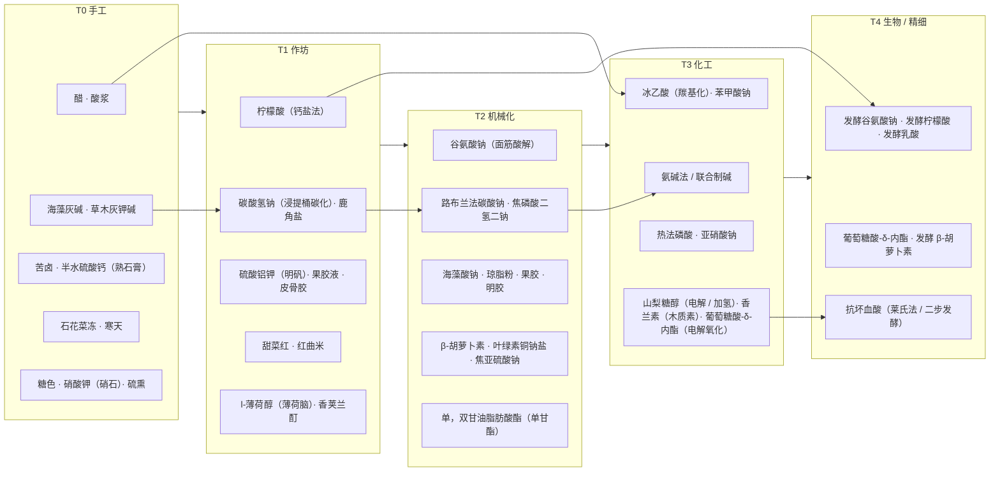

# 11 科技树、后续批次与待定问题

## 科技树

第一批 30 项按“最早可用阶段”排开（第二、三批见“批次总览”），箭头表示解锁关系（前一阶段的产物或机器是后一阶段的前置）。

### 阶段门槛（建议）

| 进入阶段 | 关键前置 | 关键新能力 |
| --- | --- | --- |
| T1 | 陶器、铁锅、木桶、土窑结构 | 燃料加热、批量浸提与煅烧 |
| T2 | 铜 / 铁机械件、首台 FE 发电 | 连续搅拌反应、压滤、真空蒸发、气体吸收 |
| T3 | 钢、耐酸内衬、高压容器 | 精馏、加氢、电解、电弧炉 |
| T4 | 不锈钢、无菌密封件、菌种工作台 | 深层通气发酵、膜分离、冷冻干燥 |

## 批次总览

| 批次 | 编号 | 项数 | 文档 | 重点 | 新增工艺 / 机器 |
| --- | --- | --- | --- | --- | --- |
| 第一批 | 1–30 | 30 | [03](03-first-batch.md)、[04](04-production-routes.md) | 覆盖主要功能类别，T0–T4 每阶段都有产物 | P01–P56；M01–M31（合并后 29 台）；H01–H13 |
| 第二批 | 31–78 | 48 | [13](13-batch-2.md) | 补齐常用防腐剂、甜味剂、增稠剂、磷酸盐、天然色素、乳化剂；石化线起步 | P57–P65；M27 裂解模式、M18 超临界模块；H14 |
| 第三批 | 79–139 | 61 | [14](14-batch-3.md) | 合成色素、高倍甜味剂、合成抗氧化剂；酶制剂、营养强化剂、香料、胶基四份专项名单 | P66–P79；M14 聚合模式与紫外灯模块、M21 密炼转子；H15 |

阶段分布（按最早可用阶段）：第二批 T0 5 项、T1 6 项、T2 12 项、T3 18 项、T4 7 项；第三批以 T3、T4 为主，T0–T1 只有植物靛、鱼肝油、植物蛋白酶、麦芽、天然精油、天然橡胶等传统做法。

### 第四批候选（未设计）

| 类别 | 品种 |
| --- | --- |
| 天然色素 | 叶黄素、紫胶红、胭脂虫红、花青素类（紫甘薯色素等）、栀子蓝、藻蓝、可可壳色、红曲黄 |
| 防腐剂 | 对羟基苯甲酸酯类、ε-聚赖氨酸、溶菌酶 |
| 抗氧化剂 | 抗坏血酸棕榈酸酯、植酸、甘草抗氧化物 |
| 增稠剂 | 阿拉伯胶、瓜尔胶、刺槐豆胶、魔芋胶、海藻酸丙二醇酯、可得然胶 |
| 被膜剂 | 紫胶（虫胶）、巴西棕榈蜡、石蜡 |
| 加工助剂 | 附录 C 表 C.1、C.2 中的溶剂、消泡剂、助滤剂、脱色剂（多数已作为中间体存在，补齐物品与说明） |
| 维生素与矿物质 | 维生素 B12、维生素 K、生物素、硒、碘化钾等（以 GB 14880 现行版本为准） |

## 待定问题

| # | 问题 | 选项 / 建议 |
| --- | --- | --- |
| 1 | 法规最大使用量做硬限制还是提示 | 建议：提示 + 超量产生负面效果（如亚硝酸盐中毒），不阻止合成 |
| 2 | 计量体系 | 建议沿用 GTCEu 习惯：1 份 = 1 个粉 = 1000 mB，配方按化学计量比写（见 09） |
| 3 | T2 动力 | 只用 FE，还是同时接受机械动力应力 / 蒸汽 |
| 4 | 贵金属与过渡金属催化剂来源 | **已定（2026-11-04）**：铑、铂、钒、钴、钯、钨由其他模组提供，配方按标签匹配；本模组注册全部催化剂物品（见 08 §C 催化剂与助剂） |
| 5 | 有毒物料与泄漏 | 氢氰酸、氯气、SO2、NOx 是否做泄漏伤害；是否只把氢氰酸路线保留为可选 |
| 6 | 低纯度能否做食品 | 允许用劣质、粗制、精制添加剂做“土法食品”（效果减弱或有副作用），还是一律要求食品级 |
| 7 | 联动机器纯度 | 按 10 第 7 节的设备档次计算固定值，还是全部开放给配置 |
| 8 | 海水获取 | 只在海洋 / 海滩群系取，还是任何水源加盐 |
| 9 | GTCEu | 作为可选依赖共用材料（见 09），还是只做化学式文本对照 |
| 10 | 季节 | 是否读取季节模组（如 Serene Seasons），让晒盐、冻融、制曲受季节影响 |
| 11 | 混用限量 | GB 2760 附录 A 第 A.4 条：相同色泽着色剂、防腐剂、抗氧化剂混用时比例之和不超过 1。建议成品配方校验时按此累加，与问题 1 一并处理 |
| 12 | 标签强制声明 | 天门冬酰苯丙氨酸甲酯（阿斯巴甜）须标注含苯丙氨酸。建议成品 Tooltip 增加固定提示行，规则写入文本规范 |
| 13 | 煤焦油芳烃来源 | 苯、萘、甲酚来自 M07 干馏与 M27 裂解。安装 GTCEu、通用机械等时，是否直接接受其苯、萘流体（标签导入，按外部物品计） |
| 14 | 版本节点的依赖差异 | 热力系列只在 1.20.1 节点，农夫乐事在 26.1.2 节点暂缺。依赖它们的原料（硫、镍、锡、银、铅、乳胶、松脂、树皮、稻米）在其他节点需要本模组的后备来源（矿石、作物或替代配方），按节点用数据生成输出。**已定（2026-11-04）**：只做硫矿石、磷灰石矿石（未装热力时生成）和稻谷、树皮（未装农夫乐事时生成或掉落）；镍、锡、银、铅不做后备，依赖其他模组；乳胶、松脂由本模组橡胶树与 H15 割取提供；后备物品在各节点都注册，按是否装有对应模组在运行时启用，配置文件可强制启用（见 08 §C、I07） |
| 15 | 纯度档位的叫法 | **已定（2026-11-04）**：“食品级”作为特例保留原名；药物、日化品等其他领域沿用同一套五档名称，界限按物料类别给出，不另设别名 |
| 16 | 手工反复精制 | H03 锅上的重结晶可反复做：海盐、硝石各 3 次即达食品级，原料消耗 8 倍。是否给手工配方加上限（`max`） |
| 17 | 默认去除比例 | ../machines/01 第 1.1 节按配方类型给出的 50%、75%、90%、99% 为游戏设定；数据生成报表出来后，与 03、13、14 的“食品级档次”对照调整 |
| 18 | 色价类天然色素 | 辣椒红、栀子黄、红曲红、甜菜红的界限暂定 1% / 5% / 10% / 50%（10 第 1.5 节），是否改为按色价折算 |
| 19 | 加权平均的计量 | 起点纯度按数量加权时 1 个物品折合 1,000 mB（与第 2 条一致），是否改按物料实际质量 |
