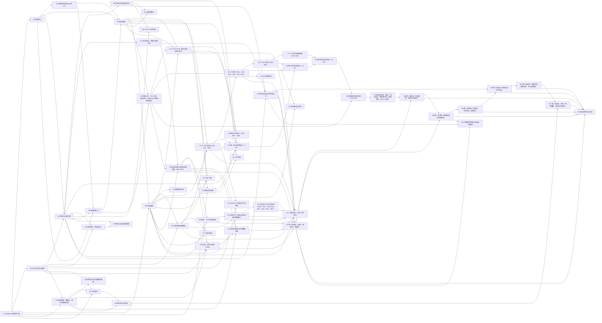

# 实装计划

> 设计文档写“做成什么样”，实装计划写“按什么顺序做、做到什么程度算完成”。计划不重复设计细节：每条任务都链接到原文档的具体一节，实现时以原文档为准。设计改动后，按下方“设计文档 → 计划”对照表找到受影响的计划并更新。

## 使用规则

1. **一份计划对应一个子系统或一批内容。** 编号从 I01 起递增，不复用；文件名为 `I<NN>-<英文短名>.md`。
2. **表头是唯一的状态来源。** 状态（未开始 / 进行中 / 已完成 / 搁置 / 阻塞）、阶段、依赖、原文档都写在每份计划开头的表里；本页的索引、对照表、依赖图由 `plan.py index` 从表头生成，不手改。
3. **引用原文档写成 `[文件 §节](相对路径)`**，节号或节标题与原文档一致，例如 [additives/10 §2.1](../additives/10-purity-jei-ae2.md)。
4. **验收至少包含三节点编译与 platform 自检**（[CONVENTIONS §7](../../CONVENTIONS.md)）。
5. **任务完成就勾选**；整份计划验收通过后把状态改为“已完成”，再运行 `plan.py index`。
6. **不确定的内容不臆测**：执行计划时遇到不确定的问题，按 [CONVENTIONS §8](../../CONVENTIONS.md) 先求证或向用户提问，结论写回原文档，再更新计划；等待期间把受影响的任务标为“待确认”。
7. **开发中无法完整验证的项**经用户同意后移入[最终验收测试](../final-acceptance.md)，项目完成后先由 Claude 测、再由玩家测；计划里写明已移入。

## 阶段与里程碑

| 阶段 | 内容 |
| --- | --- |
| A 基础 | 版本适配层、纯度、纯度原料、文本 |
| B 物料 | 物料与流体注册、标签、世界生成 |
| C 框架 | 配方框架、机器框架、界面、物流方块 |
| D 设备 | T0 工具与世界交互、原版设备、T1–T4 机器 |
| E 内容 | 三批添加剂、成品 |
| F 联动与验证 | JEI、Patchouli、AE2、他模组、GTCEu、性能 |

| 里程碑 | 包含的计划 | 完成标志 |
| --- | --- | --- |
| M-A 框架可运行 | I01–I04、I08、I09、I28 | M11 粉碎机样例在三个节点上运行配方、被漏斗自动化，性能规范逐条落实 |
| M-B 第一批可玩 | I05–I07、I10、I12–I14、I18、I22 | 第一批 30 项在 T0–T1 可做，JEI 可查 |
| M-C 工业线 | I11、I15–I17、I19、I24 | 第二批可做，AE2 自动化测试通过 |
| M-D 全内容与联动 | I20、I21、I23、I25–I27 | 第三批、成品名称、手册、联动、性能基准完成 |
| M-E 第四、五批 | I30、I31 | 第四批中原料齐全的路线都能做出；第五批 424–584 与香料 1,845 条按 17–19 能做出（11 问题 34 涉及的条目除外） |
| M-F 代谢 | I34–I36 | 吃喝原版与农夫乐事的食物计入代谢，各档效果、配置与显示在三个节点生效 |
| M-G 成品线框架与设备 | I38–I43 | R20–R29 与 W03 注册并能跑；七台 T1、九台 T2 机组与两台海水泵在三个节点跑通样例配方；模具与容器齐备 |
| M-H 成品内容与营养 | I44–I53 | 330 种成品在设计写明的最早档次都做得出；原料来源六类生成到位；每份营养与代谢成分（营养素 7 种）的数据齐全 |
| M-I 成品线联动与验收 | I54 | JEI、手册、Jade、AE2 覆盖成品线；覆盖报表无缺项、性能基准达标，试玩项移入最终验收测试 |

## 计划索引

<!-- plan-index:start -->
| 编号 | 计划 | 阶段 | 状态 | 依赖 |
| --- | --- | --- | --- | --- |
| [I01](I01-platform-api.md) | platform 适配层扩展 | A 基础 | 已完成 | — |
| [I02](I02-purity-core.md) | 纯度核心 | A 基础 | 已完成 | I01 |
| [I03](I03-purity-ingredients.md) | 纯度原料类型与对外 API | A 基础 | 已完成 | I02 |
| [I04](I04-text-and-lang.md) | 文本与本地化基础 | A 基础 | 已完成 | I01 |
| [I05](I05-materials-registry.md) | 物料与流体注册 | B 物料 | 已完成 | I02、I04 |
| [I06](I06-tags-and-external-rules.md) | 标签与外部物品规则 | B 物料 | 已完成 | I05 |
| [I07](I07-worldgen-and-crops.md) | 世界生成、作物与采集方块 | B 物料 | 已完成 | I05 |
| [I08](I08-recipe-framework.md) | 配方框架 | C 框架 | 已完成 | I02、I03、I28 |
| [I09](I09-machine-framework.md) | 机器框架 | C 框架 | 已完成 | I01、I08 |
| [I10](I10-machine-gui.md) | 机器界面与配置器 | C 框架 | 已完成 | I09、I04 |
| [I11](I11-logistics-blocks.md) | 辅助物流方块 | C 框架 | 已完成 | I09 |
| [I12](I12-t0-manual-devices.md) | T0 手工工具、被动设备与世界交互 | D 设备 | 进行中 | I08、I09、I07、I29 |
| [I13](I13-vanilla-device-bridge.md) | 原版设备桥接 | D 设备 | 进行中 | I08、I01 |
| [I14](I14-machines-t1.md) | T1 作坊机器（M01–M10、M54） | D 设备 | 进行中 | I09、I10、I08 |
| [I15](I15-machines-t2.md) | T2 机器（M11、M12、M14、M15、M17–M21） | D 设备 | 进行中 | I14、I29 |
| [I16](I16-machines-t3.md) | T3 化工机器（M22–M28） | D 设备 | 已完成 | I15 |
| [I17](I17-machines-t4.md) | T4 生物与精细机器（M29–M31） | D 设备 | 进行中 | I16 |
| [I18](I18-content-batch-1.md) | 第一批添加剂内容（1–30） | E 内容 | 已完成 | I05、I06、I12、I13、I14 |
| [I19](I19-content-batch-2.md) | 第二批添加剂内容（31–78） | E 内容 | 已完成 | I18、I15、I16 |
| [I20](I20-content-batch-3.md) | 第三批添加剂内容（79–139） | E 内容 | 已完成 | I19、I17 |
| [I21](I21-finished-products.md) | 成品物品（名称阶段） | E 内容 | 已完成 | I05、I04 |
| [I22](I22-jei.md) | JEI 集成 | F 联动与验证 | 已完成 | I08、I13、I14 |
| [I23](I23-patchouli.md) | Patchouli 手册与多方块预览 | F 联动与验证 | 已完成 | I14、I04 |
| [I24](I24-ae2.md) | AE2 兼容验证 | F 联动与验证 | 已完成 | I15 |
| [I25](I25-mod-integrations.md) | 他模组联动 | F 联动与验证 | 已完成 | I06、I08 |
| [I26](I26-gtceu.md) | GTCEu 材料联动 | F 联动与验证 | 已完成 | I05、I06 |
| [I27](I27-performance.md) | 性能基准与回归 | F 联动与验证 | 已完成 | I09、I16 |
| [I28](I28-purity-model-v2.md) | 纯度模型 v2 | A 基础 | 已完成 | I02、I03、I05 |
| [I29](I29-purity-caps-compound.md) | 纯度补充：手工上限、复配产品、规范化与不带纯度的物料 | A 基础 | 已完成 | I28、I08 |
| [I30](I30-content-batch-4.md) | 第四批添加剂内容（140–423） | E 内容 | 已完成 | I20、I29 |
| [I31](I31-content-batch-5.md) | 第五批内容（香料、加工助剂、营养强化剂、胶基物质、表 A.1 补漏） | E 内容 | 已完成 | I30 |
| [I32](I32-jade.md) | Jade 显示 | F 联动与验证 | 已完成 | I09、I10、I12 |
| [I33](I33-chemical-textures.md) | 物料与成品贴图重制 | B 物料 | 进行中 | I05、I21 |
| [I34](I34-nutrition-data.md) | 营养数据：数据包、命令与数据生成 | E 内容 | 已完成 | I01、I04 |
| [I35](I35-metabolism.md) | 代谢系统 | E 内容 | 进行中 | I34、I01、I04 |
| [I36](I36-vanilla-nutrition.md) | 原版与农夫乐事营养数据 | E 内容 | 已完成 | I34 |
| [I37](I37-immersive-display.md) | 沉浸式展示 | C 框架 | 已完成 | I09、I10 |
| [I38](I38-food-recipe-types.md) | 成品线配方类型与两段模型（R20–R29） | C 框架 | 已完成 | I08、I09、I29 |
| [I39](I39-food-quality.md) | 品质、标签与成品 Tooltip | C 框架 | 已完成 | I38、I04、I34 |
| [I40](I40-molds-and-containers.md) | 模具、工具与容器包装 | B 物料 | 已完成 | I05、I38 |
| [I41](I41-food-machines-t1.md) | 成品线 T1 设备与现有设备的新增能力 | D 设备 | 进行中 | I38、I40、I09、I10 |
| [I42](I42-food-machines-t2.md) | 成品线 T2 多方块机组（M39、M40、M43–M45、M47、M49、M51、M53） | D 设备 | 进行中 | I41 |
| [I43](I43-seawater-pumps.md) | 海水泵与取水（H16、M54、W03） | D 设备 | 已完成 | I12、I14 |
| [I44](I44-ingredient-sources.md) | 原料来源与世界生成补齐 | B 物料 | 进行中 | I05、I06、I07 |
| [I45](I45-food-nutrition-generation.md) | 成品的营养与代谢数据生成 | E 内容 | 已完成 | I34、I38、I39 |
| [I46](I46-vitamins-and-minerals.md) | 维生素与矿物质 | E 内容 | 已完成 | I34、I35 |
| [I47](I47-food-batch-1.md) | 第 1 批成品（油脂、甜味料、调味品） | E 内容 | 已完成 | I38、I39、I40、I41、I42、I44、I45 |
| [I47.5](I47.5-machine-slots.md) | 槽位修订：放不下的配方 | C 框架 | 已完成 | I09、I10、I12、I14、I15、I41、I42 |
| [I48](I48-food-batch-2.md) | 第 2 批内容（风味类型、香精与风味组） | E 内容 | 已完成 | I47、I31 |
| [I49](I49-food-batch-3.md) | 第 3 批成品（粮食制品与焙烤食品） | E 内容 | 已完成 | I47、I48 |
| [I50](I50-food-batch-4.md) | 第 4 批成品（乳制品、冷冻饮品、蛋制品） | E 内容 | 未开始 | I49 |
| [I51](I51-food-batch-5.md) | 第 5 批成品（肉制品与水产制品） | E 内容 | 未开始 | I50、I44 |
| [I52](I52-food-batch-6.md) | 第 6 批成品（果蔬豆类菌藻坚果、可可与糖果） | E 内容 | 未开始 | I51 |
| [I53](I53-food-batch-7.md) | 第 7 批成品（饮料、特殊膳食、酒类与其他类） | E 内容 | 未开始 | I52、I46 |
| [I54](I54-food-integrations.md) | 成品线联动与验收 | F 联动与验证 | 未开始 | I47、I48、I49、I50、I51、I52、I53 |
| [I55](I55-own-sources.md) | 本模组后备原料与提前的黄酒 | B 物料 | 已完成 | I44、I47、I49 |
<!-- plan-index:end -->

## 设计文档 → 计划

设计文档改动时，先在这里找到引用它的计划，逐个检查任务和验收是否需要更新。

<!-- doc-map:start -->
| 设计文档 | 引用它的计划 |
| --- | --- |
| [CONVENTIONS.md](../../CONVENTIONS.md) | [I01](I01-platform-api.md)、[I02](I02-purity-core.md)、[I03](I03-purity-ingredients.md)、[I04](I04-text-and-lang.md)、[I05](I05-materials-registry.md)、[I06](I06-tags-and-external-rules.md)、[I07](I07-worldgen-and-crops.md)、[I08](I08-recipe-framework.md)、[I09](I09-machine-framework.md)、[I10](I10-machine-gui.md)、[I11](I11-logistics-blocks.md)、[I12](I12-t0-manual-devices.md)、[I13](I13-vanilla-device-bridge.md)、[I14](I14-machines-t1.md)、[I15](I15-machines-t2.md)、[I16](I16-machines-t3.md)、[I17](I17-machines-t4.md)、[I22](I22-jei.md)、[I23](I23-patchouli.md)、[I24](I24-ae2.md)、[I25](I25-mod-integrations.md)、[I26](I26-gtceu.md)、[I27](I27-performance.md)、[I28](I28-purity-model-v2.md)、[I29](I29-purity-caps-compound.md)、[I30](I30-content-batch-4.md)、[I31](I31-content-batch-5.md)、[I32](I32-jade.md)、[I33](I33-chemical-textures.md)、[I34](I34-nutrition-data.md)、[I35](I35-metabolism.md)、[I37](I37-immersive-display.md)、[I38](I38-food-recipe-types.md)、[I39](I39-food-quality.md)、[I40](I40-molds-and-containers.md)、[I41](I41-food-machines-t1.md)、[I42](I42-food-machines-t2.md)、[I43](I43-seawater-pumps.md)、[I44](I44-ingredient-sources.md)、[I45](I45-food-nutrition-generation.md)、[I46](I46-vitamins-and-minerals.md)、[I47](I47-food-batch-1.md)、[I47.5](I47.5-machine-slots.md)、[I48](I48-food-batch-2.md)、[I49](I49-food-batch-3.md)、[I50](I50-food-batch-4.md)、[I51](I51-food-batch-5.md)、[I52](I52-food-batch-6.md)、[I53](I53-food-batch-7.md)、[I54](I54-food-integrations.md)、[I55](I55-own-sources.md) |
| [docs/additives/02-gb2760-additive-list.md](../additives/02-gb2760-additive-list.md) | [I18](I18-content-batch-1.md)、[I19](I19-content-batch-2.md)、[I20](I20-content-batch-3.md)、[I21](I21-finished-products.md) |
| [docs/additives/03-first-batch.md](../additives/03-first-batch.md) | [I18](I18-content-batch-1.md) |
| [docs/additives/04-production-routes.md](../additives/04-production-routes.md) | [I18](I18-content-batch-1.md)、[I30](I30-content-batch-4.md)、[I31](I31-content-batch-5.md) |
| [docs/additives/05-processes.md](../additives/05-processes.md) | [I18](I18-content-batch-1.md)、[I19](I19-content-batch-2.md)、[I20](I20-content-batch-3.md)、[I30](I30-content-batch-4.md)、[I31](I31-content-batch-5.md) |
| [docs/additives/06-machines.md](../additives/06-machines.md) | [I14](I14-machines-t1.md)、[I15](I15-machines-t2.md)、[I16](I16-machines-t3.md)、[I17](I17-machines-t4.md)、[I23](I23-patchouli.md)、[I25](I25-mod-integrations.md)、[I30](I30-content-batch-4.md)、[I31](I31-content-batch-5.md)、[I43](I43-seawater-pumps.md) |
| [docs/additives/07-manual-crafting.md](../additives/07-manual-crafting.md) | [I07](I07-worldgen-and-crops.md)、[I12](I12-t0-manual-devices.md)、[I13](I13-vanilla-device-bridge.md)、[I14](I14-machines-t1.md)、[I18](I18-content-batch-1.md)、[I19](I19-content-batch-2.md)、[I20](I20-content-batch-3.md)、[I23](I23-patchouli.md)、[I28](I28-purity-model-v2.md)、[I29](I29-purity-caps-compound.md)、[I43](I43-seawater-pumps.md)、[I44](I44-ingredient-sources.md)、[I47.5](I47.5-machine-slots.md) |
| [docs/additives/08-raw-materials.md](../additives/08-raw-materials.md) | [I05](I05-materials-registry.md)、[I06](I06-tags-and-external-rules.md)、[I07](I07-worldgen-and-crops.md)、[I08](I08-recipe-framework.md)、[I17](I17-machines-t4.md)、[I18](I18-content-batch-1.md)、[I19](I19-content-batch-2.md)、[I20](I20-content-batch-3.md)、[I25](I25-mod-integrations.md)、[I28](I28-purity-model-v2.md)、[I29](I29-purity-caps-compound.md)、[I30](I30-content-batch-4.md)、[I31](I31-content-batch-5.md)、[I33](I33-chemical-textures.md)、[I43](I43-seawater-pumps.md)、[I44](I44-ingredient-sources.md)、[I48](I48-food-batch-2.md) |
| [docs/additives/09-chemical-formulas.md](../additives/09-chemical-formulas.md) | [I05](I05-materials-registry.md)、[I18](I18-content-batch-1.md)、[I19](I19-content-batch-2.md)、[I20](I20-content-batch-3.md)、[I26](I26-gtceu.md)、[I28](I28-purity-model-v2.md)、[I29](I29-purity-caps-compound.md)、[I30](I30-content-batch-4.md)、[I31](I31-content-batch-5.md)、[I33](I33-chemical-textures.md)、[I47](I47-food-batch-1.md) |
| [docs/additives/10-purity-jei-ae2.md](../additives/10-purity-jei-ae2.md) | [I01](I01-platform-api.md)、[I02](I02-purity-core.md)、[I03](I03-purity-ingredients.md)、[I05](I05-materials-registry.md)、[I06](I06-tags-and-external-rules.md)、[I08](I08-recipe-framework.md)、[I09](I09-machine-framework.md)、[I12](I12-t0-manual-devices.md)、[I17](I17-machines-t4.md)、[I18](I18-content-batch-1.md)、[I19](I19-content-batch-2.md)、[I20](I20-content-batch-3.md)、[I21](I21-finished-products.md)、[I22](I22-jei.md)、[I23](I23-patchouli.md)、[I24](I24-ae2.md)、[I25](I25-mod-integrations.md)、[I26](I26-gtceu.md)、[I28](I28-purity-model-v2.md)、[I29](I29-purity-caps-compound.md)、[I30](I30-content-batch-4.md)、[I31](I31-content-batch-5.md)、[I54](I54-food-integrations.md) |
| [docs/additives/11-roadmap.md](../additives/11-roadmap.md) | [I05](I05-materials-registry.md)、[I06](I06-tags-and-external-rules.md)、[I07](I07-worldgen-and-crops.md)、[I09](I09-machine-framework.md)、[I11](I11-logistics-blocks.md)、[I15](I15-machines-t2.md)、[I16](I16-machines-t3.md)、[I18](I18-content-batch-1.md)、[I19](I19-content-batch-2.md)、[I20](I20-content-batch-3.md)、[I21](I21-finished-products.md)、[I28](I28-purity-model-v2.md)、[I30](I30-content-batch-4.md)、[I31](I31-content-batch-5.md)、[I34](I34-nutrition-data.md)、[I35](I35-metabolism.md)、[I44](I44-ingredient-sources.md)、[I51](I51-food-batch-5.md) |
| [docs/additives/12-finished-products.md](../additives/12-finished-products.md) | [I21](I21-finished-products.md)、[I30](I30-content-batch-4.md)、[I33](I33-chemical-textures.md) |
| [docs/additives/13-batch-2.md](../additives/13-batch-2.md) | [I19](I19-content-batch-2.md)、[I31](I31-content-batch-5.md) |
| [docs/additives/14-batch-3.md](../additives/14-batch-3.md) | [I20](I20-content-batch-3.md)、[I31](I31-content-batch-5.md) |
| [docs/additives/15-batch-4.md](../additives/15-batch-4.md) | [I15](I15-machines-t2.md)、[I16](I16-machines-t3.md)、[I17](I17-machines-t4.md)、[I19](I19-content-batch-2.md)、[I20](I20-content-batch-3.md)、[I30](I30-content-batch-4.md)、[I31](I31-content-batch-5.md) |
| [docs/additives/16-batch-5-backlog.md](../additives/16-batch-5-backlog.md) | [I31](I31-content-batch-5.md) |
| [docs/additives/17-batch-5.md](../additives/17-batch-5.md) | [I31](I31-content-batch-5.md) |
| [docs/additives/18-batch-5-flavors.md](../additives/18-batch-5-flavors.md) | [I30](I30-content-batch-4.md)、[I31](I31-content-batch-5.md) |
| [docs/additives/19-batch-5-synthetic-flavors.md](../additives/19-batch-5-synthetic-flavors.md) | [I31](I31-content-batch-5.md) |
| [docs/additives/README.md](../additives/README.md) | [I30](I30-content-batch-4.md) |
| [docs/final-acceptance.md](../final-acceptance.md) | [I24](I24-ae2.md)、[I35](I35-metabolism.md)、[I54](I54-food-integrations.md) |
| [docs/foods/01-overview.md](../foods/01-overview.md) | [I34](I34-nutrition-data.md)、[I35](I35-metabolism.md)、[I39](I39-food-quality.md)、[I54](I54-food-integrations.md) |
| [docs/foods/02-metabolism.md](../foods/02-metabolism.md) | [I34](I34-nutrition-data.md)、[I35](I35-metabolism.md)、[I39](I39-food-quality.md)、[I45](I45-food-nutrition-generation.md)、[I46](I46-vitamins-and-minerals.md)、[I47](I47-food-batch-1.md)、[I54](I54-food-integrations.md) |
| [docs/foods/03-nutrition-data.md](../foods/03-nutrition-data.md) | [I34](I34-nutrition-data.md)、[I35](I35-metabolism.md)、[I36](I36-vanilla-nutrition.md)、[I45](I45-food-nutrition-generation.md)、[I46](I46-vitamins-and-minerals.md) |
| [docs/foods/04-quality.md](../foods/04-quality.md) | [I38](I38-food-recipe-types.md)、[I39](I39-food-quality.md)、[I45](I45-food-nutrition-generation.md)、[I47](I47-food-batch-1.md)、[I48](I48-food-batch-2.md)、[I49](I49-food-batch-3.md)、[I50](I50-food-batch-4.md)、[I51](I51-food-batch-5.md)、[I52](I52-food-batch-6.md)、[I53](I53-food-batch-7.md) |
| [docs/foods/05-equipment.md](../foods/05-equipment.md) | [I38](I38-food-recipe-types.md)、[I39](I39-food-quality.md)、[I40](I40-molds-and-containers.md)、[I41](I41-food-machines-t1.md)、[I42](I42-food-machines-t2.md)、[I47](I47-food-batch-1.md)、[I47.5](I47.5-machine-slots.md)、[I54](I54-food-integrations.md) |
| [docs/foods/07-machine-basic-design.md](../foods/07-machine-basic-design.md) | [I38](I38-food-recipe-types.md)、[I41](I41-food-machines-t1.md)、[I42](I42-food-machines-t2.md) |
| [docs/foods/08-recipe-format-and-intermediates.md](../foods/08-recipe-format-and-intermediates.md) | [I38](I38-food-recipe-types.md)、[I44](I44-ingredient-sources.md)、[I47](I47-food-batch-1.md)、[I48](I48-food-batch-2.md)、[I49](I49-food-batch-3.md)、[I50](I50-food-batch-4.md)、[I51](I51-food-batch-5.md)、[I52](I52-food-batch-6.md)、[I53](I53-food-batch-7.md)、[I55](I55-own-sources.md) |
| [docs/foods/09-batch1-fats-sweeteners.md](../foods/09-batch1-fats-sweeteners.md) | [I45](I45-food-nutrition-generation.md)、[I47](I47-food-batch-1.md)、[I47.5](I47.5-machine-slots.md) |
| [docs/foods/10-batch1-condiments.md](../foods/10-batch1-condiments.md) | [I45](I45-food-nutrition-generation.md)、[I47](I47-food-batch-1.md)、[I47.5](I47.5-machine-slots.md) |
| [docs/foods/11-batch2-flavorings.md](../foods/11-batch2-flavorings.md) | [I48](I48-food-batch-2.md) |
| [docs/foods/12-flavor-groups.md](../foods/12-flavor-groups.md) | [I48](I48-food-batch-2.md) |
| [docs/foods/13-batch3-grain-products.md](../foods/13-batch3-grain-products.md) | [I44](I44-ingredient-sources.md)、[I45](I45-food-nutrition-generation.md)、[I49](I49-food-batch-3.md) |
| [docs/foods/14-batch3-bakery.md](../foods/14-batch3-bakery.md) | [I45](I45-food-nutrition-generation.md)、[I49](I49-food-batch-3.md) |
| [docs/foods/15-batch4-dairy.md](../foods/15-batch4-dairy.md) | [I40](I40-molds-and-containers.md)、[I45](I45-food-nutrition-generation.md)、[I49](I49-food-batch-3.md)、[I50](I50-food-batch-4.md) |
| [docs/foods/16-batch4-frozen-eggs.md](../foods/16-batch4-frozen-eggs.md) | [I45](I45-food-nutrition-generation.md)、[I50](I50-food-batch-4.md) |
| [docs/foods/17-batch5-meat.md](../foods/17-batch5-meat.md) | [I44](I44-ingredient-sources.md)、[I45](I45-food-nutrition-generation.md)、[I51](I51-food-batch-5.md) |
| [docs/foods/18-batch5-aquatic.md](../foods/18-batch5-aquatic.md) | [I45](I45-food-nutrition-generation.md)、[I51](I51-food-batch-5.md) |
| [docs/foods/19-batch6-produce.md](../foods/19-batch6-produce.md) | [I45](I45-food-nutrition-generation.md)、[I52](I52-food-batch-6.md) |
| [docs/foods/20-batch6-confectionery.md](../foods/20-batch6-confectionery.md) | [I41](I41-food-machines-t1.md)、[I45](I45-food-nutrition-generation.md)、[I52](I52-food-batch-6.md) |
| [docs/foods/21-batch7-beverages.md](../foods/21-batch7-beverages.md) | [I44](I44-ingredient-sources.md)、[I45](I45-food-nutrition-generation.md)、[I53](I53-food-batch-7.md) |
| [docs/foods/22-batch7-alcohol-snacks.md](../foods/22-batch7-alcohol-snacks.md) | [I38](I38-food-recipe-types.md)、[I45](I45-food-nutrition-generation.md)、[I47.5](I47.5-machine-slots.md)、[I53](I53-food-batch-7.md)、[I55](I55-own-sources.md) |
| [docs/foods/23-own-sources.md](../foods/23-own-sources.md) | [I35](I35-metabolism.md)、[I47](I47-food-batch-1.md)、[I55](I55-own-sources.md) |
| [docs/foods/agents/food-nutrition-data.md](../foods/agents/food-nutrition-data.md) | [I34](I34-nutrition-data.md)、[I36](I36-vanilla-nutrition.md) |
| [docs/machines/01-recipe-types.md](../machines/01-recipe-types.md) | [I08](I08-recipe-framework.md)、[I12](I12-t0-manual-devices.md)、[I13](I13-vanilla-device-bridge.md)、[I14](I14-machines-t1.md)、[I15](I15-machines-t2.md)、[I16](I16-machines-t3.md)、[I17](I17-machines-t4.md)、[I18](I18-content-batch-1.md)、[I19](I19-content-batch-2.md)、[I20](I20-content-batch-3.md)、[I21](I21-finished-products.md)、[I22](I22-jei.md)、[I24](I24-ae2.md)、[I28](I28-purity-model-v2.md)、[I29](I29-purity-caps-compound.md)、[I30](I30-content-batch-4.md)、[I31](I31-content-batch-5.md)、[I38](I38-food-recipe-types.md)、[I43](I43-seawater-pumps.md) |
| [docs/machines/02-architecture.md](../machines/02-architecture.md) | [I01](I01-platform-api.md)、[I05](I05-materials-registry.md)、[I08](I08-recipe-framework.md)、[I09](I09-machine-framework.md)、[I10](I10-machine-gui.md)、[I12](I12-t0-manual-devices.md)、[I13](I13-vanilla-device-bridge.md)、[I14](I14-machines-t1.md)、[I15](I15-machines-t2.md)、[I16](I16-machines-t3.md)、[I17](I17-machines-t4.md)、[I23](I23-patchouli.md)、[I27](I27-performance.md)、[I34](I34-nutrition-data.md)、[I35](I35-metabolism.md)、[I37](I37-immersive-display.md) |
| [docs/machines/03-io-layout.md](../machines/03-io-layout.md) | [I01](I01-platform-api.md)、[I05](I05-materials-registry.md)、[I08](I08-recipe-framework.md)、[I09](I09-machine-framework.md)、[I10](I10-machine-gui.md)、[I11](I11-logistics-blocks.md)、[I14](I14-machines-t1.md)、[I15](I15-machines-t2.md)、[I16](I16-machines-t3.md)、[I17](I17-machines-t4.md)、[I41](I41-food-machines-t1.md)、[I42](I42-food-machines-t2.md)、[I47.5](I47.5-machine-slots.md)、[I49](I49-food-batch-3.md) |
| [docs/machines/04-gui.md](../machines/04-gui.md) | [I01](I01-platform-api.md)、[I04](I04-text-and-lang.md)、[I09](I09-machine-framework.md)、[I10](I10-machine-gui.md)、[I11](I11-logistics-blocks.md)、[I14](I14-machines-t1.md)、[I15](I15-machines-t2.md)、[I22](I22-jei.md)、[I32](I32-jade.md)、[I37](I37-immersive-display.md)、[I47.5](I47.5-machine-slots.md) |
| [docs/machines/05-final-design.md](../machines/05-final-design.md) | [I12](I12-t0-manual-devices.md)、[I13](I13-vanilla-device-bridge.md)、[I14](I14-machines-t1.md)、[I15](I15-machines-t2.md)、[I17](I17-machines-t4.md)、[I38](I38-food-recipe-types.md)、[I40](I40-molds-and-containers.md)、[I41](I41-food-machines-t1.md)、[I42](I42-food-machines-t2.md)、[I47](I47-food-batch-1.md)、[I47.5](I47.5-machine-slots.md)、[I48](I48-food-batch-2.md)、[I49](I49-food-batch-3.md)、[I50](I50-food-batch-4.md)、[I51](I51-food-batch-5.md)、[I52](I52-food-batch-6.md)、[I53](I53-food-batch-7.md)、[I54](I54-food-integrations.md) |
| [docs/tag-names.md](../tag-names.md) | [I54](I54-food-integrations.md) |
| [docs/text-standard.md](../text-standard.md) | [I01](I01-platform-api.md)、[I02](I02-purity-core.md)、[I04](I04-text-and-lang.md)、[I05](I05-materials-registry.md)、[I08](I08-recipe-framework.md)、[I14](I14-machines-t1.md)、[I15](I15-machines-t2.md)、[I16](I16-machines-t3.md)、[I22](I22-jei.md)、[I23](I23-patchouli.md)、[I28](I28-purity-model-v2.md)、[I31](I31-content-batch-5.md)、[I34](I34-nutrition-data.md)、[I35](I35-metabolism.md)、[I38](I38-food-recipe-types.md)、[I39](I39-food-quality.md)、[I40](I40-molds-and-containers.md)、[I43](I43-seawater-pumps.md)、[I44](I44-ingredient-sources.md)、[I46](I46-vitamins-and-minerals.md)、[I54](I54-food-integrations.md) |
| [docs/texture-requirements.md](../texture-requirements.md) | [I37](I37-immersive-display.md)、[I40](I40-molds-and-containers.md)、[I41](I41-food-machines-t1.md)、[I42](I42-food-machines-t2.md)、[I43](I43-seawater-pumps.md)、[I44](I44-ingredient-sources.md)、[I55](I55-own-sources.md) |
| [tools/foods/nutrition/README.md](../../tools/foods/nutrition/README.md) | [I45](I45-food-nutrition-generation.md) |
<!-- doc-map:end -->

## 依赖图

<!-- dep-graph:start -->

<!-- dep-graph:end -->

## 新建计划

用 `plan.py`（只需 Python 3 标准库）：

```powershell
# 新一批内容：按内容模板生成 I28-content-batch-4.md，并重建本页索引
python docs\implementations\plan.py new content-batch-4 "第四批添加剂内容" --kind content --stage "E 内容" --deps I20 --docs ../additives/15-batch-4.md

# 新子系统：按系统模板生成
python docs\implementations\plan.py new seasoning-framework "调味品工艺框架" --kind system --stage "C 框架" --deps I08,I09 --docs ../seasonings/README.md

# 手改表头后重建索引；提交前检查编号、依赖、状态与所有链接
python docs\implementations\plan.py index
python docs\implementations\plan.py check
```

不用脚本时：复制 [_template-system.md](_template-system.md) 或 [_template-content.md](_template-content.md)，改名为下一个编号，替换 `{{…}}` 占位，再运行 `plan.py index`。

新增设计内容时放到哪里：

| 新增的设计内容 | 做法 |
| --- | --- |
| 新一批添加剂（如 `additives/15-batch-4.md`） | `new --kind content`，依赖上一批内容计划；清单按批次文档的分组填写 |
| 新的设计文档目录（如调味品） | 先为它的框架部分建 system 计划，再为内容建 content 计划 |
| 已有子系统的新规则（如新的纯度规则、新的配方条件） | 在对应计划的任务表末尾追加，链接到原文档新增的一节 |
| 新机器或新模块 | 追加到对应阶段的机器计划（I14–I17）；新阶段或新体系另建 system 计划 |
| 新配方类型 | I08 追加类型，I22 追加 JEI 类别 |
| 新的联动模组 | I25 追加一节；工作量大时另建计划 |

## 文件

| 文件 | 用途 |
| --- | --- |
| [_template-system.md](_template-system.md) | 子系统计划模板：目标、范围、任务、节点差异、验收、待定 |
| [_template-content.md](_template-content.md) | 内容计划模板：目标、范围、清单、通用步骤、验收、待定 |
| [plan.py](plan.py) | 新建计划、重建索引、检查链接 |
