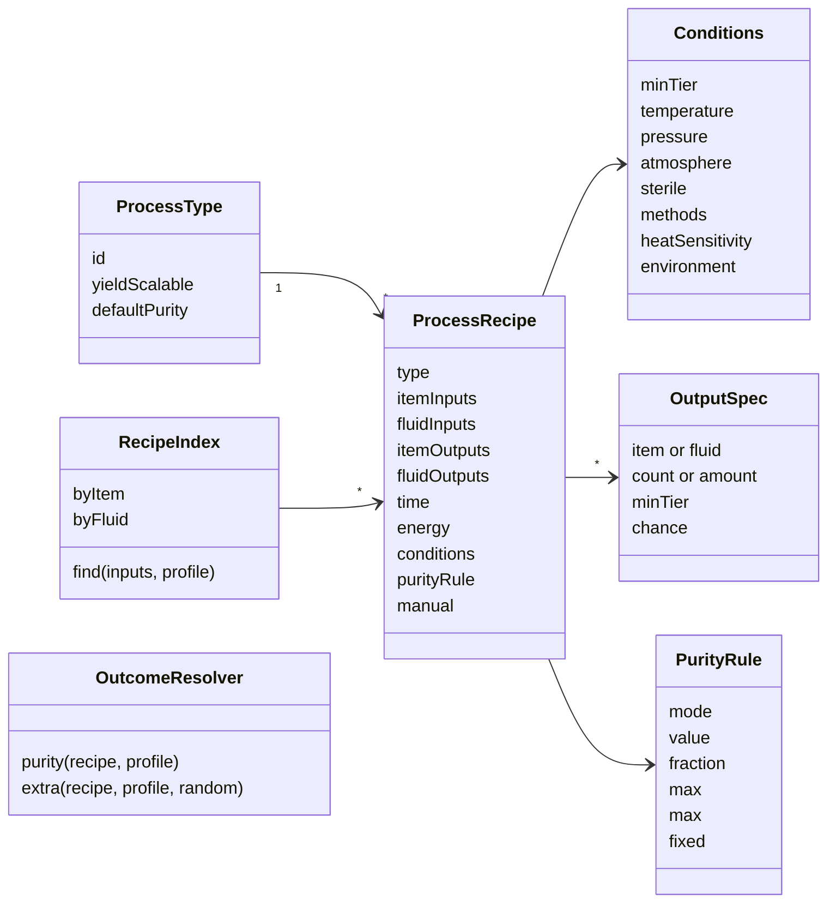
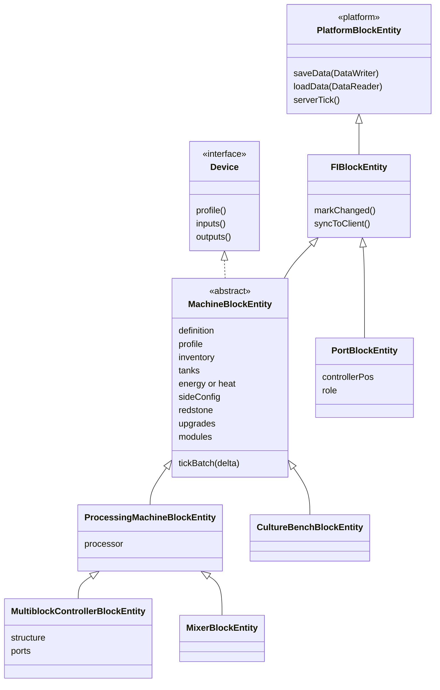
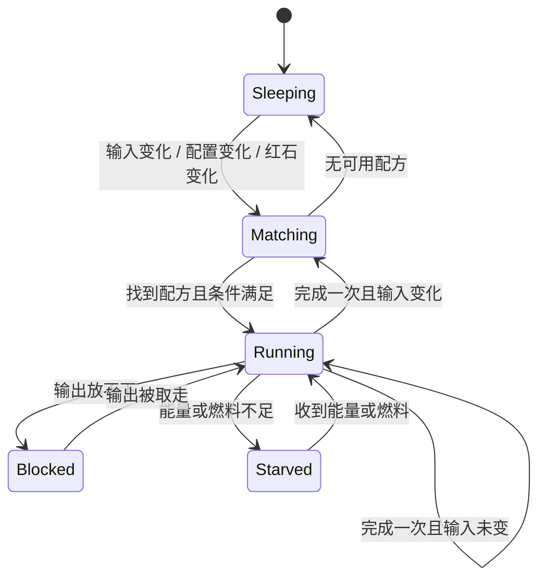

# 02 机器与配方的程序架构

目标：类少、层次浅、职责清楚；一套代码同时编译到三个版本节点；服务器每 tick 的开销可预期。本章第 6 节的性能规范是**强制规范**，与项目根目录的 `CONVENTIONS.md` 同等效力。

## 1 分层

项目用 Stonecutter 同时构建 1.20.1 Forge、1.21.1 NeoForge、26.1.2 NeoForge 三个节点，版本差异只能写在 `platform` 包（见 `CONVENTIONS.md`）。机器系统按这条规则分三层：

| 层 | 包 | 内容 | 能否引用加载器或版本相关类型 |
| --- | --- | --- | --- |
| 数据与规则 | `api`、`core`、`recipe`、`machine`、`gui`（逻辑部分） | 配方模型、设备档案、机器组件、处理流程、调度、侧面配置 | 否 |
| 适配 | `platform`、`platform.machine`、`platform.recipe`、`platform.compat.*` | BlockEntity 存取与同步、能力（物品 / 流体 / 能量）暴露、配方序列化、纯度存储、菜单与网络、JEI 等联动 | 是 |
| 资源 | `versions/<节点>/src/generated` | 数据生成输出的配方、标签、语言文件 | — |

业务层自己的数据类型不依赖加载器：

| 业务类型 | 取代的加载器类型 | 边界转换 |
| --- | --- | --- |
| `FluidAmount`（流体、mB、纯度） | Forge / NeoForge 各自的 `FluidStack` | `platform` 在能力边界转换 |
| `MachineInventory`（槽位组） | `IItemHandler`、26.1 的新传输接口 | `platform` 把它包装成各节点的物品能力 |
| `EnergyBuffer`（long） | `IEnergyStorage`、26.1 的能量接口 | 同上 |
| `DataWriter` / `DataReader` | `CompoundTag`（1.20.1、1.21.1）、`ValueOutput` / `ValueInput`（26.1） | `PlatformBlockEntity` 转发 |
| `Purity.get / set` | 1.20.1 物品 NBT byte；1.21.1 起物品与流体的数据组件 | `PlatformPurity` |

> 10 中“纯度是 NBT byte”的说法只对 1.20.1 节点成立；1.21.1 与 26.1.2 节点改为注册一个 byte 型数据组件 `foodindustrial:purity`，取值规则（−128…127，两端对数刻度，10 第 1.2 节）不变。AE2 在两种存储下都会把纯度当作物品键的一部分，10 第 6 节的约束照样适用。

## 2 包结构

```
com.tonywww.foodindustrial
├─ api                  对外 API（纯度、纯度原料、配方条件），单独打包
├─ core                 纯度刻度与档位、档次、条件枚举、调度相位
├─ recipe               配方类型描述、配方模型、匹配索引、纯度与产率结算
├─ machine
│  ├─ definition        MachineDefinition、IoLayout、模式、模块
│  ├─ component         库存、储罐、能量、热源、侧面配置、红石、升级、催化剂
│  ├─ processing        RecipeProcessor（状态机）、ManualProcess
│  ├─ block             机器方块、多方块控制器、仓口方块
│  └─ entity            机器 BlockEntity 类
├─ gui                  菜单逻辑、侧面板数据模型（界面绘制在 client 子包）
├─ world                世界交互（H10–H15）
└─ platform             版本适配（唯一允许出现 //? 和加载器 import 的包）
   ├─ machine           PlatformBlockEntity、能力注册、邻居缓存
   ├─ recipe            配方类型与序列化器注册、纯度原料注册
   ├─ purity            纯度存储
   ├─ network           同步与配置数据包
   └─ compat            jei、patchouli、farmersdelight、thermal、create、mekanism 等
```

## 3 配方侧



| 类 | 职责 | 说明 |
| --- | --- | --- |
| `ProcessType` | 配方类型描述（R01–R19、W01–W02） | 不可变数据，注册时创建；声明是否可用产率倍率与默认纯度规则。**不为每种类型写子类**。槽位上限与允许的条件不单独声明，由登记的设备推导：配方至少要有一台设备能执行（01 第 3.1 节，2026-11-04 定） |
| `ProcessRecipe` | 一条配方 | 所有类型共用这一个类；字段为空表示不用 |
| `Conditions` | 配方条件 | 与设备能力（`Capabilities`）做集合比较，结果缓存 |
| `OutputSpec` | 一个输出项 | `minTier` 实现“高档设备多产一项”；`chance` 只用于副产物 |
| `PurityRule` | 每个产物的纯度规则 | 来源 / 除杂 / 保持 / 劣化四种方式，可带上限；配方级的 `purity_sources` 指定参与加权平均的输入（additives/10 第 2.1 节） |
| `RecipeIndex` | 匹配索引 | 配方重载时按“第一个输入的所有候选物品 / 流体”建表；标签重载时重建 |
| `OutcomeResolver` | 结算纯度与产率 | 纯度结算是纯函数，输入为配方、输入纯度、设备档次与配方基准档次；纯度换算只用 256 项对照表和 `StrictMath`。产率多出部分与 `chance` 按概率产出（01 第 1 节规则 3），随机数由设备传入 |

只有三类配方需要额外逻辑，各用一个小类，不继承 `ProcessRecipe`：

| 类 | 用于 |
| --- | --- |
| `HomogenizeRule` | M21 的均质与归一（按标签自动生成配方，供 JEI 显示；I15 先在 `MixerBlockEntity` 里按输入槽算出作业，JEI 显示随 I22） |
| `BlockTransformRecipe` | W01 方块转化（随机刻驱动） |
| `HarvestRecipe` | W02 割取（玩家交互驱动） |

序列化：配方结构用 Mojang 的 `Codec` 描述，放在业务层；`Ingredient`、物品堆、流体这些各节点不同的部分由 `platform.recipe` 提供编解码器，并负责把 `Codec` 接到各节点的配方序列化器（1.20.1 的 JSON / 网络缓冲区，1.21 起的 `MapCodec` / `StreamCodec`）。

原版设备桥接（01 第 5 节）：

| 类 | 位置 | 职责 |
| --- | --- | --- |
| `VanillaCookingBridge` | `platform.recipe` | 由 R07–R09 中标记了 `vanilla_devices` 的配方生成，注册在原版烹饪配方类型下（熔炼、烟熏、高炉、营火烹饪）。`matches` 用本模组原料判定（含纯度门槛）；取结果的方法（`assemble`）调用 `OutcomeResolver`，按输入纯度和该原版设备的档案计算产物纯度并写入 |
| `VanillaDeviceProfiles` | `recipe` | 营火、熔炉、烟熏炉、高炉的档案（档次、能力、耗时倍率），与机器档案同一格式 |

原版熔炉与营火在取产物时调用配方的 `assemble`，所以纯度能在这一步写入；1.20.1 的烹饪配方 JSON 结果不能带 NBT，也只能这样做。各节点 `assemble` 的参数不同（1.20.1 为容器，1.21 起为 `SingleRecipeInput`），由 `platform.recipe` 适配，实现前在反编译源码中确认原版设备确实走 `assemble`。原版设备自己 tick，不受第 6 节调度约束，也不增加本模组的开销。

## 4 设备侧



| 类 | 职责 | 子类化规则 |
| --- | --- | --- |
| `PlatformBlockEntity`（platform） | 各节点的存取签名、客户端同步、ticker 接线 | 业务层只覆写它暴露的稳定方法 |
| `FIBlockEntity` | 脏标记、同步节流 | — |
| `MachineBlockEntity` | 持有组件；4 tick 调度入口；侧面配置；红石控制 | 抽象类，不直接实例化 |
| `ProcessingMachineBlockEntity` | 配方驱动的通用机器 | 除 M21、M25、M30 外的单方块机器直接用它，差异全部来自 `MachineDefinition` |
| `MultiblockControllerBlockEntity` | 结构校验、仓口登记 | 10 台多方块（M06、M07、M10、M19、M20、M22、M26、M27、M28、M29）共用；结构由定义中的图样描述；M22（塔板数限制馏分数）、M27（炉管段数定裂解产率）、M29（罐高定并行、在位灭菌、染菌）各有子类（I16、I17） |
| `AdsorptionColumnBlockEntity` | M25：吸附剂饱和与自动再生 | 覆写催化剂磨损、可做的配方与完成后的处理（I16） |
| `MixerBlockEntity` | M21：均质、归一 | 配料模式照常走配方；均质、归一模式不查配方，按输入槽算出作业（I15，additives/06 §T2 机械化）；密炼是模块，走配方 |
| `CultureBenchBlockEntity` | M30：分离、纯化、诱变、基因重组的交互流程 | 平板操作不走通用配方流程：接种 → 培养 → 鉴定 → 挑菌落（2026-11-11）；扩培照常走配方 |
| `PortBlockEntity` | 多方块的物品 / 流体 / 能量仓 | 不 tick，读写转发给控制器 |
| `Device`（接口） | 让机器、手工工具、被动设备都能执行 `ProcessRecipe` | 手工工具由 `ManualProcess` 实现 |

### 4.1 组件

组件是普通 Java 对象，不是 BlockEntity，可单独测试。

| 组件 | 内容 |
| --- | --- |
| `MachineInventory` | 按角色分组的物品槽（输入、输出、催化剂、燃料、升级、模块，见 03） |
| `TankSet` | 若干 `FluidTank`（业务实现，存 `FluidAmount`），可设置“只收气体 / 只收液体 / 锁定流体” |
| `EnergyBuffer` / `HeatSource` | T2 起用 FE 缓冲；T1 用燃料热源（燃烧剩余时间） |
| `SideConfig` | 六个面 × 物品、流体两条通道，自动输入、自动输出开关（见 04） |
| `RedstoneControl` | 忽略 / 低电平运行 / 高电平运行 / 禁用 |
| `UpgradeSet` / `ModuleSet` | 计算后的速率、能耗、并行数、能力集合；只在槽位变化时重算 |
| `CatalystSlot` | 催化剂或菌种的内部使用计数，满额后整件消耗（不改物品 NBT） |
| `RecipeProcessor` | 处理状态机（第 5 节） |

### 4.2 机器定义

每台机器是一个 `MachineDefinition` 实例，一处声明，生成方块、方块物品、BlockEntity 类型、菜单、JEI 催化剂、语言键和数据生成条目。

```java
public static final MachineDefinition EVAPORATING_CRYSTALLIZER = MachineDefinition.builder("evaporating_crystallizer")
    .tier(Tier.T2)
    .types(ProcessTypes.BOILING, ProcessTypes.CRYSTALLIZING)
    .layout(IoLayouts.FLUID_TO_SOLID)            // 03 的槽位模板
    .profile(DeviceProfile.standard(Tier.T2))     // 速率、产率、能耗系数
    .modes(Mode.CONCENTRATE, Mode.EVAPORATIVE, Mode.COOLING, Mode.ISOELECTRIC, Mode.FREEZING)
    .modules(Modules.VACUUM, Modules.MULTI_EFFECT)
    .phase(TickPhase.SEPARATION)                  // 第 6 节的调度相位
    .build();
```

- 模式只改变能力集合或配方类型的子集，不新建 BlockEntity 类。
- 单方块与多方块共用定义格式；多方块额外给出结构图样和仓口规则。

## 5 处理流程



每批（4 tick）执行一次：

1. 睡眠中直接返回（一次分支判断）。
2. 红石控制不允许 → 进入睡眠，等红石变化唤醒。
3. 没有当前配方：输入脏标记为真才查 `RecipeIndex`；能做的配方中取条件最多的一条（催化剂也算），一样多时取原料（输入）多的一条（2026-11-11 补：用到全部内容的配方优先于只用一部分的），再一样按配方 ID（与 additives/07 的被动设备相同，2026-11-11 用户确认）；查不到 → 睡眠。
4. 检查输出空间（按本次完成时的最大产出预留），放不下 → `Blocked`。
5. 扣除本批能量 `能耗 × 4`；不足 → `Starved`，不扣部分能量。
6. 进度 `+= 4 × 速率`；达到配方时长时：消耗输入、结算纯度与产率、写入输出、催化剂计数加一、进度减去时长（余量保留到下一次）。
7. 本批有新产物且开启自动输出时，推送一次（第 6 节第 7 条的退避规则）。

手工工具用同一条配方：`ManualProcess` 把“右键一次”记为进度一步，`manual.actions` 步完成；纯度与机器执行时相同，按产物的 `purity` 规则计算（10 第 2.1 节），T0 的档次加成为 0。

## 6 性能规范（强制）

### 6.1 调度

1. **4 tick 一批**：机器逻辑每 4 tick 执行一次，传入 `delta = 4`；进度、能耗、燃料、催化剂、计时全部按 `delta` 累计，一批推进 4 个单位。配方时长按 tick 书写，数据生成检查时长为 4 的倍数（不是时给出警告，运行时向上取整到 4 的倍数）。
2. **按类型错开相位**：每台机器的定义指定相位 0–3，机器只在 `(游戏时间 & 3) == 相位` 的那一 tick 执行。四个相位分给不同类型，同类型机器集中在同一 tick 运行（代码与数据更集中），不同类型分摊在四个 tick：

   | 相位 | 类型 | 机器 |
   | --- | --- | --- |
   | 0 | 机械与分离 | M01、M02、M04、M11、M12、M18、M19、M21 |
   | 1 | 加热与窑炉 | M03、M07、M08、M10、M20、M22、M26、M27 |
   | 2 | 结晶、干燥、精制 | M09、M15、M17、M24、M25、M28、M31 |
   | 3 | 反应与生物 | M05、M06、M14、M23、M29、M30 |

   实现：ticker 每 tick 被调用，第一行做 `(gameTime & 3) != phase` 判断后返回，代价是一次方法调用和一次位运算。`platform` 在三个节点上统一提供这一 ticker 接线。
3. **T0 被动设备和世界交互降频**：陶坛、晒盐池、晾晒架、曲盘、熏蒸箱、淋灰桶用 20 tick 一批（`delta = 20`），相位按方块坐标散列取 0–19。硝土生成（W01）用原版随机刻，不建 BlockEntity。
4. **多方块的仓口不 tick**，只转发读写；控制器按定义的相位执行。

### 6.2 睡眠与唤醒

5. **没有活干的机器必须睡眠**：无配方、输出已满、能量不足、红石禁止时，机器进入对应的睡眠状态，每批只做一次状态判断就返回。
6. **事件唤醒，不轮询**：物品或流体写入输入组、输出组被取走、收到能量、红石信号变化、侧面配置或模式变化、相邻方块变化（仅在开启自动输入时）会设置唤醒标记。

### 6.3 每批的工作量

7. **自动输入输出限频**：每批最多推送 / 拉取一次，且只在有东西可移动时执行；目标放不下时退避，间隔按 4 → 8 → 16 → … 翻倍，最长 80 tick，成功一次后恢复为 4。
8. **配方只在输入变化时匹配**：当前配方缓存在机器里；输入没变就不查索引，更不遍历配方列表。匹配用 `RecipeIndex`，候选按第一个输入查表。
9. **能力查询要缓存**：相邻方块的物品、流体、能量能力用 `platform` 提供的邻居缓存（各节点分别对接 Forge 的失效监听或 NeoForge 的能力缓存），不在每批里重新查询。
10. **热路径不分配对象**：`tickBatch` 中禁止流（`stream()`）、lambda 捕获、装箱、`String` 拼接和日志；只在真正产出时复制物品堆；倍率在定义加载时换算成整数（百分比或千分比），批内只做整数运算。
11. **状态同步节流**：方块状态 `active` 由关转开立即生效，由开转关需持续 40 tick 空闲，避免频繁触发光照和区块重绘。界面数据只在菜单打开时同步，只发变化的字段；不发送每 tick 数据包，进度条在客户端插值。
12. **多方块按事件校验**：成员方块放置、破坏时通知控制器重新校验；不做周期性扫描。仓口缓存控制器坐标。成员只用本模组方块（外壳、仓口、功能方块），由它们自己通知结构范围内的控制器，不监听原版方块（2026-11-04 定）。

### 6.4 加载与测试

13. **重载时建索引**：配方重载时建 `RecipeIndex`，标签重载时清空纯度原料的 `getItems()` 缓存和索引；运行期不做全量扫描。
14. **不追帧**：区块卸载期间不模拟，重新加载后也不补算。
15. **性能预算**：参考配置下，500 台运行中的机器在服务器线程上的平均总耗时不超过 1 ms/tick；睡眠机器的单台开销应接近空 ticker。开发版提供 `/foodindustrial perf` 命令，按机器类型统计每批耗时，用 spark 做回归对比。

## 7 platform 需要新增的 API

按 `CONVENTIONS.md` 第 4 节，先在 `platform` 中定义语义化方法，三个节点都实现并编译通过后，业务层再调用。

| API | 作用 | 各节点差异 |
| --- | --- | --- |
| `PlatformBlockEntity` | 稳定的 `saveData` / `loadData` / `serverTick` / 同步 | 26.1 存取改为 `ValueInput` / `ValueOutput` |
| `PlatformMachineCapabilities.register(...)` | 把 `MachineInventory`、`TankSet`、`EnergyBuffer` 按侧面配置暴露出去 | 1.20.1 Forge 能力 + `LazyOptional`；1.21.1 `RegisterCapabilitiesEvent`；26.1 新传输接口 |
| `PlatformNeighborCache` | 缓存相邻方块的能力 | 各节点的失效机制不同 |
| `PlatformFluids` | `FluidAmount` 与各节点 `FluidStack` 互转；气体标记；流体标签 | `FluidStack` 类型不同 |
| `PlatformPurity` | 读写物品与流体的纯度 | 1.20.1 NBT；1.21.1 起数据组件 |
| `PlatformRecipes` | 用业务 `Codec` 注册配方类型和序列化器；配方输入桥接；重载监听 | 1.20.1 JSON + 网络缓冲区；1.21 起 `MapCodec` + `StreamCodec`、`RecipeInput` |
| `PlatformIngredients` | 注册 `foodindustrial:purity`、`foodindustrial:fluid` | 1.20.1 `IIngredientSerializer`；NeoForge `ICustomIngredient` |
| `PlatformVanillaCooking` | 把桥接配方注册到原版烹饪类型；JEI 中从原版类别隐藏 | 烹饪配方的输入类型与序列化方式各节点不同 |
| `PlatformMenus`、`PlatformNetwork` | 菜单类型、带额外数据的打开、配置与同步数据包 | 1.20.1 `SimpleChannel`；1.21 起 `CustomPacketPayload` |
| `platform.compat.jei` | 21 个配方类别、催化剂、转移处理器 | 各节点 JEI 版本不同（15 / 19 / 29） |

> 各节点的签名以反编译源码或 `javap` 为准，不凭记忆（`CONVENTIONS.md` 第 4 节）。热力系列只在 1.20.1 节点有，农夫乐事在 26.1.2 节点暂缺，相关联动代码用整文件条件排除。

## 8 面向其他化工领域的通用性

本模组以后可能扩展到药物、日用化学品等食品以外的化工产品。现阶段不为此改动设计，只要求框架里没有“只适用于食品”的假设：

| 范围 | 要求 |
| --- | --- |
| 配方类型 | R01–R19 按单元操作划分（研磨、萃取、液相反应、蒸馏……），不按产品领域划分；新领域优先复用已有类型，确有新单元操作时再新增 |
| 配方条件与设备能力 | 条件键是开放集合；新增条件（例如以后可能需要的防爆、洁净等级）只需在条件表与设备能力中登记，不改匹配逻辑 |
| 机器定义 | `MachineDefinition` 不引用食品概念；机器名称、模式、模块描述写工艺本身，不写“用于某种食品” |
| 物料定义 | 物料主表的分类字段是开放的（化学品、矿物、菌种、酶、催化剂、添加剂、成品……），以后可加药品、日化品等分类；为危险性（毒性、腐蚀性、易燃、爆炸性、氧化性）预留字段，现阶段不实现任何行为 |
| 标签 | 产品类标签前缀（`additives/`、`foods/`）可并列新增其他前缀，配方仍只引用标签（additives/08 标签体系） |
| 纯度 | 门槛、刻度、结算规则与产品领域无关，档位界限按物料类别给出；档位名称“食品级”作为特例保留，其他领域沿用同一套五档名称（additives/11 待定问题 15，已定） |
| 只属于食品的规则 | 例如“成品配方默认要求添加剂 ≥ 食品级”，写在对应的配方或数据里，不写进框架代码 |
