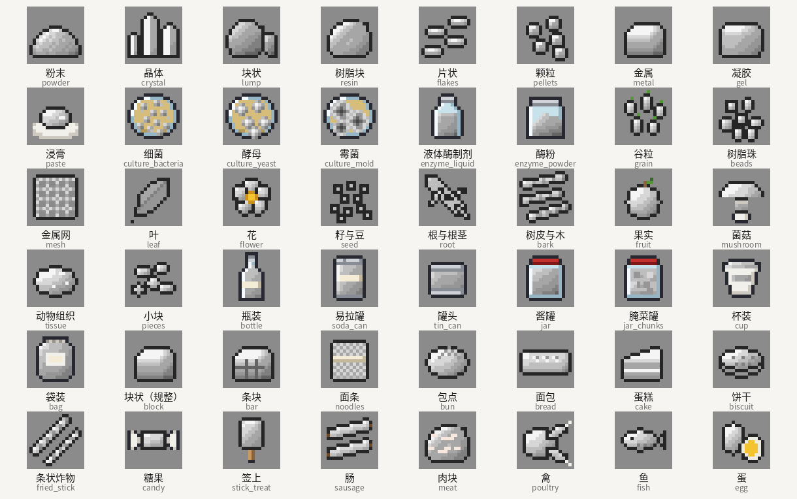
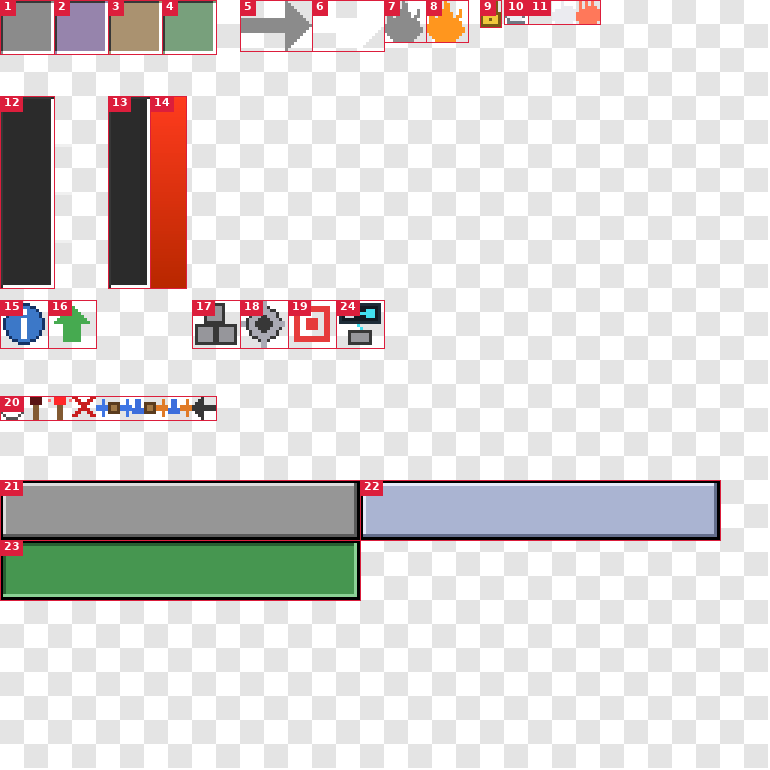
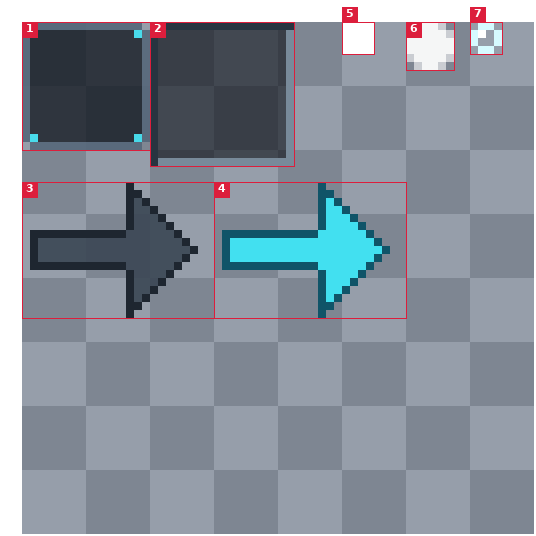
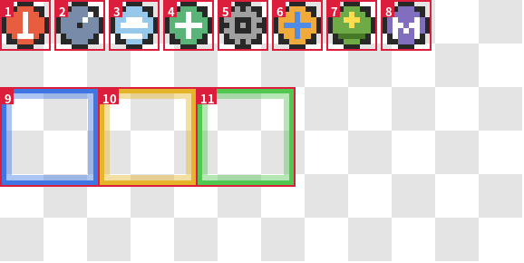

# Food Industrial 贴图需求

2026-11-17；2026-11-25 补充 I55 的作物、树木与灌木、海底方块、鸭与新原料，并重新统计；同日按审定的参考图重绘 339 张（16×16），有立体设计的机器开始用 Blockbench 建模

## 说明

Food Industrial 共需绘制 1,519 个贴图文件（见“总览”）。除各节“进度”和下面“参考图”一节里写明已完成的以外，现有贴图都是脚本画的占位图，画好后按同名替换即可。

**画风**（用户，2026-11-17）：近机械动力画风加现代科技画风。材质用安山合金、黄铜、铜，轮廓用带色的深色，光源在左上；点缀冷色钢材、青色指示灯、深色屏幕。像素只有完全不透明和完全透明两种。2026-11-25 起以审定的参考图为准（见“参考图”）。

**统计口径**：1,851 个物料与成品物品、2,101 种流体由灰度模板染色生成（2026-11-25 重新统计：物料表 1,851 个物品与 2,070 种流体，含 I47 起并入物料表的食品中间体；液体成品另有散装流体 31 种），不逐个列出，只算模板本身（见“灰度模板”一节）。以下几类也不计入：直接复用本模组其他贴图的方块（橡胶木楼梯、台阶、栅栏等用木板贴图，野生作物用作物成熟期贴图），以及借用原版或其他模组贴图的方块和物品（列在最后一节）。

**通用规格**

- PNG，RGBA，背景透明。物品与方块 16×16，遵守 Minecraft 的 16x 规范：一个方块每边 16 像素，像素对齐 16 网格（2026-11-25 用户；同日先前允许的 32×32 不再用），界面贴图的尺寸见各项。
- 文件名与路径不变：贴图在 `src/main/resources/assets/foodindustrial/textures/` 下的 `item/`、`block/`、`gui/`，灰度模板在 `tools/textures/templates/`。
- 1.20.1、1.21.1、26.1.2 三个游戏版本共用同一套贴图。
- 交来新模板后，开发者运行 `tools/textures/generate.py` 重新生成全部染色贴图。

### 参考图（Approved Textures v3）

2026-11-25 用户交来审定的美术参考图包 `Food_Industrial_Approved_Textures-v3.zip`（36 张效果图：风格总览、机器、储罐与手工设备与多方块、矿石与岩土、植物与树木、实体、I55 新原料），并定：照参考图的风格重绘贴图。同日用户定贴图遵守 16x 规范，照参考图重绘的都是 16×16。参考图包不放进仓库。

参考图是效果图，不是贴图：方块画成三个视角的等轴立方体，作物画成立在土块上的植株，物品画在灰底上。`tools/textures/reference/run.py <解压后的目录>` 从中取出贴图：找出每个立方体、把三个可见面展开成正方形，去掉效果图给侧面加的明暗（左侧面约为顶面的 0.83、右侧面约 0.59，在图上量得），把植株、物品从底色上抠出，再按格取色降到 16×16。机器、方块的参考图本身大致是每面 16 像素的画法，取色前先找出它自己的像素网格（与展开的方格常差 0.2–0.4 格），在每个像素的中心取色；作物、物品画得比每格 16 像素细，每格取覆盖最多的颜色，细小的亮色（玉米棒、果实）因此保得住，但细节比参考图少，需要时可以手工修。机器的“工作中”正面：参考图画了火或亮灯的，未工作的正面把火熄灭、灯调暗；带观察窗的，工作时窗口亮起；其余两张相同。

| 部分 | 已重绘 | 说明 |
| --- | --- | --- |
| 机器 | 184 | 46 台全部，均为脚本画（见下文“脚本画的方块贴图”） |
| 多方块部件与仓口 | 17 | 全部 |
| 储罐 | 5 | 木桶罐的内壁与桶底由桶壁调暗得到 |
| 手工设备 | 9 | 全部 |
| 矿石与岩土（含 I44 矿石与矿层） | 17 | 全部 |
| 植物 | 32 | I07 的 7 种作物与栀子丛；香荚兰（可可豆布局）、石花菜、麒麟菜未重绘 |
| 橡胶木与燕巢 | 9 | 橡胶木门的两张未重绘（门面取出来不方正） |
| I55 作物 | 28 | 玉米、番茄、卷心菜、菠萝、洋葱、大葱、黄瓜：成熟期取自参考图，幼苗各期由成熟期缩小、果实改绿得到；其余 9 种参考图没画 |
| I55 树木 | 8 | 肉桂原木、甜橙、番木瓜、核桃的树叶（结果与不结果） |
| I55 新原料（物品） | 30 | 全部 |
| 合计 | 339 | |

### 脚本画的方块贴图

2026-11-25 用户：方块贴图不要由参考图降低分辨率得到，要用脚本画出来（参考图取样的贴图边缘有异常像素）。`tools/textures/draw/` 按参考图的布局和配色逐像素画：`pixels.py` 是画布、材质色阶（轮廓、暗部、中间色、亮部、高光，左上受光；底色在参考图上量得）和木板、斜面边、铆钉、圆盘等画法；`machine_faces.py` 是各机器的各面；`run.py` 写入贴图。参考图取样的流程会跳过这些文件。立体模型的部件也用同一套材质上色。

2026-11-26 用户：底子不错，再优化几轮，过渡更明显、细节更自然。改为按光照层级画（`pixels.Layer`）：每种材质九级色阶，每个像素记材质和亮度，渐变、两像素宽的斜面边、边框与铁箍投下的短阴影、凹处在上沿和左沿下最暗，都叠加在亮度上，最后取最近的色阶。细节：木纹顺着木板走、中途偏一格，偶有木节（纹理绕开）和两块板的对接缝；铁箍三行带铆钉；钉头与铆钉左上亮、右下投影；钢板两道淡淡的拉丝；玻璃上的反光；工作时灯条在下方的白漆上泛青光；培养台顶面按参考图另两个视角画出通风格栅。

2026-11-26 用户：两台木制机器（螺旋压榨机、浸提桶）要更多参考原版木桶。木头、铁箍和腔内改用原版木桶的配色（木桶侧面的 7 种棕色、铁箍的 3 种近黑灰、开口木桶里的 3 种深棕，各补足九级），画法也照木桶：木板平涂，只差半级到一级；每块板第一列亮、最后一列是在两种最深色之间跳动的缝，第二列有几处短的深色斑点（`pixels.staves`）；铁条两像素宽，向光一半是铁色、另一半近黑，下面一行木板落在阴影里（`pixels.strap`）。浸提桶侧面是 4 像素宽的桶板和两道铁箍；顶面一圈浅色的桶板端头，里面是桶盖（用户说原先的桶盖不自然，改照原版木桶的比例：最宽 12 像素、四角切去，横向木板拼得紧，缝只暗一级，边缘左上亮、右下暗）；压榨机侧面和顶面四周包铁条、四角钉头，顶面四块木板绕着中间的铁板转一圈。图案是为这两台机器另画的，没有照抄原版贴图。部件图集里的木垫板和出液槽也随之改用这套棕色。

2026-11-26 用户确认 4 台试做机器（螺旋压榨机、浸提桶、萃取罐、培养台），定为规范（`CONVENTIONS.md` 第 11 节），其余机器照此画贴图、建模。同日其余 42 台全部画完，按材质分在几个文件里：`kilns.py`（砖石：石磨、熬煮灶、土窑、烘房、砖烤炉、糖果台；`masonry.py` 照原版砖块和石砖的配色砌砖、画工作时火膛里的火焰）、`crafts.py`（陶缸、灰泥木框、木箱、木桶、铜：发酵缸、曲房、结晶槽、手摇压面机、手摇搅拌桶、手摇绞肉机、冰盐冷冻桶、手摇灌装封口机、蒸馏甑、电动海水泵）、`steelworks.py`（二阶钢板机器 17 台，钢板照萃取罐）、`labworks.py`（三、四阶：化工机器是钢框里的青灰面板，两台炉子框里是耐火砖，生物机器是培养台那样的白漆）。木桶和木箱的画法在 `woodwork.py`。有原版对应物的材质用原版的配色（石砖、平滑石、砖块、铜块、雪、冰、切制砂岩、营火的火焰），其余在参考图上量得。工作中的正面：火膛有火焰，灯、屏幕、观察窗和发光的开口亮起。

2026-11-26 用户：这组机器的边框过粗，与参考图严重不符。改为照参考图的粗细：钢板（含萃取罐）、白漆（含培养台）的边只有一个像素，左上亮、右下暗，不再有第二圈；手摇压面机、手摇绞肉机、手摇灌装封口机的包铁（包钢）改为一个像素；蒸馏甑、海水泵的铜板包边一个像素，铆钉移到铜板上；化工机器的钢框仍两像素（参考图如此），但外圈亮、内圈灰，四角改成斜切，不再是 4×4 的方块；电解槽的铜带收在框内。螺旋压榨机的铁条参考图本来就宽，仍为两像素。

### 立体模型（Blockbench）

2026-11-25 用户：参考图里有立体设计的机器用 Blockbench 建模，遵循 Blockbench 的 Minecraft 风格指南与 MC-Modeling-Skills，风格尽量接近参考图；阀门、仪表盘这类部件用几个方块搭成立体的，不用贴图表现。

2026-11-26 用户：机器的非主体部件（如压榨机的核心、浸提桶的龙头）也要处理好贴图和模型。部件改为逐面画（不再用统一的明暗套色），压榨机去掉螺杆上的两圈螺纹盘、压板加厚，浸提桶的龙头从十字形改成管、出水嘴和把手。

做法见 `tools/models/`：

- `machines.py` 写每台机器的形状。保留参考图的立方体外形，贴图用脚本画的；参考图画成开口的（压榨腔、观察窗）向里凹；画成凸出的（龙头、手轮、仪表、出液槽、螺杆）用几个小方块搭出，放在参考图画的位置。部件的各面由 `tools/textures/draw/part_faces.py` 按面的大小画，与方块贴图同一套光照层级和色阶，左上受光。遵守 16x 规范：每单位 1 像素，与 16×16 贴图一致，方块坐标都是整数，最小的部件 1 单位。
- 搭出来的部件不画在贴图上，免得同一个部件出现两次。
- `preview.py` 在本地出预览。`blockbench.py` 和 `combine.py` 生成脚本，在用户电脑上的 Blockbench（MCP 插件）里建模、截图、导出。`install.py` 核对导出与形状一致后，写成 `models/block/<id>_shape.json`；Blockbench 工程存在 `tools/models/bbmodel/`。
- 机器定义标 `shaped()` 后，方块模型以形状为父模型。这类方块不遮挡邻居的面，光可以透进来，否则方块内部的面会发黑。
- 机器自有的贴图：`_parts`（部件图集，32×32，各部件仍按每单位 1 像素贴，`part_faces.py` 画、`tools/models` 拼成）；`_inner`（凹处内壁）、`_flank`（另一侧面）与各面一起由脚本画。

| 机器 | 立体部分 | 方块数 | 自有贴图 |
| --- | --- | --- | --- |
| 螺旋压榨机 | 正面开口的压榨腔（框宽 3、深 6）；螺杆（螺纹画成明暗相间的条纹，每转过一个角错一格）、压板（正面两颗螺栓）、顶面有一圈导流槽的木垫板、出液槽（槽底湿色） | 11 | `_parts`、`_inner` |
| 浸提桶 | 黄铜龙头，在下面那道铁箍上方：伸出桶外的管、管端向下的出水嘴（嘴口画暗）、立在管上的把手 | 4 | `_parts` |
| 萃取罐 | 两个八角仪表（各由两块交叉方块组成，白表盘、钢表圈，加一根转角的深色指针）；手轮：直径 7 的像素圆轮缘（8 块，左上几块亮、右下几块暗，看起来是圆的）、两根轮辐、轮毂、轴 | 19 | `_parts` |
| 培养台 | 正面与西侧的观察窗向里凹 1 | 9 | `_inner`、`_flank` |

其余 42 台（2026-11-26）：开口用 `carve()` 从方块里挖出（火膛、观察窗、门、顶上的口、格栅的缝），形状和贴图共用同一份开口位置；凹处的背面显示该面自己的贴图（所以火膛工作时有火），侧壁用 `_inner`。

| 机器 | 立体部分 | 方块数 |
| --- | --- | --- |
| 石磨 | 出粉口（凹 3）与伸出的木唇、磨眼 | 9 |
| 熬煮灶 | 拱形火膛与灰坑、顶上嵌的铁锅（锅壁 `_pot`） | 19 |
| 土窑 | 拱形火膛与灰坑、顶上烟道口 | 14 |
| 烘房 | 拱形火膛；顶上木格栅（5 根木条） | 19 |
| 砖烤炉 | 圆拱炉口（凹 4） | 11 |
| 糖果台 | 火膛与灰坑 | 10 |
| 发酵缸 | 缸身高 15，木盖在缸肩上凸起 1 | 2 |
| 曲房 | 门凹 1，黄铜门把、温度计 | 7 |
| 结晶槽 | 顶上盐池（凹 4） | 5 |
| 手摇压面机 | 观察窗凹 5，里面三层面片和擀面杖；顶上进料口 | 13 |
| 手摇搅拌桶 | 顶上圆口（凹 3），里面十字铁桨和轴 | 20 |
| 手摇绞肉机 | 顶上深料斗（凹 6），正面带孔绞盘 | 8 |
| 冰盐冷冻桶 | 顶上圆形钢碗（凹 4） | 17 |
| 手摇灌装封口机 | 灌装腔凹 5，灌装头、管、托盘；顶上进料口 | 16 |
| 蒸馏甑 | 正面八角黄铜舱盖，顶上颈口 | 16 |
| 电动海水泵 | 正面大压力表，西侧进水口的管箍（进水口在 `_flank`），顶上出口 | 25 |
| 粉碎机 | 粉碎腔凹 5，底上一排齿；顶上进料缝 | 14 |
| 固液分离机 | 观察窗凹 1，两侧百叶缝各凹 1（背面 `_back`） | 29 |
| 搅拌反应罐 | 细长观察窗，两个仪表盒；顶上黄铜口（口沿 `_collar`）里的搅拌轴和桨 | 26 |
| 蒸发结晶器 | 玻璃管窗（工作时发青光），一列指示灯；顶上玻璃口 | 22 |
| 干燥机 | 门上小窗，两个铰链和把手；两侧小窗，侧面和背面下方通风缝，顶上通风缝 | 45 |
| 吸收塔 | 控制面板凹 1 | 5 |
| 回转窑 | 正面火窗与铁框，三面凸出的腰箍；顶上通风缝 | 31 |
| 调配机 | 大观察窗凹 1（画着搅拌桨），顶上口 | 17 |
| 和面成型机组 | 成型腔凹 4，木辊、钢辊和中间的面片 | 8 |
| 均质杀菌机组 | 两个压力表 | 7 |
| 烘烤机组 | 上面暗色炉窗，下面加热槽（工作时发橙光） | 7 |
| 蒸煮油炸机组 | 屏幕和玻璃读数板各凹 1，旋钮；顶上通风缝 | 19 |
| 发酵陈酿库 | 冷库门的两个铰链和拉手，温度表 | 9 |
| 切配机组 | 刀片间的五道缝，出料槽；顶上通风缝 | 35 |
| 糖果巧克力机组 | 观察腔凹 3，里面一堆巧克力；旋钮 | 13 |
| 冷冻机组 | 格栅面板凹 1 | 5 |
| 灌装灭菌机组 | 面板凹 2，白色灌装管和喷嘴、第二根管、压力表 | 11 |
| 精馏塔 | 黄铜旋钮 | 3 |
| 高压反应釜 | 大压力表（8 格） | 5 |
| 电解槽 | 顶上两个电极口 | 7 |
| 吸附柱 | 观察窗凹 1（画着活性炭），顶上口 | 17 |
| 电弧炉 | 拱形电弧窗凹 2，顶上两个电极口 | 18 |
| 气相反应炉 | 圆形火窗，两个小仪表，顶上口 | 33 |
| 喷雾干燥塔 | 出料锥（三级台阶，凹 1 到 3），顶上口 | 15 |
| 无菌发酵罐 | 读数玻璃条凹 1（正面和两侧，西侧 `_flank`，背面 `_back`） | 13 |
| 膜分离机 | 膜组腔凹 3，三根膜管，压力表 | 11 |

参考图不一致的地方按 A 视角处理：部分图里正面在 A、B 视角里落在不同的面上，或同一个特征同时出现在两个面上（海水泵的进水口、固液分离机的百叶、无菌发酵罐的读数条）；电弧炉和气相反应炉只有 A 视角画了钢框，统一加上框。

暂不重绘：参考图里的 I55 灌木丛画成了树叶方块（游戏里是十字形），蚝礁下面画了底座（游戏里同海草，只有十字形两片），用户定以后修正。参考图没有画到的（I44 的其余物种、灰度模板、界面、机器模块与模具等手绘物品、实体）照旧，以后按参考图的风格另画。

**待你确认**

- 借用贴图的三项（手摇柄、传动接口、模组手册）是否另画。
- 流体目前是静态贴图，是否要做成动画。

## 总览

方块贴图最多，共 1,252 张：I44 与 I55 的作物、草本与树木占近八成，其次是机器的四个面。

| 部分 | 文件数 | 内容 |
| --- | --- | --- |
| 灰度模板 | 80 | 物品模板 48 种（灰度层 48 张 + 固定层 25 张）、流体模板 3 种（静止与流动各 1 张，共 6 张）、工程菌标记 1 张 |
| 物品 | 160 | 机器模块、升级与框架 26，工具与容器 8，成品线的模具 22 与容器包装 10，作物产物 9，手工食品 2，橡胶木门 1，I44 与 I55 新原料 49，香精 33 |
| 方块 | 1,252 | 机器 184，多方块部件与仓口 17，储罐 5，手工设备 9，矿石与岩土 17，植物与海底方块 39，橡胶木 10，I44 与 I55 作物与树木 970，燕巢 1 |
| 实体 | 6 | I44 灵猫、河狸，I55 鸭（成体与 26.1 幼体） |
| 界面 | 21 | 机器界面 6，沉浸式展示面板 1，JEI 配方页 1，代谢图标 13 |
| 合计 | 1,519 | |

## 灰度模板

52 种模板（80 个文件）决定了 1,851 个物品和 2,101 种流体的样子：画好一种模板，用它的物品重新生成后全部更新。物品的颜色由开发者按物料定，画师不用管。

### 进度

2026-11-17 应用了 FI_Create_Texture_Pack 第一批，共 18 种物品模板和工程菌标记：

- 同名直接替换：粉末、晶体、块状、叶、籽与豆、瓶装、易拉罐、罐头、酱罐、杯装、袋装、细菌、液体酶制剂。
- 浸膏：只换灰度层，保留原来的浅碟固定层（用户确认）。
- 按用户确认对应替换：flake → 片状 flakes，pellet → 颗粒 pellets，ingot → 金属 metal，culture（含固定层）→ 酵母 culture_yeast。
- 流体模板暂不应用：新图四周有一圈深色边框，在世界和储罐里会拼成方格；气体被改成完全不透明。需去掉边框、气体恢复半透明后再交。
- 包里其余 34 种模板没有对应的物品种类，未使用。

### 物品模板的画法

- **灰度层** `item_<种类>.png`：只用灰色，生成时按物品颜色染色。灰度 166（约 65%）是物品本色；更暗的灰压暗，纯黑为本色的 25%；更亮的灰向白色提亮，纯白提亮 60%。
- 现有模板用 9 级灰：38、70、100、128、150、166、190、215、245，依次是轮廓、暗部、本色、高光。光源在左上。
- **固定层** `item_<种类>_fixed.png`（可选）：彩色，不染色，叠在灰度层上面。画玻璃、瓶盖、标签、木签这类不随物品变色的部分。下表“固定层”一栏写了的种类才有这一层，其余可以按需要新增。
- 两层都是 16×16，对齐叠放。

| 种类 | 文件名 `item_…` | 灰度层画什么 | 固定层画什么 | 物品数 | 例子 |
| --- | --- | --- | --- | --- | --- |
| 粉末 | powder | 一堆粉末 | | 667 | 碳酸镁、熟石灰、石膏 |
| 晶体 | crystal | 三根并立的棱柱晶体 | | 203 | 氯化钠、氯化钾、泻盐 |
| 块状 | lump | 两块不规则的石块 | | 35 | 光卤石、石灰石、硫磺 |
| 树脂块 | resin | 一块玻璃质树脂，边缘亮、内有反光 | | 35 | 松香、紫胶 |
| 片状 | flakes | 几片蜡质薄片 | | 54 | 卤片、硬脂酸 |
| 颗粒 | pellets | 五颗圆粒 | | 16 | 烧碱、活性炭 |
| 金属 | metal | 一根金属锭，顶面亮 | | 4 | 硅、钠、镁、铬 |
| 凝胶 | gel | 一块果冻状方块 | | 1 | 石花菜冻 |
| 浸膏 | paste | 一块软膏，有刮痕和油光 | 浅碟 | 43 | 薰衣草浸膏 |
| 细菌 | culture_bacteria | 十几个圆形光滑小菌落 | 俯视的培养皿：玻璃边、淡琥珀色培养基 | 59 | 醋酸菌、谷氨酸棒杆菌 |
| 酵母 | culture_yeast | 几个较大、带高光的乳脂状菌落 | 同一培养皿 | 9 | 啤酒酵母 |
| 霉菌 | culture_mold | 两三团铺开的绒毛状菌落，中心深、边缘浅 | 同一培养皿 | 20 | 黑曲霉、红曲霉 |
| 液体酶制剂 | enzyme_liquid | 瓶中液体与液面高光 | 小玻璃瓶与瓶盖 | 68 | α-淀粉酶、果胶酶 |
| 酶粉 | enzyme_powder | 瓶中的粉末堆 | 广口小瓶 | 7 | 木瓜蛋白酶、凝乳酶 |
| 谷粒 | grain | 一小堆椭圆谷粒 | 绿色芽尖 | 8 | 发芽小麦、麦芽 |
| 树脂珠 | beads | 一堆半透明小球 | | 9 | 固定化脂肪酶、聚苯乙烯 |
| 金属网 | mesh | 一块金属丝网 | | 1 | 铂网 |
| 叶 | leaf | 一片叶子 | | 71 | 甜菊干叶、罗勒 |
| 花 | flower | 一朵花的花瓣 | 黄色花心 | 39 | 红花、丁香花蕾 |
| 籽与豆 | seed | 一把种子 | | 55 | 大米、亚麻籽 |
| 根与根茎 | root | 一段根 | | 24 | 甘草根、大蒜 |
| 树皮与木 | bark | 几片树皮或木片 | | 23 | 肉桂皮、檀香木 |
| 果实 | fruit | 一个圆果 | 果柄与小叶 | 28 | 沙棘果、桑椹 |
| 菌菇 | mushroom | 菌盖 | 菌柄 | 2 | 干香菇 |
| 动物组织 | tissue | 一块软组织 | | 10 | 鱼肝、蛋黄、胰脏 |
| 小块 | pieces | 一小堆不规则小块 | | 38 | 干辣椒、栀子碎 |
| 瓶装 | bottle | 瓶中液体 | 细颈玻璃瓶、瓶盖、白标签 | 62 | 酱油、食用油、果汁 |
| 易拉罐 | soda_can | 高罐罐身 | 顶盖、拉环、高光 | 8 | 可乐、苏打水 |
| 罐头 | tin_can | 罐身标签 | 矮金属罐 | 7 | 午餐肉罐头 |
| 酱罐 | jar | 罐中细腻的酱 | 玻璃罐与红盖 | 19 | 果酱、炼乳 |
| 腌菜罐 | jar_chunks | 罐中块状物与汤汁 | 同一玻璃罐 | 11 | 泡菜、榨菜 |
| 杯装 | cup | 杯口露出的内容 | 纸杯或塑料杯 | 28 | 酸奶、布丁 |
| 袋装 | bag | 鼓起的包装袋 | 白标签、封口 | 35 | 奶粉、薯片 |
| 块状（规整） | block | 带切面的规整方块 | | 29 | 奶酪、黄油、豆腐 |
| 条块 | bar | 压出格子的长条 | | 5 | 巧克力、牛肉干 |
| 面条 | noodles | 一束弯曲的长条 | 捆扎的纸条 | 13 | 挂面、腐竹 |
| 包点 | bun | 两三个带褶的圆面团 | | 19 | 饺子、包子 |
| 面包 | bread | 带割纹的面包 | | 8 | 吐司、法棍 |
| 蛋糕 | cake | 一角蛋糕，顶面亮、侧面分层 | | 10 | 海绵蛋糕、蛋挞 |
| 饼干 | biscuit | 两三片带小孔的薄饼 | | 10 | 苏打饼干、曲奇 |
| 条状炸物 | fried_stick | 两根扭条 | | 5 | 油条、麻花 |
| 糖果 | candy | 糖块 | 两端扭紧的糖纸 | 18 | 硬糖、奶糖 |
| 签上 | stick_treat | 签上的糖或冰 | 木签 | 5 | 冰棍、冰糖葫芦 |
| 肠 | sausage | 两根弯的香肠 | 两端扣结 | 4 | 腊肠、火腿肠 |
| 肉块 | meat | 肉块 | 白色肥肉纹理 | 10 | 腊肉、培根 |
| 禽 | poultry | 整只烤禽 | 腿骨末端 | 5 | 烤鸭、白切鸡 |
| 鱼 | fish | 一条鱼 | 鱼眼 | 5 | 咸鱼、熏鱼 |
| 蛋 | egg | 两个蛋的蛋壳 | 切开那个蛋的蛋白与蛋黄 | 6 | 皮蛋、咸鸭蛋 |

### 流体模板

每种流体模板画静止和流动两张，16×16 灰度。游戏运行时乘以流体颜色：越接近白色，越接近流体本色，所以整体要画得很亮。用于世界里的流体、储罐内的液面和界面里的液槽。

| 种类 | 模板文件 | 复制到 `block/` 后的文件名 | 流体数 | 要求 |
| --- | --- | --- | --- | --- |
| 液体 | fluid_liquid_still、fluid_liquid_flowing | fluid_still、fluid_flowing | 1,858 | 清透的水面；现有灰度 205–240，不透明 |
| 黏稠液体 | fluid_viscous_still、fluid_viscous_flowing | fluid_viscous_still、fluid_viscous_flowing | 202 | 油脂、糖浆、胶乳等，纹理厚重；现有灰度 175–225 |
| 气体 | fluid_gas_still、fluid_gas_flowing | fluid_gas_still、fluid_gas_flowing | 41 | 半透明的雾气；现有灰度 225–250，不透明度 200/255 |

### 工程菌标记

`badge_engineered.png`，16×16 彩色，不染色。只在右上角画一个青色双螺旋小标，其余透明；叠在 29 个基因工程菌的培养皿上，和普通菌种区分。

下图是现有的 48 种物品模板（灰度层叠固定层，放大 5 倍），可作构图参考。

## 物品贴图

160 张不走模板的物品贴图，都在 `textures/item/`，16×16。“手持”一栏打了 √ 的物品拿在手里时像原版工具一样斜握，建议按左下到右上的斜向构图。“参考外观”是按现实设备拟的建议，可改。

### 进度

2026-11-18 这 44 张已全部画完（按上面的画风）。

- 来源是 `tools/textures/item_art.py`：每张贴图是一幅 16×16 的字符画，改图就改字符画，然后运行脚本重写 `textures/item/` 下的同名文件。
- 原来的占位脚本（`tools/machines/placeholder_textures.py`、`tools/manual/manual_textures.py`、`tools/logistics/logistics_textures.py`、`tools/world/world_assets.py`）不带 `--force` 不会覆盖已有文件；带 `--force` 运行后要再运行一次 `item_art.py`。`tools/gui/gui_textures.py` 从 2026-11-18 起不再画物品贴图，只画界面贴图。
- 1.20.1 开发环境实测：44 个物品都能给出，快捷栏看了 17 个、手持看了 8 个，显示正常。
- 2026-11-19 加了成品线的模具 22 张（含 I41 的糖衣锅）与容器包装 10 张（I40），来源是 `tools/textures/food_tool_art.py`：用带明暗的形状拼成，不是字符画；改图就改脚本里对应的函数。

### 机器模块、升级与框架（24）

| 物品 | 文件名 | 用途 | 参考外观 |
| --- | --- | --- | --- |
| 机械框架 | machine_frame | T2 机器共用的框架 | 铁制方框，带斜撑 |
| 化工框架 | chemical_frame | T3 机器共用的框架 | 比机械框架更精密，带金色核心 |
| 洁净框架 | clean_frame | T4 机器共用的框架 | 亮面不锈钢框，带青色核心 |
| 速率升级 | speed_upgrade | 速率 ×1.5，能耗 ×2 | 电路板加芯片；四种升级外形统一、靠颜色区分 |
| 能效升级 | efficiency_upgrade | 能耗 ×0.7 | 同上 |
| 并行升级 | parallel_upgrade | 每个多处理一份 | 同上 |
| 规范化模块 | standardization_module | 产出纯度降到档位下限 | 同上 |
| 滤板组 | filter_plates | 固液分离机：过滤 | 一叠板框压滤机滤板 |
| 离心转鼓 | centrifuge_drum | 固液分离机：离心 | 带孔的金属转鼓 |
| 耐腐蚀内衬 | corrosion_lining | 搅拌反应罐：耐腐蚀 | 一片弯曲的搪瓷衬板 |
| 真空泵 | vacuum_pump | 反应罐、蒸发结晶器：真空 | 小型泵体加电机 |
| 低温夹套 | cryo_jacket | 搅拌反应罐：冷冻 | 缠着冷媒管、结霜的夹套 |
| 紫外灯 | uv_lamp | 搅拌反应罐：紫外 | 发紫光的灯管 |
| 多效蒸发器 | multi_effect | 蒸发结晶器：能耗减半 | 三个串联的小蒸发罐 |
| 冷却辊 | chill_roll | 干燥机：熔体急冷成片 | 冰冷的金属辊筒 |
| 冷冻干燥单元 | freeze_dryer | 干燥机：冷冻、真空 | 带观察窗的冷冻舱 |
| 超临界单元 | supercritical_unit | 萃取罐：超临界、高压 | 厚壁高压容器加压力表 |
| 铅室衬里 | lead_chamber | 吸收塔：铅室法 | 灰暗的铅板 |
| 高剪切乳化头 | emulsifying_head | 调配机：乳化 | 转子–定子式乳化头 |
| 密炼转子 | internal_mixer | 调配机：密炼 | 一对啮合的转子 |
| 分子蒸馏组件 | molecular_distillation | 精馏塔：分子蒸馏、真空 | 短程蒸馏器 |
| 挤压膨化段 | extrusion_section | 和面成型机组：高温，挤压膨化 | 带加热圈的螺杆挤出段 |
| 超高温段 | uht_section | 均质杀菌机组：超高温灭菌 | 铜管换热板组 |
| 精油分层器 | essential_oil_separator | 蒸馏甑：分出精油 | 玻璃分层瓶，油层在上、水层在下 |
| 石墨电极 | graphite_electrode | 电解槽、电弧炉的电极 | 一根黑色石墨棒 |
| 膜组件 | membrane_module | 膜分离机的耗材 | 卷式膜组件 |

### 工具与容器（8）

| 物品 | 文件名 | 用途 | 手持 | 参考外观 |
| --- | --- | --- | --- | --- |
| 设备扳手 | device_wrench | 旋转、拆下机器 | √ | 扳手 |
| 红图 | redprint | 复制、粘贴机器设置 | √ | 红色的图纸 |
| 研钵 | mortar | 研磨 | √ | 研钵与研杵 |
| 筛子 | sieve | 过滤 | √ | 木框筛网 |
| 布袋 | cloth_bag | 拧压、过滤 | √ | 湿布袋 |
| 燧石小刀 | flint_knife | 割取橡胶、松脂，刮下酒石 | √ | 燧石刀片绑木柄 |
| 液体瓶 | fluid_bottle | 装 250 mB 液体 | | 一个玻璃瓶；不随内容变色 |
| 气瓶 | gas_cylinder | 搬运气体 | | 钢制气瓶加阀门 |

### 成品线的模具（22）

机器里作催化剂，按次数消耗；在工作台上不消耗（[machines/05](machines/05-final-design.md) 第 3 节）。

| 物品 | 文件名 | 用途 | 参考外观 |
| --- | --- | --- | --- |
| 筛网 | granulating_screen | 制粒 | 木圈金属网 |
| 压片冲模 | tablet_die | 压片、压块 | 冲头与模座 |
| 包馅模 | filling_mold | 饺子、包子等 | 半圆的饺子夹 |
| 拉伸模 | stretching_mold | 拉面、麻花 | 木架上拉开的面条 |
| 挤丝模 | extrusion_die | 米粉、粉丝 | 带孔的圆模板，下面出丝 |
| 蛋糕模 | cake_mold | 蛋糕 | 圆形活底模 |
| 吐司模 | loaf_pan | 吐司 | 长方形烤盘 |
| 挞派模 | tart_pan | 蛋挞、派 | 花边圆浅盘 |
| 夹板 | baking_iron | 华夫饼、威化、蛋卷 | 带格纹的铁夹与木柄 |
| 月饼模 | mooncake_mold | 月饼 | 木柄印模 |
| 奶酪模 | cheese_mold | 奶酪 | 带孔的木框 |
| 冰棍模 | popsicle_mold | 冰棍、雪糕 | 三格模具插着木棍 |
| 灌肠嘴 | stuffing_nozzle | 灌肠 | 金属漏嘴 |
| 火腿模 | ham_mold | 西式火腿 | 带压盖的金属盒 |
| 豆腐模 | tofu_mold | 豆腐、豆干 | 木框里的白布与豆腐 |
| 巧克力模 | chocolate_mold | 巧克力 | 透明模板里的巧克力块 |
| 硬糖模 | hard_candy_mold | 硬糖 | 粉色硅胶模 |
| 棒棒糖模 | lollipop_mold | 棒棒糖 | 圆坑带棍槽的金属模 |
| 淀粉模 | starch_mogul | 软糖 | 木盘里的淀粉印坑 |
| 糖衣锅 | panning_drum | 包衣 | 铜质滚筒，筒里的彩色糖豆 |
| 吹瓶模 | blow_mold | 玻璃瓶、PET 瓶 | 两半开合的瓶形模 |
| 橡木桶 | oak_barrel | 陈酿烈酒 | 带铁箍的木桶 |

### 成品线的容器与包装（10）

灌装封口时作输入；玻璃罐、灌装玻璃瓶在倒出或吃完后还回（[machines/05](machines/05-final-design.md) 第 4 节）。画的是空容器，装了成品后的样子由成品的模板负责。

| 物品 | 文件名 | 参考外观 |
| --- | --- | --- |
| 纸袋 | paper_bag | 牛皮纸袋 |
| 玻璃罐 | glass_jar | 带金属盖的玻璃罐 |
| 塑料袋 | plastic_bag | 红色封边的透明袋 |
| 纸杯 | paper_cup | 带红色腰带的纸杯 |
| 马口铁罐 | tin_can | 贴标签的罐头 |
| 塑料肠衣 | plastic_casing | 一段红色塑料肠衣 |
| 灌装玻璃瓶 | glass_bottle | 绿色酒瓶 |
| 铝罐 | aluminum_can | 蓝色易拉罐 |
| PET 瓶 | pet_bottle | 透明塑料瓶，绿色瓶盖与标签 |
| 滤纸袋 | tea_bag | 带线与标签的茶包 |

### 作物产物、食品与其他（12）

| 物品 | 文件名 | 说明 |
| --- | --- | --- |
| 辣椒 | chili_pepper | 一两个红辣椒 |
| 栀子果 | gardenia_fruit | 橙红色、带纵棱的栀子果 |
| 蓼蓝 | indigo_plant | 一把蓼蓝叶（染蓝色用） |
| 薄荷 | mint | 一枝薄荷 |
| 稻谷 | paddy | 一束带壳稻穗 |
| 迷迭香 | rosemary | 一枝针状叶的迷迭香 |
| 甜菊 | stevia | 一枝甜菊 |
| 姜黄根茎 | turmeric_rhizome | 一块姜黄根茎 |
| 香荚兰豆 | vanilla_pod | 几根深褐色细长豆荚 |
| 苹果干 | dried_apple | 晒干的苹果片 |
| 浆果干 | dried_berries | 晒干的浆果 |
| 橡胶木门 | rubber_door | 物品栏里的门图标，按原版木门物品的画法 |

### 香精（33）

I48：11 种香精（`<类型>_flavoring`）按剂型各三张：液体剂型（水溶性、油溶性、乳化）画成小瓶 `<类型>_flavoring`，浆膏画成罐 `<类型>_flavoring_paste`，粉末（拌和型、胶囊型）画成小袋 `<类型>_flavoring_powder`；颜色取风味类型的颜色（果香橙、乳香奶白、甜香焦糖、坚果与焙烤棕、肉味与咸味赭红、辛香红、蔬菜与青香绿、酒香酒红、花香粉、清凉薄荷绿、烟熏灰）。来源是 `tools/textures/flavoring_art.py`（同 `food_tool_art.py` 的画法），物品按剂型用自定义模型数据切换。

### I44 与 I55 新原料（49）

成品线、肢解附魔与本模组后备原料（I55，[foods/23](foods/23-own-sources.md)）新增、没有物料条目的原料，现为物料模板按颜色着色的占位图（`tools/world/source_assets.py`）。模板的样子不合适的，“要点”一栏写了该画成什么（建议，可改）。

| 物品 | 文件名 | 现用模板 | 要点 |
| --- | --- | --- | --- |
| 红米、大麦、糯稻、高粱、玉米、燕麦 | red_rice、barley、glutinous_paddy、sorghum、corn、oats | 谷粒 | 玉米画一根玉米棒 |
| 红心萝卜、紫甘薯、菊芋块茎、洋葱 | red_radish、purple_sweet_potato、jerusalem_artichoke、onion | 根与根茎 | 洋葱画圆球形的鳞茎 |
| 红苋菜、芥菜、粽叶、大葱、卷心菜、白菜、菠菜、茶叶、柠檬草 | red_amaranth、mustard_green、zongzi_leaf、scallion、cabbage、napa_cabbage、spinach、tea_leaf、lemongrass | 叶 | 大葱画白绿两截的长葱；卷心菜画圆球、白菜画长圆的整棵；柠檬草画一束细长的叶 |
| 绿豆、赤豆、黑豆、蚕豆、大豆、芝麻、砂仁、花生、核桃、葛缕籽、山苍子 | mung_bean、adzuki_bean、black_soybean、broad_bean、soybean、sesame、amomum、peanut、walnut、caraway_seed、litsea_berry | 籽与豆 | 花生画带壳的荚果，核桃画带硬壳的核桃，山苍子画黑褐色的小圆果 |
| 梅子、番茄、黄瓜、菠萝、橙、柠檬、木瓜、葡萄、椰子 | plum、tomato、cucumber、pineapple、orange、lemon、papaya、grape、coconut | 果实 | 黄瓜画长条带刺，菠萝带冠芽，木瓜长圆，葡萄画一串，椰子画棕色带纤维的硬壳 |
| 猪皮、猪后腿、小肠、鸡爪 | pork_skin、pork_hind_leg、small_intestine、chicken_feet | 动物组织 | |
| 桂皮、稻草 | cassia_bark、straw | 树皮与木 | 桂皮卷成筒；稻草画一小捆金黄的茎秆 |
| 蚝 | oyster | 块状 | 灰白色、带壳的牡蛎 |
| 虾 | shrimp | 鱼 | 一只弯曲的虾 |
| 生鸭肉 | raw_duck | 禽 | 生的禽肉（模板画的是烤好的整只禽） |
| 鸭蛋 | duck_egg | 蛋 | 一个完整的淡青色蛋（模板画的是切开的蛋） |

## 方块贴图

1,252 张，都在 `textures/block/`，16×16。表中“参考外观”是按现实设备拟的建议，可改。

### 机器（46 台 × 4 = 184）

每台机器四张，文件名是前缀加后缀：

- `_front`：正面，放置时朝向玩家。
- `_front_active`：工作时的正面，如炉口有火、指示灯亮。外形与 `_front` 一致。
- `_side`：左、右、背面共用。
- `_top`：顶面与底面共用。

有立体模型的机器另有脚本生成的自有贴图，见上文“立体模型”。

“结构”一栏有内容的是多方块的控制器，外壳见下一小节，控制器的画风要和外壳配套。

| 阶段 | 机器 | 文件名前缀 | 参考外观 | 结构 |
| --- | --- | --- | --- | --- |
| T1 工坊 | 石磨 | stone_mill | 上下两扇石磨盘，正面出料槽 | 顶上装手摇柄或传动接口 |
| T1 工坊 | 螺旋压榨机 | screw_press | 木架上的大螺杆，正面压板与出液口 | 顶上装手摇柄或传动接口 |
| T1 工坊 | 熬煮灶 | boiling_stove | 砖砌灶台，正面灶口，顶面嵌锅 | |
| T1 工坊 | 浸提桶 | steeping_vat | 带箍的大木桶，正面有龙头 | |
| T1 工坊 | 发酵缸 | fermentation_vat | 大陶缸，缸口盖木盖 | |
| T1 工坊 | 曲房 | koji_room | 木门、温度计 | 曲房墙围成的房间 |
| T1 工坊 | 土窑 | earth_kiln | 拱形窑口 | 窑砖围成的房间 |
| T1 工坊 | 蒸馏甑 | pot_still | 铜质锅形蒸馏器 | 顶上要放冷凝器 |
| T1 工坊 | 结晶槽 | crystallizing_tank | 浅口大槽，槽壁挂晶体 | |
| T1 工坊 | 烘房 | drying_room | 炉口与烘架 | 烘房墙围成的房间 |
| T1 工坊 | 电动海水泵 | seawater_pump | 泵体与进水管，正面压力表 | |
| T2 机械 | 粉碎机 | crusher | 金属机壳，正面进料口与锤片 | |
| T2 机械 | 固液分离机 | solid_liquid_separator | 卧式分离机，正面观察窗 | |
| T2 机械 | 搅拌反应罐 | stirred_reactor | 立式罐，顶面搅拌电机 | |
| T2 机械 | 蒸发结晶器 | evaporating_crystallizer | 带视镜的蒸发罐 | |
| T2 机械 | 干燥机 | dryer | 箱式烘箱，正面门与料盘 | |
| T2 机械 | 萃取罐 | extraction_tank | 带仪表的立式罐 | 顶上要放冷凝器 |
| T2 机械 | 吸收塔 | absorption_tower | 塔身底部的操作面板 | 塔壁 |
| T2 机械 | 回转窑 | rotary_kiln | 窑头燃烧口 | 窑筒壳 |
| T2 机械 | 调配机 | mixer | 带搅拌头的配料罐 | |
| T3 化工 | 精馏塔 | distillation_column | 塔底再沸器与仪表 | 化工塔壁 |
| T3 化工 | 高压反应釜 | high_pressure_reactor | 厚壁釜体，法兰螺栓与压力表 | |
| T3 化工 | 电解槽 | electrolyzer | 槽体与两根电极、铜排 | |
| T3 化工 | 吸附柱 | adsorption_column | 装黑色填料的细柱 | |
| T3 化工 | 电弧炉 | electric_arc_furnace | 炉门与电极，工作时有弧光 | 耐火砖 |
| T3 化工 | 气相反应炉 | gas_phase_reactor | 观火孔与仪表 | 耐火砖、炉管 |
| T3 化工 | 喷雾干燥塔 | spray_dryer | 塔底锥形出料口 | 化工塔壁 |
| T4 生物与精细 | 无菌发酵罐 | sterile_fermenter | 亮面不锈钢罐，视镜与控制屏 | 无菌罐壁 |
| T4 生物与精细 | 菌种工作台 | culture_bench | 超净台：玻璃拉门、显微镜、培养皿 | |
| T4 生物与精细 | 膜分离机 | membrane_separator | 一排膜管与压力表 | |
| T1 成品线 | 手摇压面机 | noodle_press | 一对钢辊与出面口 | 顶上装手摇柄或传动接口 |
| T1 成品线 | 手摇搅拌桶 | mixing_churn | 带箍的木桶，桶里的搅拌叶 | 同上 |
| T1 成品线 | 砖烤炉 | brick_oven | 拱形炉口，工作时炉里有火 | |
| T1 成品线 | 手摇绞肉机 | meat_grinder | 顶上进料斗，正面出肉口 | 顶上装手摇柄或传动接口 |
| T1 成品线 | 糖果台 | candy_table | 石台面，台下炉膛 | 放在石块上才能冷却 |
| T1 成品线 | 冰盐冷冻桶 | ice_salt_freezer | 木桶里的金属内桶，桶缝有冰 | 顶上装手摇柄或传动接口 |
| T1 成品线 | 手摇灌装封口机 | filling_sealer | 压盖头与托盘 | 同上 |
| T2 成品线 | 和面成型机组 | forming_line | 不锈钢控制柜，正面压辊与出料口 | 食品机组外壳，3 × 3 截面长 5 |
| T2 成品线 | 均质杀菌机组 | homogenizing_sterilizer | 控制柜与压力表、温度计 | 食品机组外壳，3 × 3 × 3 |
| T2 成品线 | 烘烤机组 | baking_line | 隧道炉入口与观察窗 | 同和面成型机组 |
| T2 成品线 | 蒸煮油炸机组 | cooker_fryer | 夹层锅控制面板 | 同均质杀菌机组 |
| T2 成品线 | 发酵陈酿库 | aging_cellar | 带温湿度表的库门 | 同均质杀菌机组 |
| T2 成品线 | 切配机组 | cutting_station | 刀盘护罩与出料槽 | 同均质杀菌机组 |
| T2 成品线 | 糖果巧克力机组 | confectionery_line | 调温缸与浇注头 | 同和面成型机组 |
| T2 成品线 | 冷冻机组 | freezing_unit | 结霜的控制面板 | 同均质杀菌机组 |
| T2 成品线 | 灌装灭菌机组 | filling_retort_line | 灌装头与压力表 | 同和面成型机组 |

### 多方块部件与仓口（17）

除了注明的，全部六个面用同一张贴图。

| 方块 | 文件名 | 用在 | 参考外观 |
| --- | --- | --- | --- |
| 曲房墙 | koji_room_wall | 曲房 | 草泥墙或木板墙 |
| 烘房墙 | drying_room_wall | 烘房 | 红砖墙 |
| 窑砖 | kiln_brick | 土窑 | 烧黑的土砖 |
| 塔壁 | tower_wall | 吸收塔 | 铆接钢板 |
| 窑筒壳 | kiln_shell | 回转窑 | 弯曲的厚钢板 |
| 化工塔壁 | chemical_tower_wall | 精馏塔、喷雾干燥塔 | 带保温层的钢板 |
| 耐火砖 | refractory_bricks | 电弧炉、气相反应炉 | 浅色耐火砖 |
| 无菌罐壁 | sterile_vessel_wall | 无菌发酵罐 | 亮面不锈钢 |
| 食品机组外壳 | food_machine_casing | 成品线的九台 T2 机组 | 拉丝不锈钢板 |
| 炉管 | furnace_tube_side、furnace_tube_top | 气相反应炉内部 | 竖着的金属管；_side 是四个侧面，_top 是上下管口 |
| 进气口 | air_intake | 吸收塔、回转窑、无菌发酵罐、气相反应炉，代替一块外壳供气 | 百叶格栅 |
| 物品仓 | item_port | 代替多方块外壳的接口 | 三种仓外形统一，物品仓用橙棕色 |
| 流体仓 | fluid_port | 同上 | 蓝色 |
| 能量仓 | energy_port | 同上 | 红色 |
| 冷凝器 | condenser_side、condenser_top | 放在蒸馏甑、萃取罐顶上 | 铜质盘管；_side 是四个侧面，_top 是上下面 |

### 储罐（5）

储罐里的液体由游戏画在罐内，贴图只画罐体。

| 方块 | 文件名 | 画什么 |
| --- | --- | --- |
| 木桶罐 | wooden_tank_side | 桶壁外侧：竖木板加两道铁箍。模型上方开口，壁厚 2 像素 |
| 木桶罐 | wooden_tank_inner | 桶壁内侧 |
| 木桶罐 | wooden_tank_bottom | 桶底 |
| 金属储罐 | metal_tank_side | 铁框，中间是全透明的窗口（alpha 0），透过窗口看到液面 |
| 金属储罐 | metal_tank_top | 顶面与底面的铁板 |

### 手工设备（9）

每个设备一张贴图，用在模型的所有面上。除熏蒸箱外都不是完整方块：模型没有指定 UV，每个面取贴图上与该面坐标对应的区域，所以侧面大多只用到贴图下部，顶面用到中间。

| 方块 | 文件名 | 模型形状（像素） | 参考外观 |
| --- | --- | --- | --- |
| 陶锅 | clay_pot | 12×12 的锅底 + 高 7、厚 1 的锅壁，上方开口 | 红褐色陶锅 |
| 铁锅 | iron_pot | 同陶锅 | 黑色铸铁锅 |
| 陶坛 | crock | 10×10×12 的坛身 + 6×6×2 的坛口 | 釉面陶坛 |
| 淋灰桶 | leach_barrel | 16×16 的开口桶，壁厚 2、底厚 2 | 木桶，内壁沾灰 |
| 晒盐池 | salt_pan | 16×16×1 的薄板 | 浅池底与盐花 |
| 晾晒架 | drying_rack | 四根 2×2×12 的腿 + 顶部 5 根横条 | 竹木架 |
| 曲盘 | koji_tray | 14×14 的浅盘，边高 3 | 竹编浅盘 |
| 熏蒸箱 | fumigation_box | 完整方块 | 木箱，缝隙冒烟 |
| 手摇海水泵 | hand_seawater_pump | 10×10×14 的泵体 + 长 10 的摇柄 + 伸向水面的进水管 | 木桶改的泵，铁箍与铁摇柄 |

### 矿石与岩土（11）

全部六个面同一张。矿石建议以原版石头为底、嵌入矿物斑点。

| 方块 | 文件名 | 矿物的颜色 |
| --- | --- | --- |
| 石膏矿石 | gypsum_ore | 米白 |
| 明矾石矿石 | alunite_ore | 淡粉 |
| 菱镁矿石 | magnesite_ore | 白 |
| 磷灰石矿石 | apatite_ore | 蓝绿 |
| 硫矿石 | sulfur_ore | 黄 |
| 硒矿石 | selenium_ore | 暗红 |
| 铬铁矿石 | chromite_ore | 黑 |
| 岩盐 | rock_salt | 整块淡粉白岩盐（不是石头底） |
| 天然碱矿 | trona_ore | 沙黄色底、白色结晶（干湖沉积） |
| 钠硝石矿 | nitratine | 沙黄色底、白色结晶（沙漠沉积） |
| 硝土 | nitre_soil | 泥土底、表面泛白色硝霜 |

### 植物与海底方块（39）

| 植物 | 文件名 | 张数 | 模型与画法 |
| --- | --- | --- | --- |
| 辣椒 | chili_pepper_stage0–3 | 4 | 原版作物的“井”字形；stage0 幼苗到 stage3 成熟结红辣椒。stage3 同时是野生植株的贴图（十字形） |
| 姜黄 | turmeric_rhizome_stage0–3 | 4 | 同上；宽叶，成熟时叶开始发黄 |
| 甜菊 | stevia_stage0–3 | 4 | 同上；成熟时开小白花 |
| 薄荷 | mint_stage0–3 | 4 | 同上；对生圆叶 |
| 迷迭香 | rosemary_stage0–3 | 4 | 同上；针状叶，成熟时开淡蓝花 |
| 蓼蓝 | indigo_plant_stage0–3 | 4 | 同上；成熟时开粉红小花穗 |
| 稻谷 | paddy_stage0–3 | 4 | 同上；成熟时稻穗金黄下垂 |
| 栀子丛 | gardenia_bush_stage0–3 | 4 | 十字形灌木；stage2 开白花、stage3 结橙红果 |
| 香荚兰 | vanilla_stage0–2 | 3 | 贴在树干侧面的豆荚，套用原版可可豆（cocoa_stage0–2）的模型，贴图布局照原版可可豆画；三张豆荚一次比一次大、成熟时变黄 |
| 石花菜 | gelidium | 1 | 原版海草的十字形，长在水下；红色细枝状海藻。物品栏也用这张 |
| 麒麟菜 | eucheuma | 1 | 同上；黄褐色、多刺的粗枝海藻 |
| 紫菜 | laver | 1 | 同上（I55）；紫红色、薄而皱的叶状海藻 |
| 蚝礁 | oyster_reef | 1 | 同上的十字形（I55，不是植物，模型照海草），长在海底；成簇的灰白牡蛎壳 |

各阶段的花、果描述是按真实植物拟的建议。作物的生长阶段：年龄 0–1 用 stage0，2–3 用 stage1，4–6 用 stage2，7（成熟）用 stage3。

### I44 矿石与矿层（6）

| 方块 | 文件名 | 画法 |
| --- | --- | --- |
| 钛铁矿石 | ilmenite | 石头底、黑色矿物斑点 |
| 软锰矿石 | pyrolusite | 石头底、深褐黑斑点 |
| 凹凸棒石黏土矿层 | attapulgite_deposit | 灰黄色黏土 |
| 膨润土矿层 | bentonite_deposit | 灰褐色黏土 |
| 珍珠岩矿层 | perlite_deposit | 浅灰、带白色珍珠状斑点的火山玻璃 |
| 滑石矿层 | talc_deposit | 灰白泛绿、蜡状光泽 |

### I44 与 I55 作物、野生草本、树木与灌木（970）

每个物种的颜色、部位与群系见 [I44 生成清单](implementations/lists/I44-generation-list.md)（I55 的条目也在其中）；现为程序画的占位图。I55 新增作物 16 种（大豆、芝麻、番茄、砂仁、玉米、燕麦、洋葱、大葱、卷心菜、白菜、菠菜、花生、黄瓜、菠萝、柠檬草、葛缕子）、树 4 种（肉桂带自有原木，核桃、甜橙、番木瓜）、灌木丛 3 种（葡萄、茶、山鸡椒），现有柠檬树另加结果的树叶。

| 类别 | 文件名 | 张数 | 模型与画法 |
| --- | --- | --- | --- |
| 作物（92 种） | `<id>_crop_stage0–3` | 368 | 原版作物的“井”字形，年龄与贴图的对应同上表；stage3 画出成熟的产物（花、果、籽或根冒出地面） |
| 野生草本（45 种） | `wild_<id>_stage0–3` | 180 | 十字形；stage3 开花或结籽，可采集；物品栏用 stage3 |
| 灌木丛（31 种） | `<id>_bush_stage0–3` | 124 | 十字形，同栀子丛；兼采花与果的在 stage2 开花、stage3 结果，只采花的在 stage3 开花；物品栏用 stage3 |
| 树苗（90 种） | `<id>_sapling` | 90 | 十字形 |
| 树叶（90 种） | `<id>_leaves` | 90 | 不染色，直接画成最终颜色 |
| 开花的树叶 | `<id>_leaves_flowering` | 8 | 同一树叶上画花（只有采花的树种：丁香、白兰、依兰、卡南伽、桂花、槐、酸橙、银荆） |
| 结果的树叶 | `<id>_leaves_fruiting` | 34 | 同一树叶上画果 |
| 自有原木（38 种） | `<id>_log`、`<id>_log_top` | 76 | 照原版橡木原木的布局；皮、木、树脂、胶乳从树干来的树种才有，其余用原版树干 |

### 燕巢（1）

| 方块 | 文件名 | 画法 |
| --- | --- | --- |
| 燕巢 | swiftlet_nest | 贴在崖壁上的半杯形燕窝（白色唾液丝编成），模型是贴墙的小方块 |

### 橡胶木（10）

全部照原版橡木同名贴图的布局画；橡胶木楼梯、台阶、栅栏、栅栏门、按钮、压力板都用木板贴图，不另画。

| 文件名 | 画什么 | 参考 |
| --- | --- | --- |
| rubber_log | 原木侧面的树皮 | 灰褐色树皮，可带割胶的斜向刀痕 |
| rubber_log_top | 原木截面 | 浅色年轮，外圈树皮 |
| stripped_rubber_log | 去皮原木侧面 | 浅黄白色木质 |
| stripped_rubber_log_top | 去皮原木截面 | |
| rubber_planks | 木板 | 浅黄白色（橡胶木木材偏浅） |
| rubber_leaves | 树叶 | 游戏不给它染色，直接画成最终的绿色；三出复叶 |
| rubber_sapling | 树苗 | 十字形 |
| rubber_door_top、rubber_door_bottom | 门的上下半 | 透明像素会留空，可画窗 |
| rubber_trapdoor | 活板门 | 同上 |

## 实体贴图（6）

都在 `textures/entity/`。I44、I55 的三种新生物借用原版体型，贴图按所借原版贴图的 UV 布局画（豹猫、鸡 64×32，狐狸 48×32；26.1 的幼体另有布局：豹猫、狐狸 32×32，雏鸡 16×16）。

| 生物 | 文件名 | 借用的体型 | 画法 |
| --- | --- | --- | --- |
| 灵猫 | civet、civet_baby | 豹猫 | 灰褐底、黑色斑点与尾环，面部黑白相间 |
| 河狸 | beaver、beaver_baby | 狐狸 | 深褐色毛，扁平的黑色鳞状尾巴 |
| 鸭 | duck、duck_baby | 鸡（26.1 用温带鸡的模型与布局） | 褐色麻鸭：褐底、深色斑纹，嘴与脚橙黄；雏鸭黄褐色绒毛 |

## 界面贴图

21 张，都在 `textures/gui/`。图集类贴图里各元素的坐标写死在代码里，重画时位置和尺寸必须不变；想改布局要先告诉开发者。

### 机器界面（6）

| 文件名 | 尺寸 | 画什么 |
| --- | --- | --- |
| window.png | 256×256 | 机器窗口底板 |
| panel_blue.png | 256×256 | 侧边面板：信息 |
| panel_green.png | 256×256 | 侧边面板：升级 |
| panel_orange.png | 256×256 | 侧边面板：输入输出 |
| panel_red.png | 256×256 | 侧边面板：红石 |
| elements.png | 256×256 | 小元素图集，见下表 |

窗口和面板的大小会变，游戏从 256×256 的大框里截取四块拼成：右侧和下侧各取最外 4 像素，其余从左上角起取。所以边框沿边要处处一样，中间画纯色，不要有只在某个位置出现的花纹。按钮（下表 21–23）也是这样拼的，只是边宽 2 像素。

`elements.png` 的区域（坐标为左上角 x, y，编号对应下方示意图）：

| 编号 | x, y | 尺寸 | 内容 |
| --- | --- | --- | --- |
| 1 | 0, 0 | 18×18 | 普通槽 |
| 2 | 18, 0 | 18×18 | 催化剂槽 |
| 3 | 36, 0 | 18×18 | 主产物槽 |
| 4 | 54, 0 | 18×18 | 升级槽 |
| 5 | 80, 0 | 24×17 | 进度箭头（空） |
| 6 | 104, 0 | 24×17 | 进度箭头（满），按进度从左往右露出 |
| 7 | 128, 0 | 14×14 | 燃料火焰（灭） |
| 8 | 142, 0 | 14×14 | 燃料火焰（亮），按剩余燃料从下往上露出 |
| 9 | 160, 0 | 7×9 | 锁 |
| 10 | 168, 0 | 8×8 | 气体标记（云） |
| 11 | 176, 0 | 3 个 8×8 | 排气开关：关、溢出时排、全排 |
| 12 | 0, 32 | 18×64 | 液槽框（下凹，游戏在里面画液体和刻度） |
| 13 | 36, 32 | 14×64 | 能量条框 |
| 14 | 50, 32 | 12×64 | 能量条填充，从下往上露出 |
| 15 | 0, 100 | 16×16 | 信息面板图标 |
| 16 | 16, 100 | 16×16 | 升级面板图标 |
| 17 | 64, 100 | 16×16 | 多方块结构按钮图标 |
| 18 | 80, 100 | 16×16 | 模式按钮图标 |
| 19 | 96, 100 | 16×16 | 高亮结构按钮图标 |
| 20 | 0, 132 | 9 个 8×8 | 小按钮图标：忽略红石、低电平、高电平、禁用、物品输入、流体输入、物品输出、流体输出、返回 |
| 21 | 0, 160 | 120×20 | 按钮（普通） |
| 22 | 120, 160 | 120×20 | 按钮（鼠标悬停） |
| 23 | 0, 180 | 120×20 | 按钮（选中） |
| 24 | 112, 100 | 16×16 | 沉浸式展示按钮图标（2026-11-18 新增，排在 19 右边） |

### 沉浸式展示面板（1）

2026-11-18 新增。开启沉浸式展示后，机器在世界里显示一块小面板，面板上的底板、格子和箭头都取自这张图。

| 文件名 | 尺寸 | 画什么 |
| --- | --- | --- |
| immersive_panel.png | 64×64 | 面板元素图集，见下表 |

这张图可以用半透明像素（底板和格子要透出后面的世界）。面板固定按最大亮度显示，不受昼夜影响。

| 编号 | x, y | 尺寸 | 内容 |
| --- | --- | --- | --- |
| 1 | 0, 0 | 16×16 | 底板。四角各 3×3 像素原样使用，四条边和中间拉伸到面板大小，所以边要沿边处处一样，中间画纯色 |
| 2 | 16, 0 | 18×18 | 格子，里面放物品图标或流体 |
| 3 | 0, 20 | 24×17 | 进度箭头（空） |
| 4 | 24, 20 | 24×17 | 进度箭头（满），按进度从左往右露出 |
| 5 | 40, 0 | 4×4 | 纯白色块，不要改；状态灯由它染色得到 |
| 6 | 48, 0 | 6×6 | 蒸汽团，白色，游戏里放大并淡出 |
| 7 | 56, 0 | 4×4 | 气泡 |

### JEI 配方页（1）

`recipe.png`，96×48：

| 编号 | x, y | 尺寸 | 内容 |
| --- | --- | --- | --- |
| 1–8 | 0, 10, 20 … 70；y 0 | 9×9 | 配方条件图标：温度、压力、气氛、无菌、工艺方法、热敏性、环境、模式 |
| 9 | 0, 16 | 18×18 | 端口位置框（蓝） |
| 10 | 18, 16 | 18×18 | 控制器框（金） |
| 11 | 36, 16 | 18×18 | 选中设备框（绿） |

### 代谢图标（13）

在 `gui/metabolism/`，用于玩家身体状态面板和 Apothic Attributes 的属性面板。

| 文件名 | 尺寸 | 代表 | 现在画的是 |
| --- | --- | --- | --- |
| caffeine.png | 16×16 | 咖啡因 | 冒热气的咖啡杯 |
| alcohol.png | 16×16 | 酒精 | 一杯啤酒 |
| fast_sugar.png | 16×16 | 快吸收糖 | 两块方糖 |
| nitrite.png | 16×16 | 亚硝酸盐（I45） | 褐色的血滴与一小堆淡黄晶体 |
| impurity.png | 16×16 | 杂质 | 暗紫灰色的水滴 |
| vitamin_c.png | 16×16 | 维生素 C | 切开的橙子 |
| vitamin_b1.png | 16×16 | 维生素 B1 | 几粒谷物 |
| vitamin_d.png | 16×16 | 维生素 D | 太阳 |
| vitamin_a.png | 16×16 | 维生素 A（I46） | 胡萝卜 |
| calcium.png | 16×16 | 钙（I46） | 骨头 |
| iron.png | 16×16 | 铁（I46） | 红细胞 |
| zinc.png | 16×16 | 锌（I46） | 牡蛎 |
| button.png | 8×8 | 打开身体状态面板的按钮 | 红色人形 |

## 借用的贴图（不计入）

下面三项现在直接用原版或机械动力的贴图，是否另画待你确认。流体桶由游戏按流体颜色自动绘制，不需要贴图。

| 方块或物品 | 现用贴图 | 说明 |
| --- | --- | --- |
| 手摇柄 hand_crank | 原版橡木木板、去皮橡木原木 | 装在石磨、压榨机顶上的木摇柄，模型是底座、竖杆、横臂、把手 |
| 传动接口 transmission_interface | 机械动力的安山机壳、齿轮箱顶面 | 装在石磨、压榨机顶上接传动轴，只在装了机械动力时出现 |
| 模组手册 manual | 原版书 | Patchouli 手册物品图标 |
